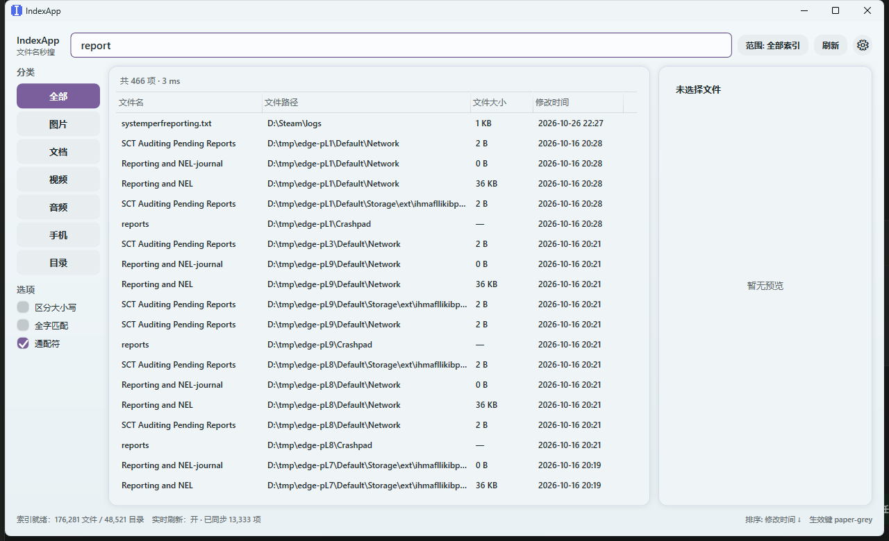

# IndexApp

一个开源的 Windows 文件名秒搜工具，按 `_rev` 逆向报告的行为契约 clean-room 重写。前端使用 **StartUI4Controls** 组件库，引擎使用 .NET 10 的目录遍历 + 内存索引 + 自定义快照。



> 当前状态：**M2.0 实时增量版**（目录遍历索引 + 目录监视 + 启动对账）。真实 USN/MFT、Windows 服务、Explorer 右键菜单、颜色标签、自动更新在后续阶段；升级边界、验收闸门与“需管理员才能验证”的前置条件见 [M2 升级规划报告](docs/M2升级规划报告.md)，架构背景见 [续命方案-架构设计](docs/续命方案-架构设计.md) 与 [ADR-0001](docs/adr/0001-adopt-vs-build.md)。

## 已经能做什么

- 文件名子串搜索，大小写不敏感；`*` / `?` 通配、全字匹配、区分大小写开关。
- 分类过滤：全部 / 图片 / 文档 / 视频 / 音频 / 手机 / 目录。
- 排序：文件名 / 文件大小 / 修改时间；点击列头切换升降序。
- 目录范围（文件夹选择器）与右键清除范围。
- **实时增量**：运行中新增/删除/重命名文件自动进入搜索结果；启动时用目录 mtime 对账补齐关闭期间的文件名变化；监视溢出明确提示重建。
- 实时刷新可在设置面板关闭（关闭后回到 F5 重建的 M1 行为）。
- 双击/Enter 打开；`Ctrl+Enter` 在资源管理器定位；`Ctrl+C` 复制路径。
- 结果行右键菜单：打开 / 打开所在目录 / 复制完整路径；文件或目录已不存在时弹出错误提示。
- 图片预览、文本预览；其他类型显示文件信息与“暂无预览”。
- 设置浮层：默认灰纸主题、明暗/套装切换、字体族/字号、全局缩放（StartUI4 底座），以及实时刷新开关、索引根说明与“重建索引”。
- 单实例、全局热键 `Alt+\`` 呼出/隐藏。
- 无遥测、无联网、无机器码；索引快照本地保存。

## 快速开始

前置：Windows 10 1809+ / Windows 11，.NET SDK 10.x。

```powershell
# 构建
dotnet build app\IndexApp.csproj

# 启动（首次扫描所有就绪的固定盘并写快照；之后加载快照）
run.cmd

# 自测（StartUI4 组件/主题/设置/排印，退出码 = 失败断言数）
run.cmd selftest
```

`run.cmd` 由 StartUI4 脚手架生成，会构建最新源码并启动 Debug exe。

## 测试

```powershell
# 引擎单元/集成测试（70 项）
dotnet run --project tests\IndexCore.Tests\IndexCore.Tests.csproj

# StartUI4 自测（70 项，退出码 0）
app\bin\Debug\net10.0-windows\IndexApp.exe --selftest
Get-Content "$env:APPDATA\IndexApp\selftest.txt"

# 一键跑构建 + 两套测试
run-tests.cmd
```

性能/容量基准：

```powershell
# 生成测试数据（可选；默认 1000 目录 × 1000 文件）
dotnet run --project tools\TestDataGen\TestDataGen.csproj -- "C:\Temp\IndexApp1M" 1000 1000

# 构建/加载索引并跑查询
dotnet run --project bench\IndexCore.Bench\IndexCore.Bench.csproj -- "C:\Temp\IndexApp1M" "C:\Temp\IndexApp1M.idx" --rebuild
```

## 数据位置

| 数据 | 位置 |
|---|---|
| 索引快照 | `%LOCALAPPDATA%\IndexApp\index.bin`（`.bak` 为上一份） |
| UI 设置 | `%APPDATA%\IndexApp\settings.json`（kv1 纯文本） |
| 错误日志 | `%APPDATA%\IndexApp\error.log` |
| StartUI4 自测报告 | `%APPDATA%\IndexApp\selftest.txt` |

环境变量（自动化/验收用）：

- `INDEXAPP_ROOT`：覆盖索引根，多个用 `;` 分隔。
- `INDEXAPP_SNAPSHOT`：覆盖快照路径。

## 目录结构

```text
app/                  WPF 应用（StartUI4Controls 前端）
src/IndexCore/        索引引擎：目录遍历、增量更新、watcher、查询、快照
tests/IndexCore.Tests 引擎测试（控制台断言，退出码 = 失败数）
bench/IndexCore.Bench 容量/查询/对账基准
tools/TestDataGen     测试数据生成器
lib/                  StartUI4Controls v3.0.0 源码（48 文件）
docs/                 架构方案、ADR、截图
doc/                  运行与构建（T0Level）与修复清单
```

## 文档

- [M2 升级规划报告](docs/M2升级规划报告.md)（M2.0 实时增量 / M2.1 USN+MFT+服务 / 验收闸门 / 风险 / 本轮范围）
- [三方对比分析：M1 / 原 app / Everything](docs/三方对比分析-M1-原app-Everything.md)（架构、启动/刷新、技术栈、性能、安全、FAQ）
- [续命方案与架构设计](docs/续命方案-架构设计.md)（决策卡、M1/M2 术语、里程碑、风险）
- [USN 增量：原理与生效流程](docs/USN增量-原理与生效流程.md)
- [验证台账](docs/验证台账.md)（1M 基准、1M/全盘内存、未验证项）
- [T0Level 上手文档](doc/运行与构建（T0Level）.md)

## 架构与边界

- **引擎**：`FileIndex` 用 `FileSystemEnumerable` 遍历目录，`Entry[]` + UTF-8 名称 arena 常驻内存；查询用并行分片 + `Span<byte>` 子串匹配；快照带 FNV-1a 校验、原子替换。M2.0 起条目可追加、删除走墓碑、父子链维护子树，快照写盘前压实。
- **实时刷新**：`IndexWatcher` 用 `FileSystemWatcher` 收目录事件，500ms 合并后调用 `FileIndex.ApplyChanges`；启动后在后台分块 `Reconcile`，用目录 mtime 补齐关闭期间的文件名变化。缓冲区溢出时状态栏提示 F5，不静默假装实时。
- **UI**：WPF + StartUI4Controls；结果集用 `VirtualizingRows`（`IList` 惰性行缓存），不创建 1M 个行对象。状态栏额外显示实时刷新/对账状态。
- **为什么先目录监视**：MFT/USN 需要卷句柄/管理员权限；本机当前进程非管理员，`fsutil usn readjournal C:` 返回“拒绝访问”。M2.0 先交付无需 UAC 的实时路径，接口保留 M2.1 替换点（详见 `docs/M2升级规划报告.md`）。
- **默认索引根**：所有就绪的固定盘（本机 C:\、D:\、E:\），排除 `WinSxS`/`Installer`/`Package Cache`/开发缓存以及应用自身数据目录；可用 `INDEXAPP_ROOT` 收窄。首次构建显示进度，之后从快照秒开。
- **预览**：M1 图片/文本；PDF/视频/Office 走系统处理器或图标是后续工作。

## 实测（本机 2026-10-27）

| 项 | 读数 | 口径 |
|---|---|---|
| 1M 索引全量构建 | 1,187 ms | 1,001,001 条目；NVMe；Debug 控制台基准 |
| 快照写入 | 733 ms；79,551,206 bytes | 1M 条目 |
| 默认全盘快照 | 774,220 条目（658,993 文件 / 115,227 目录） | 本机 C:\、D:\、E:\ |
| 应用启动（加载快照） | 1,476–1,605 ms | v0.2.0 发布包；后台对账不阻塞首屏 |
| 后台对账完成 | 2,690–2,860 ms | UIA 状态离开 `reconciling` |
| 查询 `report` | 引擎 P95 17–19 ms；UI 101–127 ms | 1,285 命中 |
| 空查询 | UI 201–359 ms | 76.6 万命中，显示前 200,000；超过 200 ms 闸门 |
| 私有内存 | no-runtime 240.3 MB；self-contained 316.5 MB | 启动后约 30s 空闲；自包含包超过 300 MB |
| UI 帧间隙 | 856 帧，max 42.3 ms，p95 7.7 ms，0 个 >100 ms | `--perf`，本轮合成器未节流 |
| 引擎测试 | 70 PASS | `run-tests.cmd` |
| StartUI4 自测 | 70 PASS + 1 INFO，退出码 0 | `run-tests.cmd` |
| 发布产物 | no-runtime 1,758,754 B；self-contained 70,337,651 B | `publish*` |

UI 帧间隙：本轮 `--perf` 实测 856 帧、最大 42.3 ms、p95 7.7 ms、0 个 >100 ms；M1 曾遇到的约 10 Hz 合成器节流未复现。内存闸门按框架依赖包通过（240.3 MB）；自包含包 316.5 MB 超标，差值来自捆绑运行时与 M2 增量结构。详见 `docs/验证台账.md` §9。

## 扫描会伤硬盘吗

不会。当前扫描是**只读的目录元数据枚举**：只读文件名、大小、修改时间和属性，不读取文件内容，不修改/删除被扫描盘上的文件，也不做 MFT 裸卷读取、磁盘修复或格式化。索引快照写在 `%LOCALAPPDATA%\IndexApp\index.bin`。

- 首次启动会对所有固定盘做一次全量枚举；之后启动直接加载快照，按 F5 或“重建索引”才会再次全量扫描。
- M2.0 的实时刷新使用 `FileSystemWatcher` 目录通知，不轮询文件内容；启动后的对账也只读目录 mtime，变化目录才枚举。频繁手动重建会增加 I/O，这是使用代价，不是硬件损坏。
- 如果不想全盘扫描，可设置 `INDEXAPP_ROOT=C:\Users\你的用户名`（或某个目录）后重建；范围按钮只接受**已在索引中**的目录，新建/被排除目录会明确提示重建，而不是静默失效。

启动时也可直接限定范围：

```powershell
IndexApp.exe --path "D:\Apps"
```

## 发布

```powershell
'' | .\publish_no_runtime.cmd    # 框架依赖单文件（目标机需 .NET Desktop Runtime 10.x）
'' | .\publish.cmd               # 自带运行时单文件（体积大，免装 .NET）
```

产物与验收细节见 `doc/运行与构建（T0Level）.md`。

## 明确不做

- 不复用原 `FinderPro.exe` / `FinderFS.dll` / XSkin / Foxit / 原图标（原副本签名 HashMismatch，且为商业代码）。
- 不做遥测、机器码、静默升级、HTTP 明文上报。
- 不在 M1 做内容全文检索、正则、驱动级索引、跨平台。

## 许可证

新项目代码：MIT（待最终确认；见 `LICENSE`）。`lib/StartUI4Controls` 的许可见 `lib/LICENSE.txt`；`AvalonEdit` 等第三方依赖按各自许可证分发。
