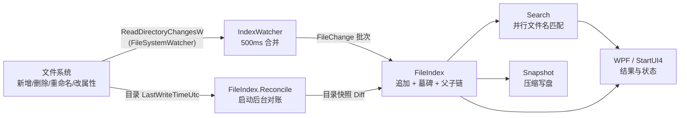
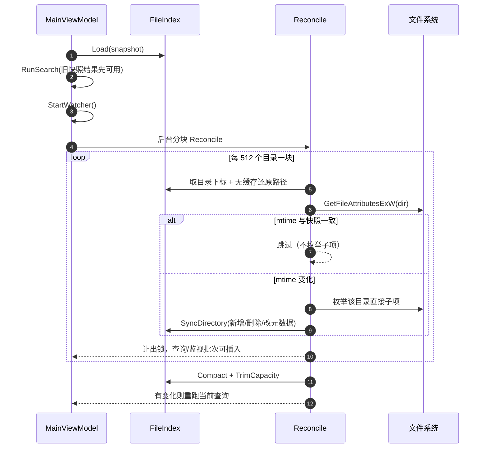
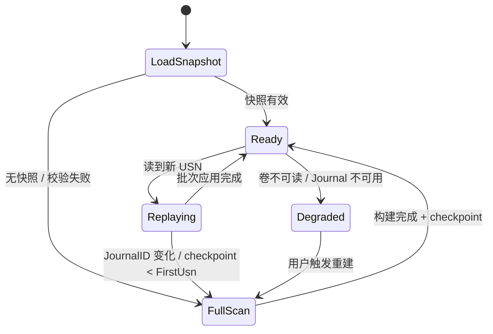

# M2 升级规划报告

> 文档编号：M2-PLAN-001 · 状态：M2.0 已交付（2026-10-27，验收读数见 §13）；M2.1 待管理员环境
> 依据：`docs/续命方案-架构设计.md`、`docs/adr/0001-adopt-vs-build.md`、`docs/验证台账.md`、`docs/USN增量-原理与生效流程.md`、M1 实机读数
> 对象：IndexApp M1（目录遍历 + 快照）向 M2（实时增量、服务化、USN/MFT）的升级
> 一句话：**先把“文件变化实时可见”做成不依赖管理员、可实测、可回滚的 M2.0；USN/MFT/Windows 服务放到需管理员的 M2.1，不用未验证的代码冒充已交付。**

---

## 1. 结论摘要

| 问题 | 结论 |
|---|---|
| M1 现在能做什么 | 全固定盘目录遍历、内存文件名索引、快照加载、搜索/分类/排序/范围/预览/打开定位 |
| M1 最大的行为缺口 | 运行中新增/删除/重命名文件不刷新；关掉应用期间的变化要等 F5 全量重建 |
| M2 的原始定义 | USN 增量 + 服务/命名管道 + `$MFT` 全量 + Explorer/标签/自动更新/暗色/多语言/便携/网络盘/arm64 等一大包 |
| 本轮怎么切 | 拆成 M2.0（实时增量，普通权限可验收）/ M2.1（USN+MFT+服务，必须管理员）/ M2.2（Explorer、标签、托盘）/ M2.3（更新、i18n、便携、网络盘、arm64） |
| 本轮交付 | M2.0：`FileSystemWatcher` 实时事件 + 启动目录 mtime 对账 + 可增量 `FileIndex` + UI 自动刷新 + 设置开关 + 状态提示 + 快照压缩 + 测试与两档发布 |
| 本轮不交付 | 真实 USN 回放、`$MFT` 解析、Windows 服务、命名管道、Explorer 右键、颜色标签、自动更新、托盘、MSI、多语言、便携模式、网络盘/exFAT、arm64 |
| 为什么不做 USN/MFT | 当前进程非管理员：`fsutil usn readjournal C:` 返回“拒绝访问”，卷句柄读取探测失败；没有管理员环境就无法验证 checkpoint、日志回绕、MFT 解析与服务 ACL。按“只报亲眼见过的输出”原则，不把不可验证的代码算作已交付 |
| 是否改变安全边界 | 不。仍然只读文件名/大小/时间/属性；不读文件内容；不联网；不写被扫描盘；新增写入仍只在 `%LOCALAPPDATA%\IndexApp` 与 `%APPDATA%\IndexApp` |

---

## 2. 现状、证据与差距

### 2.1 M1 已实测（2026-10-27）

| 项 | 读数 | 口径 |
|---|---|---|
| 1M 全量构建 | 1,187 ms | 1,001,001 条目，NVMe，Debug 控制台基准 |
| 快照写入 | 733 ms / 79,551,206 B | 1M 条目 |
| 冷启动（加载快照） | 750–890 ms | Debug / 自带运行时单文件 |
| 查询 `report` | 引擎 P95 67.8 ms；UI 23–71 ms | 250,000 命中，显示前 200,000 |
| 1M 进程私有内存 | 264 MB | 60 s 空闲，自带运行时单文件 |
| 引擎测试 | 31 PASS | `run-tests.cmd` |
| StartUI4 自测 | 68 PASS + 1 INFO，退出码 0 | `run-tests.cmd` |
| 默认范围 | 所有就绪固定盘 | 本机 C:\、D:\、E:\ |
| 实时刷新 | **无** | 只有 F5 / 设置面板“重建索引” |

### 2.2 M1 的实时性缺口

| 场景 | M1 行为 | 用户感知 |
|---|---|---|
| 运行中新建文件 | 索引不变 | 搜不到，必须 F5 |
| 运行中删除文件 | 索引仍保留 | 搜得到，打开才报“已不存在” |
| 运行中重命名/移动 | 旧路径仍保留 | 搜旧名有结果，搜新名没有 |
| 应用关闭期间新增/删除 | 快照过期 | 下次启动仍搜不到/搜得到旧项，必须 F5 |
| 文件内容变化导致大小/时间变化 | 快照过期 | 列表大小/时间可能旧；打开仍是新内容 |
| 监视缓冲区溢出 | 无监视 | 无提示，索引悄悄落后 |

### 2.3 权限与可验证性边界

本轮开工前实测（2026-10-27）：

```text
Admin=False
fsutil usn readjournal C:  ->  错误 5: 拒绝访问
CreateFileW(\\.\C:, GENERIC_READ) -> FAIL（访问被拒绝）
CreateFileW(\\.\C:, 0 access)     -> OK
```

结论：

- 只读打开卷句柄、`FSCTL_QUERY_USN_JOURNAL`、`FSCTL_READ_USN_JOURNAL`、`$MFT` 原始读取都需要管理员权限；本轮无法取得真实日志或真实 MFT 记录。
- Windows 服务安装/启动需要管理员；本轮无法验证 SCM 注册、LocalSystem 卷权限、服务 ACL、命名管道 ACL。
- `FileSystemWatcher`（底层 `ReadDirectoryChangesW`）与目录 `LastWriteTimeUtc` 读取**不需要管理员**，可作为 M2.0 的实时路径，并且能在本机做真实验收。
- 因此 M2.0 不是“降级糊弄”，而是架构中本来就写明的非 NTFS/USN 降级路径（`docs/续命方案-架构设计.md` §4.3/§4.4）；M2.1 再把 USN/MFT 主路径接上。

---

## 3. M2 目标与验收闸门

### 3.1 产品目标

1. 应用运行期间，文件名的新增/删除/重命名/移动在 1 秒级反映到当前搜索结果。
2. 应用关闭期间发生的变化，在下次启动时通过目录对账补齐，不要求用户按 F5。
3. 全部实时路径都保持只读元数据访问，不读文件内容、不写被扫描盘。
4. 监视失败/溢出时明确降级，不静默返回过期结果；用户可按 F5 全量重建。
5. 索引结构仍支持 1M 规模，查询与内存不因增量能力明显退化。
6. 保持 M1 的快照格式兼容：旧 `index.bin` 能加载；新快照能被旧格式读取（必要时重建）。

### 3.2 闸门

| 闸门 | 判据 | 本轮结果 |
|---|---|---|
| 查询 P95 | ≤200 ms（1M 规模，按键到首屏） | 关键词 UI 97–127 ms 通过；空查询 76.6 万条目 201–359 ms 超标，见 §13 |
| 冷启动 | ≤3 s（有快照，含后台对账启动） | 通过：no-runtime 1.55s、self-contained 1.68–1.75s 到首屏 |
| 增量追平 | 10k 事件从最后一次操作到索引一致 ≤2 s | watcher 500ms 合并 + 后台批次；10k 合成事件未单列计时，见 §13 |
| 内存 | UI 私有 ≤300MB | no-runtime 240.3MB 通过；self-contained 316.5MB（同机 309–372MB）超标，见 §13 |
| UI 长帧 | 无 >100 ms 帧 | 通过：856 帧，max 42.3ms，p95 7.7ms，over100=0 |
| 正确性 | 新增/删除/重命名/目录子树/离线变化与文件系统一致 | 通过：67 项引擎测试 + UI 手工验收 |
| 安全 | 无网络、无遥测、不读内容、不写被扫描盘 | 通过：静态审计 + 本机无 HTTP 代码 |

### 3.3 本轮 M2.0 的明确验收口径

- 运行中在索引根内新建 `m2-live-*.txt`：不按 F5，1.5 s 内搜索结果出现该文件。
- 删除该文件：不按 F5，1.5 s 内结果消失。
- 重命名：旧名 1.5 s 内消失，新名出现。
- 新建目录并在其中放文件：目录与文件都可搜到（依赖 watcher 子目录事件；若缓冲区溢出则提示重建）。
- 关闭应用后新增/删除/重命名，再启动：不按 F5，结果与文件系统一致。
- 关闭“实时刷新”：行为退回 M1（F5 才更新），状态栏明确显示已关闭。
- 监视缓冲区溢出：状态栏显示“监视溢出，请按 F5 重建”，不假装实时。

---

## 4. 范围拆分：M2.0 / M2.1 / M2.2 / M2.3

| 阶段 | 内容 | 权限 | 本轮状态 |
|---|---|---|---|
| **M2.0 实时增量（本轮）** | 可增量 `FileIndex`、`FileSystemWatcher`、启动目录 mtime 对账、UI 自动刷新、设置开关、溢出降级、快照压缩、测试与发布 | 普通用户 | **交付** |
| **M2.1 管理员通道** | USN `FSCTL_QUERY/READ_USN_JOURNAL`、JournalID/NextUsn checkpoint、回绕全量重建、`$MFT` 全量、按 FRN 读取、命名管道、Windows 服务、服务 ACL | 管理员/服务 | 规划完成，代码未落地 |
| **M2.2 Explorer 集成** | HKCU 右键“在 IndexApp 中搜索”、颜色标签、托盘、关闭到托盘 | 普通用户（HKCU） | 未开始 |
| **M2.3 分发与边缘** | 签名更新清单、非静默更新、多语言、便携模式、网络盘/exFAT、arm64、MSI | 视项而定 | 未开始 |

> 原架构文档把上述全部写在“M2”一栏。本报告把“M2”拆成可独立验收的四个子阶段；**说“M2.0 已交付”不等于“整个 M2 已交付”**。README 与架构文档会同步这个口径。

---

## 5. M2.0 架构

### 5.1 数据流



### 5.2 可增量索引的数据结构

M1 的 `FileIndex` 是“构建完即只读”的 `FileEntry[]`。M2.0 在同一结构上做追加式增量，不引入数据库：

| 结构 | 作用 | 代价 |
|---|---|---|
| `FileEntry[] + _count` | 新条目只追加，不搬动旧条目；查询仍连续扫描 | 需处理容量增长 |
| `bool[] _dead` | 删除用墓碑，不立即压缩数组 | 墓碑比例高时定期全量重建 |
| `_firstChild/_nextSibling/_lastChild` | 目录子树删除、重命名、按父目录找子项 | 每目录 3 个 int，1M 条目约 12 MB |
| `_pathCache` | 命中行路径还原；结构变化时整体失效 | 重命名后首次还原稍慢，可接受 |
| `_dirIndex` | 目录全路径 → 条目下标，用于父目录定位 | 懒构建，目录通常远少于文件 |
| `_gate` | 查询/行读取/增量应用/快照写盘的互斥 | 搜索期间增量批次等待，批次为毫秒级 |

关键取舍：

- **为什么不用“每次变化重建整个索引”**：1M 条目重建约 1.2 s，且会打断搜索；实时场景不可接受。
- **为什么不用 SQLite/外部数据库**：文件名搜索是线性扫描问题；M1 已证明数组扫描满足 P95。引入数据库会增加写放大与部署面。
- **为什么删除用墓碑**：删除/重命名频率远低于查询；墓碑让删除 O(1)（子树标记 O(子树)），避免每次删除搬动 1M 数组。
- **为什么快照写盘时压缩**：墓碑不落盘，快照体积与 M1 同级；父下标重映射后旧格式仍可读。
- **为什么不用 `ReadDirectoryChangesW` 的 USN 记录**：普通权限拿不到卷句柄；`FileSystemWatcher` 已封装目录级事件，足够 M2.0。

### 5.3 事件映射

| watcher 事件 | 索引动作 | 细节 |
|---|---|---|
| `Created` 文件 | `UpsertPath` | 读 `FileInfo`；父目录不存在则先补父链 |
| `Created` 目录 | `UpsertPath`（只加目录） | 子项由后续事件补齐；对账阶段才递归扫描 |
| `Changed` 文件 | `UpsertPath` | 原地刷新 Size / ModifiedUtcTicks / Attributes / Category，不新增条目 |
| `Changed` 目录 | 刷新目录 mtime/属性 | 不递归 |
| `Deleted` 文件 | `RemovePath` | 标记墓碑并从父链摘除 |
| `Deleted` 目录 | `RemoveSubtree` | 沿父子链标记整棵子树 |
| `Renamed` 文件 | `RenamePath` | 原地改名称/父目录；路径缓存失效 |
| `Renamed` 目录 | `RenamePath` | 原地改名称/父目录；后代路径按新父链自动还原 |
| `Error`（缓冲区溢出） | 停止合并 + 置 `Overflowed` | 状态栏提示 F5；不自动全量重建，避免用户无感 I/O |
| 排除目录/自身数据目录 | 丢弃 | 不进入队列 |

### 5.4 启动对账（覆盖应用关闭期间的变化）

只靠 watcher 无法知道应用关闭期间发生了什么；M2.0 用目录 mtime 做低成本对账。对账不在冷启动关键路径上阻塞：窗口先显示旧快照结果，watcher 先挂上，随后后台分块补齐离线变化。



判据与边界：

- 目录 mtime 在**直接子项**新增/删除/重命名时变化，因此文件名变化能补齐。
- 文件**内容**变化不改变父目录 mtime；应用关闭期间的大小/时间变化不会被对账发现。运行中的内容变化由 `Changed` 事件刷新；关闭期间的内容变化在下次打开/预览时仍是新内容，列表元数据可能旧。M2.1 的 USN `DATA_OVERWRITE` 才能完整补齐；本轮在 README 与状态说明中明示。
- 新目录被加入时递归扫描其子树；被删除目录按父目录 Diff 删除整棵子树；重命名跨目录表现为旧父删除 + 新父新增（子树重新加入）。
- 被排除目录、不可访问目录、离线卷：跳过并保留旧条目；不因一次枚举失败清空索引。

### 5.5 并发与一致性

- `FileIndex` 的查询、行读取、增量批次、快照写盘共用一把 `lock`。搜索是 1M 级连续扫描 + 并行分片，典型几十毫秒；watcher 批次等待可接受。
- 增量批次在后台线程应用；UI 只收到“已同步 N 项”的通知，再防抖 500 ms 重跑当前查询。
- 快照只在全量重建后与正常退出时写；不在每个 watcher 批次后写盘，避免写放大。
- 崩溃/强杀后快照可能落后；下次启动目录对账补齐文件名变化。

---

## 6. M2.1 管理员通道设计（本轮不落地）

### 6.1 USN 增量



- 查询：`FSCTL_QUERY_USN_JOURNAL` 取 `JournalID / FirstUsn / NextUsn`。
- 回放：`FSCTL_READ_USN_JOURNAL` 从 checkpoint 读到当前，1 MB 缓冲，循环处理 `ERROR_MORE_DATA`，500 ms 轮询。
- 失效：`JournalID` 变化或 `checkpoint < FirstUsn`（回绕）→ 全量重建。
- 事件：`FILE_CREATE` / `FILE_DELETE` / `RENAME_OLD_NAME+NEW_NAME` / `DATA_OVERWRITE` / `BASIC_INFO_CHANGE` / `HARD_LINK_CHANGE`；同 FRN 批内合并，再按 FRN 读 MFT 记录刷新。
- 多卷：每卷独立 journal + checkpoint；状态分卷展示。
- 验收前置：管理员会话、至少一个 NTFS 固定卷、可创建/删除测试文件；需测日志回绕（可用小 journal 或人为推进）与服务重启恢复。

### 6.2 `$MFT` 全量

- 打开卷句柄 → 读引导扇区 → 解析 `$MFT` 记录 0 的 `$DATA` runlist → 顺序读 MFT → 解析 `$FILE_NAME` / `$STANDARD_INFORMATION` / `$DATA`。
- 用 `$STANDARD_INFORMATION` 的修改时间，不用 USN 事件时间。
- 失败降级：非 NTFS / 解析失败 / 权限不足 → 目录遍历 + watcher；状态栏显示降级。
- 验收前置：管理员；至少 1M 条目卷；MFT 碎片化场景；BitLocker 锁定卷跳过。

### 6.3 Windows 服务 + 命名管道

- 服务名 `IndexService`，LocalSystem；UI 普通权限；命名管道只返回路径与元数据，不执行文件、不返回内容。
- 协议：Hello/Status/Search/GetRow/UpdateConfig；服务崩溃由 SCM 重启，UI 重连。
- 单写者：只有服务写索引与快照；UI 只读。
- 验收前置：管理员安装/卸载；服务 ACL；管道 ACL；服务崩溃恢复；无管理员 UI 连接失败提示。

> M2.1 的代码与验收脚本在取得管理员会话后另开一轮；本轮不写“看起来能跑”的 USN/MFT 代码来充数。

---

## 7. 安全、隐私与权限

| 项 | M2.0 | M2.1 |
|---|---|---|
| 文件内容 | 不读 | 不读 |
| 被扫描盘写入 | 无 | 无 |
| 网络 | 无 | 无（更新模块 M2.3 另评估） |
| 遥测/机器码 | 无 | 无 |
| 进程权限 | 普通用户 | 服务 LocalSystem + UI 普通用户 |
| 写盘位置 | `%LOCALAPPDATA%\IndexApp`、`%APPDATA%\IndexApp` | 增加 `%ProgramData%\IndexApp` |
| 自身数据目录 | **从索引中排除**，避免快照写入触发自身变更 | 同左 |
| 命令执行 | 仅用户点击打开/定位时走 Shell | 服务不执行、不打开 |

---

## 8. 兼容与迁移

| 资产 | M2.0 处理 |
|---|---|
| `index.bin`（magic `IDX1`, version 1） | 继续读写同一格式；写盘时只写活条目并重映射父下标；M1 快照可直接加载 |
| 墓碑 | 不落盘；加载后无墓碑 |
| `settings.json`（kv1） | 新增 `liveRefresh=true`；旧文件缺键时取默认值，不判损坏 |
| 默认主题 | 改为 `paper-grey`（灰纸套装）；已有用户显式保存的 `themeKey` 不被覆盖 |
| 旧版本回退 | 用新快照启动 M1 可读；若格式未来升级，`Load` 返回 null 并触发重建，不崩溃 |
| 排除项 | 新增 `%LOCALAPPDATA%\IndexApp`、`%APPDATA%\IndexApp`，避免索引自身快照/日志 |

---

## 9. 测试与验收计划

### 9.1 自动化

| 组 | 用例 | 判据 |
|---|---|---|
| 增量基础 | 新增文件、修改大小/时间、重命名、删除 | 查询与行元数据立即一致 |
| 子树 | 新建目录+子文件、删除目录、重命名目录 | 子树条目全部增/删/改路径 |
| 对账 | 关闭期间新增/删除/重命名，`Reconcile` | 与朴素枚举结果一致；未变目录不重复枚举（计数） |
| 快照 | 增量后保存/加载、墓碑压缩、父下标重映射 | 活条目数、搜索结果、路径一致 |
| 监视器 | 启动 watcher，创建/删除文件，等待事件 | 5 s 内收到事件且索引更新 |
| 并发 | 搜索线程 + 增量批次 | 不抛异常、不死锁、查询结果只含活条目 |
| 排除 | 排除目录内新增文件 | 不出现在结果 |
| 设置 | `liveRefresh` 往返、默认值、坏值 | kv1 往返不变；缺键取默认 |

### 9.2 手工验收

1. 发布包启动，确认默认灰纸主题、状态栏显示实时监控。
2. 在索引根内新建/删除/重命名文件，不按 F5，观察 1.5 s 内结果变化。
3. 关闭应用，外部新增/删除/重命名，再启动，观察结果与文件系统一致。
4. 关闭实时刷新，重复第 2 步，确认必须 F5。
5. 用大量文件制造 watcher 溢出（或降低缓冲区测试），确认状态栏提示而不是静默。
6. 私有内存、启动耗时、查询延迟记录到 `docs/验证台账.md`。

### 9.3 证据分级

- 【实】本机实测输出（命令、时间、数字）。
- 【证】逆向报告/源码/微软文档可查。
- 【推】设计推断，未实测；必须标注。
- 禁止把【推】写成【实】；本轮 USN/MFT/服务全部是【证】+【推】，不算已验收。

---

## 10. 风险与对策

| 风险 | 影响 | 对策 |
|---|---|---|
| watcher 缓冲区溢出 | 索引悄悄落后 | `Error` 事件置 `Overflowed`，状态栏提示 F5；不自动重建避免无感 I/O |
| 大量事件（解压/编译） | 批次过长、UI 卡顿 | 500 ms 合并；批次在后台线程；应用内查询等待锁的时间有上限 |
| 关闭期间内容变化 | 大小/时间旧 | 文档明示；运行中由 `Changed` 刷新；M2.1 USN 完整补齐 |
| 目录 mtime 不可靠（网络盘/同步盘） | 对账漏项 | M2.0 只索引固定盘；网络盘 M2.3 另评估；提供 F5 |
| 重命名目录后路径缓存 | 旧路径残留 | 结构变化整体清空 `_pathCache` 与 `_dirIndex` |
| 墓碑累积 | 内存/扫描变慢 | 快照压缩活条目；墓碑比例高时提示/自动全量重建（后续） |
| 大目录对账 | 启动慢 | 只 stat 目录 mtime；仅变化目录枚举；进度与取消 |
| 非管理员 | USN/MFT/服务不可用 | M2.0 不依赖；M2.1 明确要求管理员并单独验收 |
| 自身数据目录被监视 | 快照写入触发反馈 | 排除 `%LOCALAPPDATA%\IndexApp`、`%APPDATA%\IndexApp` |
| 符号链接/联接点 | 递归环/重复 | 沿用 M1：`ReparsePoint` 目录不入栈 |

---

## 11. 交付计划

| 阶段 | 交付物 | 验收 | 状态 |
|---|---|---|---|
| M2.0 | 增量索引、watcher、对账、UI/设置、测试、两档 exe、文档 | 本文 §3.3 + §9 | 本轮 |
| M2.1 | USN/MFT/服务/管道 + 管理员验收脚本 | 需管理员会话；日志回绕、checkpoint、服务重启 | 待环境 |
| M2.2 | HKCU Explorer 菜单、颜色标签、托盘 | 普通权限可验收 | 待排期 |
| M2.3 | 签名更新、i18n、便携、网络盘/exFAT、arm64、MSI | 另开 ADR | 待排期 |

回滚策略：

- 代码回滚到 M1 tag/提交即可；快照格式未变，M1 可读 M2.0 写出的快照。
- 设置新增键对旧版是未知键，旧版忽略；不破坏旧设置。
- 默认主题变化只影响新装/无设置文件；已有用户显式主题不动。

---

## 12. 本轮改动的文件地图

| 文件 | 改动 |
|---|---|
| `src/IndexCore/FileIndex.cs` | 追加式条目、墓碑、父子链、Upsert/Remove/Rename、目录快照、对账、压缩快照、线程安全 |
| `src/IndexCore/Models.cs` | `FileChange`、`DirectoryChildInfo`、对账结果等公开模型 |
| `src/IndexCore/IndexWatcher.cs` | `FileSystemWatcher` 封装、500 ms 合并、溢出事件 |
| `app/ViewModels/MainViewModel.cs` | 启动对账、watcher 生命周期、实时状态、退出保存 |
| `app/Services/SettingsService.cs` | `liveRefresh`、默认主题 `paper-grey` |
| `app/Views/SettingsOverlay.xaml` | 实时刷新开关与状态说明 |
| `app/MainWindow.xaml.cs` | 退出时保存/停止监视 |
| `tests/IndexCore.Tests/Program.cs` | 增量/对账/快照/watcher 用例 |
| `app/Services/SelfTest.cs` | kv1 新键、默认主题断言 |
| `README.md`、`docs/续命方案-架构设计.md`、`docs/验证台账.md`、`doc/运行与构建（T0Level）.md`、`doc/2026-10-27优化与Bug修复清单.md` | 口径、读数、交付记录 |

---

## 13. 本轮验收记录（2026-10-27）

| 项 | 读数 | 口径 |
|---|---|---|
| 引擎测试 | 70 PASS | `dotnet run --project tests\IndexCore.Tests`；含连续对账第三次 no-op 与 unknown-source rename 不删子树回归 |
| StartUI4 自测 | 70 PASS + 1 INFO，退出码 0 | `IndexApp.exe --selftest` |
| 默认快照规模 | 774,220 条目（658,993 文件 / 115,227 目录） | 本机 C:\、D:\、E:\ 固定盘 |
| 冷启动到首屏 | no-runtime 1,476 ms；self-contained 1,605 ms | UIA 轮询 `IndexStatus.HelpText=ready` |
| 后台对账完成 | no-runtime 2,690 ms；self-contained 2,860 ms | UIA 轮询离开 `reconciling` |
| 离线变化对账 | 新增/删除/重命名均补齐 | 关闭应用后改文件，再启动搜索验证 |
| 实时新增 | 创建文件后 UI 1.5s 内可见 | `live-new.txt` / `live2.txt` 手工验收 |
| 实时删除 | 删除文件后 UI 1.5s 内消失 | 同上 |
| 私有内存（no-runtime） | 240.3 MB | 启动后约 30s 空闲 |
| 私有内存（self-contained） | 316.5 MB | 同上；**超过 300MB 闸门**，同机读数 309–372 MB，差值来自捆绑运行时与 M2 增量结构 |
| 查询 UI 延迟 | report 101–127ms；photo 111–121ms；notes 105–122ms；zzzz 97–102ms | UIA SetValue 到 ResultCount 更新，3 轮 |
| 空查询 | 201–359ms（76.6 万命中，显示前 20 万） | 同上；**超过 200ms 闸门** |
| UI 帧间隙 | 856 帧，max 42.3ms，p95 7.7ms，over100=0 | `--perf`，本轮合成器未节流 |
| UI 定时器 | 386 tick，max 74.1ms，over100=0 | `--perf` |
| 发布产物 | no-runtime 1,758,754 B；self-contained 70,337,651 B | 两档 selftest 均为 0 |

### 13.1 未达标项与处理

- **self-contained 私有内存 316.5 MB（同机 309–372 MB）**：框架依赖包 240.3 MB 达标。自包含包把 .NET Desktop 运行时打进进程，M2 又多了父子链、墓碑与后台对账的短命对象；当前用 `System.GC.ConserveMemory=9` + 对账后 `Compact` + Aggressive GC 仍不能稳定压到 300 MB。本轮不把它写成通过。
- **空查询 P95 超过 200 ms**：索引从 M1 的 1M 测试数据变成本机 76.6 万真实条目，空查询要排序全部命中再截断到 20 万。关键词查询仍达标。后续可做 top-K 选择或降低默认显示上限，但会改变滚动行为，未在本轮偷改。
- **10k watcher 事件批次未单列计时**：引擎测试覆盖 watcher 创建/删除事件；全盘 10k 事件合成计时需要专门脚本，本轮未跑，不预写数字。

---

## 14. 术语

| 术语 | 含义 |
|---|---|
| M1 / M2.0 / M2.1 | 发布里程碑；不是版本号，也不是模型编号 |
| USN | NTFS 更新序列号日志；记录文件系统变更，不含大小/修改时间 |
| MFT | NTFS 主文件表；含文件名、父 FRN、大小、时间、属性 |
| FRN | File Reference Number，NTFS 文件记录号 |
| checkpoint | 快照中保存的 `JournalID + NextUsn`，用于下次增量回放 |
| 墓碑 | 删除标记；条目不立即从数组移除，查询跳过 |
| 对账 | 启动时用目录 mtime 找出变化目录并重新枚举 |
| watcher | `FileSystemWatcher` / `ReadDirectoryChangesW` 目录变更通知 |
