# M2 架构设计与场景流程分析

> 文档编号：ARCH-002 · 里程碑：**M2.0（普通权限实时增量版）** · 日期：2026-10-27
> 范围：只描述当前已实现的 M2.0 架构——目录遍历全量索引 + `FileSystemWatcher` 实时增量 + 启动后台目录对账 + WPF/StartUI4 单进程。
> 明确不含：NTFS `$MFT` 裸卷解析、USN Journal 回放、Windows 服务、命名管道、多用户 ACL；这些属于需要管理员环境的 M2.1。
> 依据：`src/IndexCore/FileIndex.cs`、`src/IndexCore/IndexWatcher.cs`、`app/ViewModels/MainViewModel.cs`、`app/MainWindow.xaml.cs`、`docs/验证台账.md` §9、`docs/M2升级规划报告.md`。

---

## 0. 一页结论

| 问题 | M2.0 的答案 |
|---|---|
| 为什么要做 M2.0 | M1 只有 F5 全量重建；运行中新增/删除/重命名不能进入搜索结果 |
| 为什么不用 USN/MFT/服务 | 本机当前进程非管理员：`fsutil usn readjournal C:` 返回“拒绝访问”，卷句柄读取失败；USN/MFT/服务安装无法在本轮验证 |
| M2.0 的实时机制 | `FileSystemWatcher`（底层 `ReadDirectoryChangesW`）→ 500 ms 合并 → `FileIndex.ApplyChanges` |
| M2.0 的离线机制 | 启动后在后台分块 `FileIndex.Reconcile`：只 stat 目录 mtime，变化目录才枚举并做子项 Diff |
| 索引还能保持秒搜吗 | 能。条目数组 + UTF-8 arena + 并行 `Span<byte>` 匹配仍保留；增量只追加、删除用墓碑、快照写盘前 Compact |
| 主要风险 | 全盘 watcher 缓冲区溢出、关闭期间文件内容变化导致大小/时间滞后、自包含包内存偏高 |
| 当前交付 | v0.2.0 两档单文件 exe；框架依赖包私有内存 262–266 MB，自包含包 309–372 MB；关键词查询与 UI 帧闸门通过，空查询与自包含内存未完全达标 |

---

## 1. 目标、约束与非目标

### 1.1 目标

1. 运行期间，文件名新增/删除/重命名/移动在约 1 秒内反映到当前查询。
2. 应用关闭期间的**文件名变化**在下次启动后通过后台对账补齐，不要求用户先按 F5。
3. 保持 M1 的查询路径：内存数组连续扫描，1M 级关键词查询 P95 ≤200 ms。
4. 不读取文件内容、不联网、不遥测、不写被扫描盘；唯一写入是 `%LOCALAPPDATA%\IndexApp\index.bin` 与 `%APPDATA%\IndexApp\settings.json`。
5. 普通用户权限可安装、可运行、可验收。
6. 实时能力失败时明确降级，不静默返回过期结果。

### 1.2 约束

| 约束 | 对设计的影响 |
|---|---|
| 非管理员 | 不能打开卷句柄、不能读 USN/MFT、不能安装 LocalSystem 服务 |
| 单进程交付 | 索引、查询、watcher、UI 都在 IndexApp.exe 内；没有 IPC |
| 全盘默认根 | `FileSystemWatcher` 对 C:\、D:\、E:\ 递归监视，缓冲区溢出是常态风险 |
| 目录 mtime 语义 | 目录 mtime 对子项新增/删除/重命名敏感，对文件内容写入不敏感 |
| 内存闸门 | 不能为每个变化维护整张目录路径字典；必须分块、缓存有界、定期 Compact |

### 1.3 非目标

- 不做内容全文检索、正则、驱动级索引。
- 不承诺关闭期间的文件大小/修改时间实时准确；只承诺文件名变化对账。
- 不做服务化、命名管道、Explorer 右键、颜色标签、自动更新、托盘、MSI。
- 不把自包含包的捆绑运行时算作引擎内存问题来掩盖；分别报告两档读数。

---

## 2. 总体架构

### 2.1 组件图

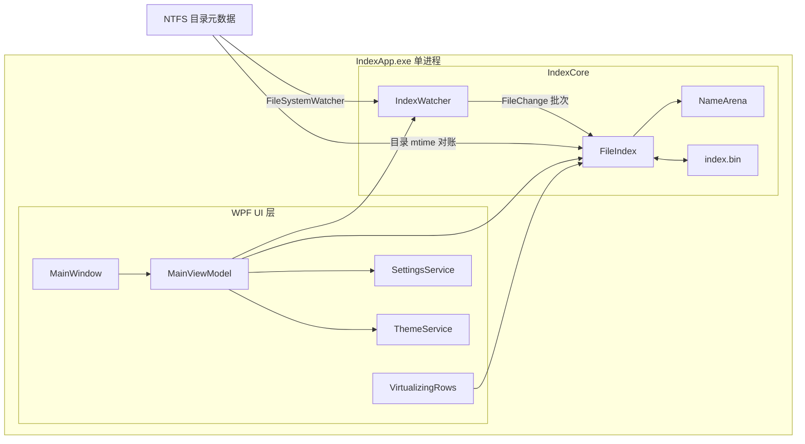

### 2.2 线程模型

| 线程/调度器 | 职责 | 入口 |
|---|---|---|
| WPF UI Dispatcher | 窗口、绑定、搜索防抖、实时事件合并、状态文案 | `MainWindow_Loaded` → `InitializeAsync` |
| `Task.Run` 后台线程 | 全量 Build、快照 Load、Reconcile、Search | `MainViewModel` |
| `FileSystemWatcher` 内部线程 | 接收 OS 目录事件并入队 | `IndexWatcher.Start` |
| `System.Threading.Timer` | 每 500 ms 排空 watcher 队列并调用 `ApplyChanges` | `IndexWatcher.Drain` |
| 后台对账 Task | 分块 `Reconcile`，完成后 `TrimCapacity` + Aggressive GC | `StartBackgroundReconcile` |

所有会改变索引结构或读取条目数组的操作共用 `FileIndex._gate` 一把锁。watcher 事件处理器本身不加锁，只做排除判断和入队，避免对账持锁时卡死 OS 事件线程。

### 2.3 索引生命周期状态机

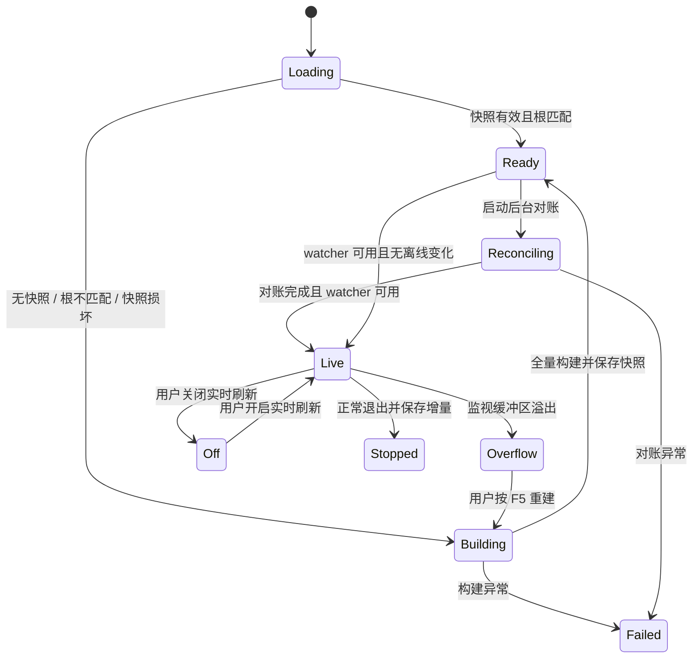

状态码同时写入 `MainWindow.xaml` 的 `AutomationProperties.HelpText`，UIA 验收读 ASCII 值：`loading` / `building` / `ready` / `reconciling` / `live` / `off` / `overflow` / `failed` / `stopped`。

---

## 3. 组件实现方式

### 3.1 `FileIndex`：可增量内存索引

位置：[src/IndexCore/FileIndex.cs](file:///C:/Users/webtu/Desktop/一份搜索软件重构项目/开源搜索工具/src/IndexCore/FileIndex.cs)

| 数据结构 | 作用 | M2.0 变化 |
|---|---|---|
| `FileEntry[] _entries` + `int _count` | 连续条目数组，查询热路径 | 从固定长度变为可追加，容量 25% 增长 |
| `NameArena _names` / `_lower` | UTF-8 原名与小写名 arena | 支持 `Add(ReadOnlySpan<byte>)` 与 `Trim()`，Compact 时搬活名字 |
| `bool[] _dead` | 删除墓碑 | 新增；查询、行读取、路径还原都跳过 |
| `_firstChild` / `_nextSibling` / `_lastChild` | 父子链，支持目录子树删除/重命名/按父找子 | 新增 |
| `_rootIndex` | 根路径 → 根条目下标 | 新增，数量等于索引根数 |
| `_dirCache` | 最近目录路径 → 条目下标，上限 5000 | 新增，避免整张目录路径表常驻 |
| `_pathCache` | 条目路径还原缓存 | 只给 UI/行读取用；对账用 `GetPathNoCacheLocked` 避免撑大缓存 |
| `_gate` | 查询、增量、快照、Compact 互斥 | 新增 |

核心公开能力：

- `Build(IndexOptions, IProgress<IndexProgress>, CancellationToken)`：一次性目录遍历；排除路径/排除目录名；符号链接目录不入栈。
- `Search(SearchQuery, CancellationToken)`：并行分片扫描 `_entries[0.._count]`，跳过 `_dead`，按分类/范围/词项匹配，再排序截断。
- `ApplyChanges(IReadOnlyList<FileChange>)`：批量应用 Created/Changed/Deleted/Renamed。
- `Reconcile(IProgress<IndexProgress>, CancellationToken)`：分块 stat 目录 mtime，变化目录枚举直接子项并 Diff。
- `Save(string)` / `Load(string, IndexOptions?)`：快照 magic `IDX1`、version 1；Save 前 `Compact()`，只写活条目并重映射父下标。
- `Compact()`：丢墓碑、搬活名字、重建父子链、清缓存；`TrimCapacity()` 当前就是调用 `Compact()`。

### 3.2 `IndexWatcher`：普通权限实时源

位置：[src/IndexCore/IndexWatcher.cs](file:///C:/Users/webtu/Desktop/一份搜索软件重构项目/开源搜索工具/src/IndexCore/IndexWatcher.cs)

| 项 | 实现 |
|---|---|
| 事件源 | 每个索引根一个 `FileSystemWatcher`，`IncludeSubdirectories=true`，`InternalBufferSize=64KB` |
| 关注变化 | FileName、DirectoryName、Size、LastWrite、Attributes、CreationTime |
| 入队前过滤 | 调用 `FileIndex.IsPathExcluded(path, isDirectory)`，排除表只读、不加锁 |
| 合并 | `ConcurrentQueue<FileChange>`，`Timer` 每 500 ms 排空，单批上限 20,000 |
| 应用 | `FileIndex.ApplyChanges(batch)`，随后刷新受影响父目录 mtime |
| 溢出 | `Error` 事件里识别 `InternalBufferOverflowException`，置 `Overflowed` 并抛 `Faulted` |
| 停止 | `Stop()` 先停 watcher/timer，再 `Drain()` 一次，尽量把已收到事件落进索引 |

`OnRenamed` 特别处理排除目录：

- 新路径被排除、旧路径未排除 → 入队 `Deleted(old)`，避免索引留下旧路径。
- 旧路径被排除、新路径未排除 → 入队 `Created(new)`。
- 两端都未排除 → 入队 `Renamed(old,new)`。

### 3.3 `MainViewModel`：流程编排与 UI 状态

位置：[app/ViewModels/MainViewModel.cs](file:///C:/Users/webtu/Desktop/一份搜索软件重构项目/开源搜索工具/app/ViewModels/MainViewModel.cs)

| 成员 | 职责 |
|---|---|
| `InitializeAsync` | 启动后加载/构建索引，只跑一次 |
| `LoadOrBuildAsync` | 快照有效则先出结果；否则全量构建 |
| `BuildIndexAsync` | 停 watcher、取消对账、全量扫描、保存快照、挂 watcher、后台对账 |
| `StartBackgroundReconcile` | 后台分块对账；完成后 Compact + Aggressive GC；有变化则重跑查询 |
| `StartWatcher` / `StopWatcher` | 根据 `SettingsService.LiveRefresh` 管理 `IndexWatcher` 生命周期 |
| `OnWatcherChanged` | 把 watcher 的“已同步 N 项”映射到 UI 状态，并启动 450 ms 查询刷新防抖 |
| `OnWatcherFaulted` | 溢出/启动失败写状态，不自动重建 |
| `RunSearchAsync` | 组装 `SearchQuery`，后台跑引擎，结果交给 `VirtualizingRows` |
| `Shutdown` | 停监视、取消后台任务、有脏数据才保存快照、保存设置 |

`IndexOptions` 默认根来自所有就绪固定盘；可用 `INDEXAPP_ROOT` 覆盖。排除项包含重目录与自身数据目录：

- 路径排除：`%LOCALAPPDATA%\IndexApp`、`%APPDATA%\IndexApp`、快照文件本身、`WinSxS`、`Installer`、`Package Cache`、开发缓存等。
- 目录名排除：`node_modules`、`.git`、`.vs`、`.idea`、`bin`、`obj`、`$Recycle.Bin`、`System Volume Information`。

### 3.4 WPF 壳与结果虚拟化

| 组件 | 实现点 |
|---|---|
| `MainWindow` | `Loaded` 调 `InitializeAsync`；`Closing` 调 `Shutdown`；F5 调 `RefreshIndexAsync`；右键菜单打开/定位/复制；文件不存在弹 `UI4MessageBox` |
| `VirtualizingRows` | 实现 `IList<FileRow>`，只向可见行物化 `FileRow`，缓存上限 4096 |
| 状态栏 | 左侧 `IndexStatusText` + `LiveStatusText`；`IndexStatus` 带 `AutomationProperties.HelpText` 状态码 |
| 设置浮层 | 默认灰纸主题；实时刷新开关；索引根说明；重建索引按钮 |
| 预览 | 图片/文本在 UI 进程按需读取；服务不存在，因此没有权限提升 |

### 3.5 设置与主题

| 组件 | M2.0 行为 |
|---|---|
| `SettingsService` | kv1 纯文本；新增 `liveRefresh=true`；默认 `themeKey=paper-grey` |
| `ThemeService` | `paper-grey` 是预置套装键；应用前必须 `UI4ThemePacks.RegisterAll()` |
| `App.OnStartup` | 顺序固定：`base.OnStartup` → selftest 分支 → 读设置 → 注册 light 覆盖 → 注册套装 → 应用主题 → 排印 → 创建窗口 |

### 3.6 测试与基准

| 工程 | 覆盖 |
|---|---|
| `tests/IndexCore.Tests` | 70 项引擎断言：搜索、范围、排序、快照、增量、目录子树、对账、watcher、排除路径、unknown-source rename 不删子树 |
| `app/Services/SelfTest` | 70 项 StartUI4 断言：主题令牌、套装资源键、kv1 十项往返、默认灰纸、默认实时刷新、XAML 可解析 |
| `bench/IndexCore.Bench` | 加载/查询/对账/Compact 诊断；支持 `--reconcile` 打印 checked/changed/added/removed/updated 与内存 |

---

## 4. 组件原理与工作流程

### 4.1 增量写入协议

`ApplyChanges` 收到的是路径级事件，不是 FRN。所有匹配都按路径解析：

1. `NormalizePath` 得到全路径。
2. `FindEntryByPathLocked` 先解析父目录，再在父目录的直接子项里按名字匹配。
3. Created/Changed → `UpsertPathLocked`：存在则原地更新元数据；不存在则补父目录链并追加条目。
4. Deleted → `RemovePathLocked`：单文件直接墓碑；目录先收集子树再标记墓碑。
5. Renamed → `RenamePathLocked`：旧条目存在时原地改名字/父链；旧条目不存在时只 Upsert 新路径，**绝不删除新路径**（这是 M2.0 验收时修掉的数据丢失缺陷）。

关键不变量：

- 条目下标一旦分配就不复用；墓碑只表示不可见。
- 目录子树删除必须在标记死之前收集节点，否则父节点死后路径还原会提前返回空。
- 目录重命名只改条目名字与父链，后代路径靠父子链重新计算；结构变化后清 `_pathCache` 与 `_dirCache`。
- 排除表只读；watcher 事件处理器不能调用会持索引锁的 API。

### 4.2 对账协议

`Reconcile` 的目标是用一次目录 stat 换掉一次全量扫描：

1. 在锁内复制当前活目录条目下标数组。
2. 每 512 个目录一块。
3. 块内对每个目录：锁内取路径（不写路径缓存）与快照 mtime；锁外 `GetFileAttributesExW` 取实际 mtime。
4. mtime 一致 → 跳过。
5. mtime 变化 → 锁外枚举该目录直接子项；锁内再次确认条目仍活且 mtime 仍不同，然后 `SyncDirectoryLocked`。
6. `SyncDirectoryLocked`：
   - 索引里有、磁盘没有 → 删除子树。
   - 两边都有且是文件 → 更新大小/时间/属性。
   - 两边都有且是目录 → 只更新属性，保留 mtime，让外层逐目录处理，避免父目录 Diff 把子目录 mtime 提前“吃掉”。
   - 磁盘有、索引没有 → 追加；新目录会递归扫描其子树。
7. 每块结束 `Thread.Sleep(0)` 让出锁，查询与 watcher 批次可以插入。
8. 全部完成后 `TrimCapacity()` 回收墓碑与 arena 尾部，并做 Aggressive GC。

### 4.3 查询与增量的并发关系

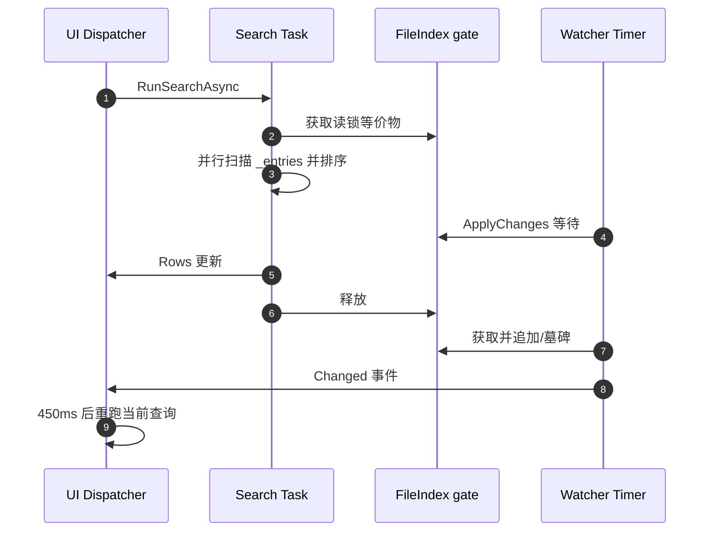

这不是读写锁，而是一把互斥锁。选择它的原因：

- 搜索典型几十毫秒，watcher 批次典型毫秒级；实现简单、可证明不会撕裂数组。
- watcher 事件处理器不拿锁，只入队；真正应用发生在后台 timer。
- 对账分块，不会一次性持锁 3–5 秒。

### 4.4 快照格式与兼容

| 字段 | 内容 |
|---|---|
| magic | `IDX1` |
| version | `1` |
| header | entryCount、namesLength、lowerLength、rootCount、roots |
| entries | 每条：parentIndex、nameOffset、nameLength、lowerOffset、lowerLength、size、modifiedUtcTicks、attributes、category |
| arenas | names UTF-8 bytes、lower UTF-8 bytes |
| checksum | FNV-1a over compact entries + roots + arena used bytes |

M2.0 的 Save 会先 Compact，所以快照里没有墓碑。M1 写出的快照可被 M2.0 加载；M2.0 写出的快照也可被 M1 加载，因为条目布局未变。

### 4.5 内存策略

| 策略 | 原因 |
|---|---|
| 25% 增长，不翻倍 | 76 万条时多一条若翻倍会多占几十 MB |
| 对账路径不写 `_pathCache` | 11 万目录路径缓存会把私有内存抬高 |
| `_dirCache` 上限 5000 | 保留热点目录解析，不常驻整张目录表 |
| 对账后 Compact + Aggressive GC | 回收墓碑、旧名字与短命对象 |
| `System.GC.ConserveMemory=9` | 让 .NET 更积极把空闲段还给系统 |

---

## 5. 12 个场景交互流程

### 场景 1：冷启动（无快照）

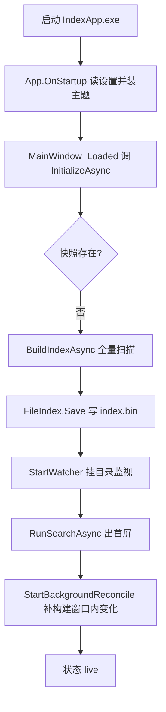

判据：窗口必须出现；状态从 `building` 到 `ready` 再到 `live`。首轮全量构建不计入“有快照冷启动 ≤3s”闸门，但必须显示进度。

边界：无就绪固定盘时回落到用户目录；构建异常写 `failed` 并保留旧索引（若有）。

### 场景 2：热启动（快照有效）

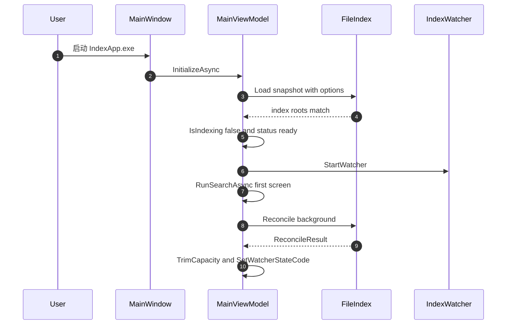

判据：默认全盘快照下，UIA 状态到 `ready` 实测约 1.5–1.7 秒；后台对账完成约 2.7–3.2 秒。

边界：对账不阻塞首屏；用户在 `reconciling` 期间仍可搜索，结果可能短暂落后于离线变化。

### 场景 3：快照根不匹配

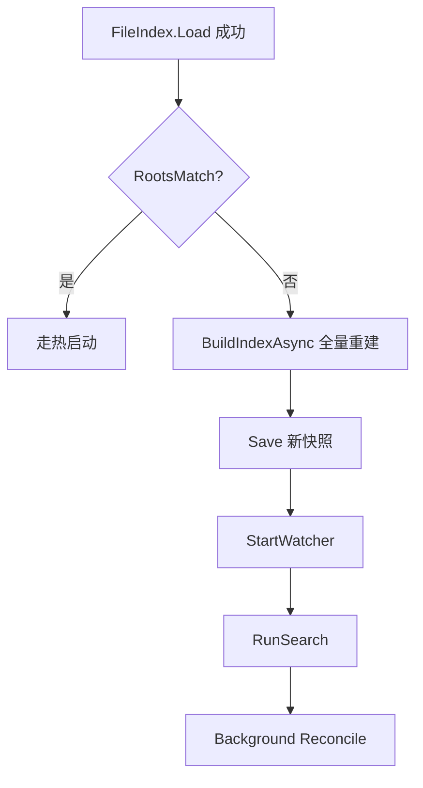

判据：`INDEXAPP_ROOT` 或固定盘集合变化后，不把旧根快照当当前根使用。

边界：`RootsMatch` 只比较根，不比较排除项；排除项变化由后台对账逐步收敛。

### 场景 4：快照损坏或版本不符

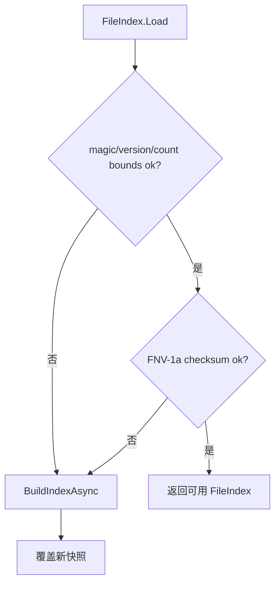

判据：`Load` 对损坏快照返回 `null`，不抛到 UI；应用自动重建。

边界：`.bak` 保留上一份快照；当前版本不自动尝试 `.bak`，避免把旧根误当新根。

### 场景 5：运行中新增文件

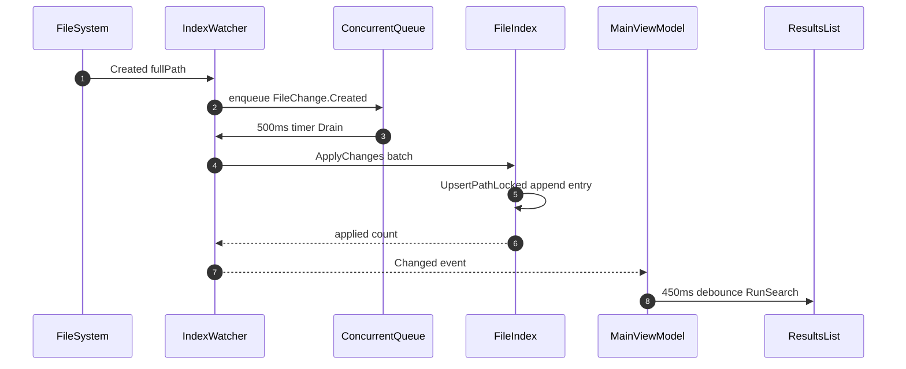

判据：在已索引根内创建 `m2-live.txt`，不按 F5，约 1.5 秒内搜索结果出现。

边界：排除目录内新增会被 watcher 入队前过滤；新目录本身先只添加目录条目，子项由后续事件补齐。

### 场景 6：运行中删除文件

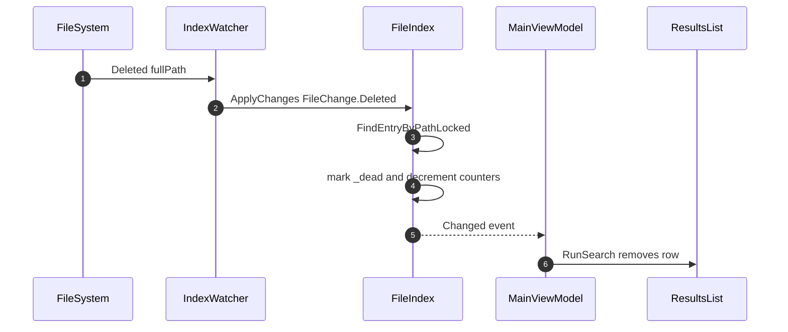

判据：删除已索引文件后，当前查询在约 1.5 秒内不再显示该行。

边界：若删除事件丢失，启动对账或 F5 会收敛；打开旧结果行仍会先做存在性检查并弹错。

### 场景 7：运行中同目录重命名

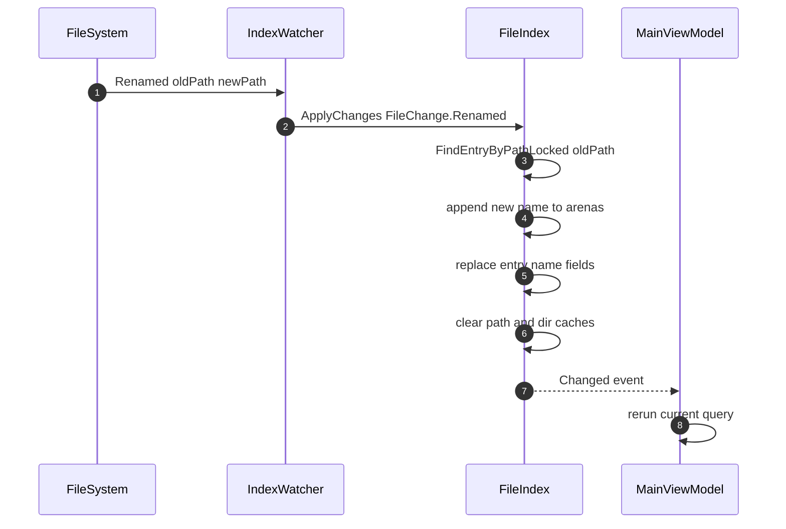

判据：旧名查询消失，新名查询出现；行路径指向新路径。

边界：同目录重命名不移动条目下标，只追加新名字；旧名字在 Compact 前仍占 arena。

### 场景 8：跨目录移动或目录重命名

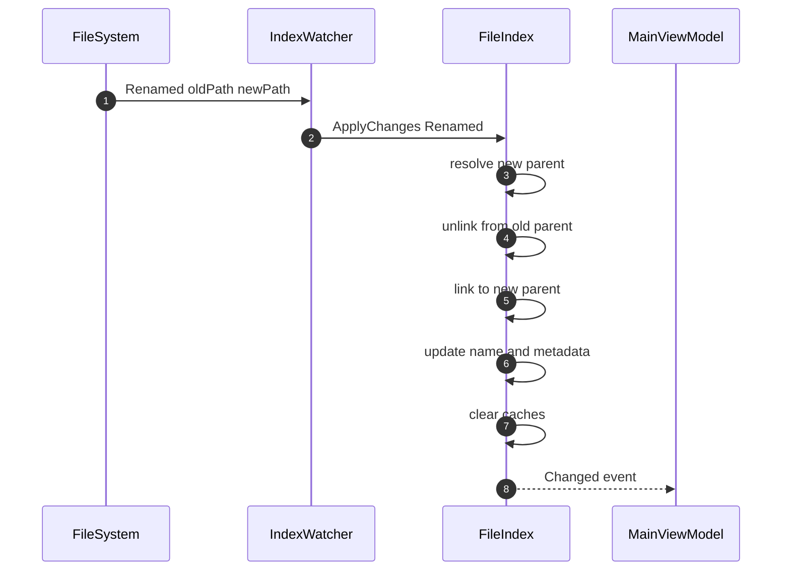

判据：目录子树不需要重新枚举，后代路径通过父子链重算；子项仍可搜到且路径已更新。

边界：如果 watcher 只报新路径且旧路径不在索引中，`RenamePathLocked` 只 Upsert 新路径，不删除已有目标子树。

### 场景 9：运行中修改文件内容

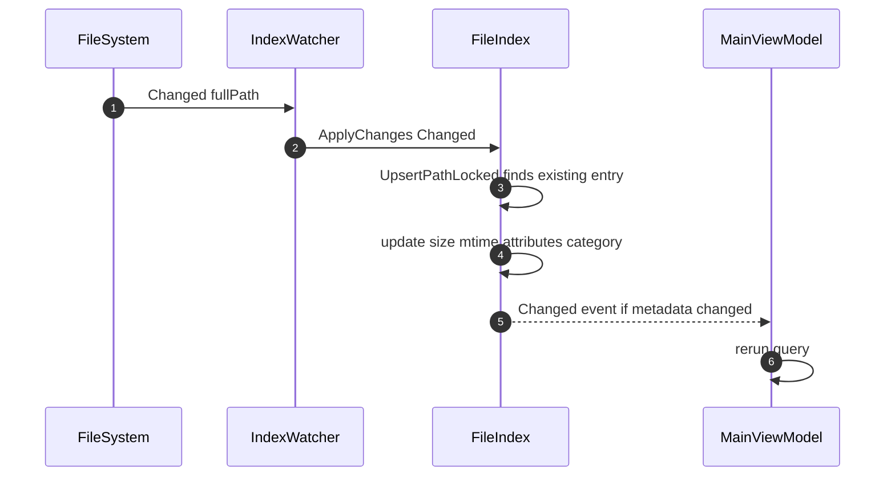

判据：运行中的文件内容变化可刷新列表大小/时间；未变化时 watcher 不触发重查。

边界：应用关闭期间文件内容变化不改父目录 mtime，启动对账不保证发现；需要 F5 或运行中收到 Changed 事件。

### 场景 10：应用关闭期间的文件名变化

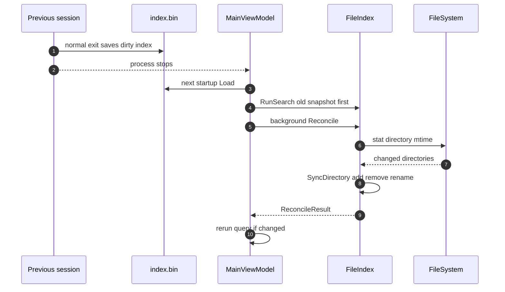

判据：关闭应用期间新增/删除/重命名文件，再启动后不按 F5 可搜到新状态；实测状态显示 `启动对账 新增 2 / 删除 2 / 更新 0`。

边界：只补文件名变化；关闭期间纯内容写入导致的大小/时间变化不保证。

### 场景 11：用户按 F5 全量重建

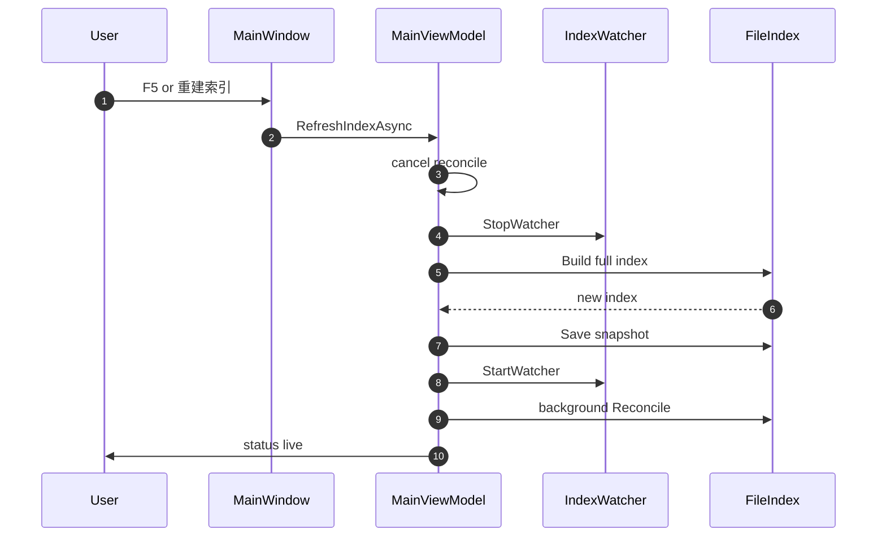

判据：重建期间旧结果清空并显示进度；成功后状态回到 `ready`，随后 `live`。

边界：`IsIndexing` 期间搜索请求返回，避免半索引查询；重建失败时若旧索引仍在，会重新挂 watcher。

### 场景 12：监视溢出或关闭实时刷新

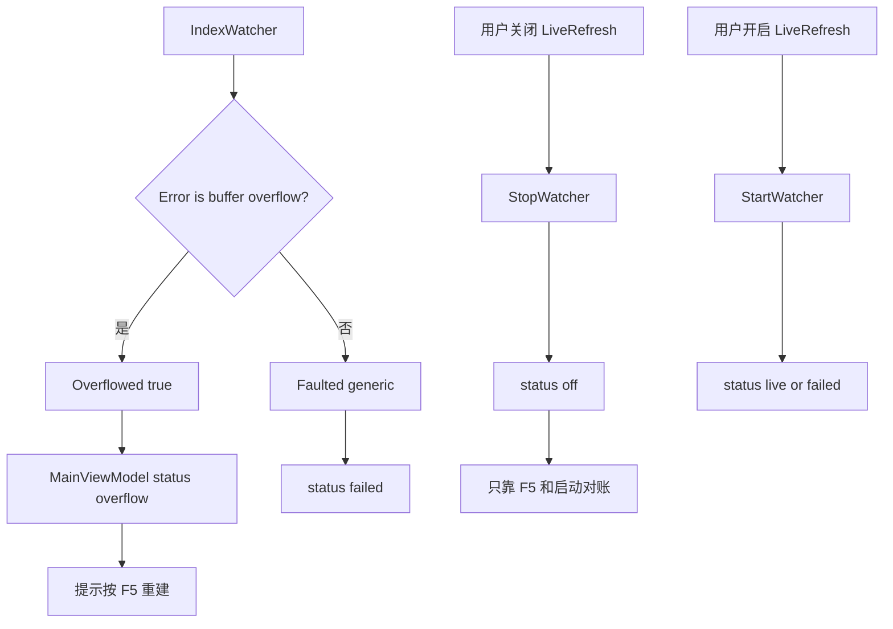

判据：溢出必须可见，不能继续显示“实时刷新：开”；关闭开关后行为退回 M1（F5 才更新）。

边界：溢出后 watcher 不自动全量重建，避免用户无感地触发全盘 I/O；用户选择 F5。

---

## 6. 失败模式与降级矩阵

| 失败 | 检测点 | 用户可见 | 自动恢复 | 人工恢复 |
|---|---|---|---|---|
| 快照缺失 | `Load` 返回 null | 状态 `building` | 全量重建 | 无 |
| 快照损坏 | magic/version/checksum | 状态 `building` | 全量重建 | 无 |
| 根不匹配 | `RootsMatch` | 状态 `building` | 全量重建 | 无 |
| watcher 启动失败 | `WatcherCount=0` 或异常 | `实时刷新：不可用/启动失败` | 无 | F5 或检查根目录 |
| 缓冲区溢出 | `InternalBufferOverflowException` | `溢出，请按 F5 重建` | 无 | F5 |
| 单事件路径被锁/消失 | `ApplyChanges` catch | 无单独弹窗，状态可能不增 | 下批或 F5 | F5 |
| 对账异常 | `Reconcile` throw | `StatusMessage` | 无 | F5 |
| 正常退出保存失败 | `Shutdown` catch | `StatusMessage` | 下次启动对账 | F5 |
| 强杀/崩溃 | 下次启动 | 状态可能短暂旧 | 后台对账补文件名 | F5 |
| 文件已删除但结果仍在 | 打开/定位前检查 | 错误对话框 | 实时删除或 F5 | F5 |

---

## 7. 内存与缓冲区溢出风险专章

本章单独分析 M2.0 当前版本里两类最容易把“实时增量”变成“不可靠体验”的风险：**内存增长/峰值**与 **`FileSystemWatcher` 缓冲区溢出**。结论先说在前面：

- 内存风险主要来自“常驻索引结构变大 + 对账/Compact 的短命对象 + 自包含包捆绑运行时”，不是单个 bug；当前已用 25% 增长、有界缓存、分块对账、Compact、Aggressive GC、`ConserveMemory=9` 压低，但自包含包仍未稳定达到 300 MB 闸门。
- 缓冲区溢出风险来自“全盘递归监视 + OS 事件生产速度超过消费速度 + 64 KB 缓冲上限”；当前版本能检测并明确提示 F5，但不能保证不丢事件，也不能自动恢复。
- 当前 `IndexWatcher` 的待处理队列没有硬上限；如果事件持续高速产生且索引锁被长任务占住，队列本身也会成为内存风险。

### 7.1 风险总览

| 风险 | 所在层 | 触发条件 | 现象 | 严重度 | 当前处理 |
|---|---|---|---|---|---|
| 索引常驻内存偏高 | `FileIndex` | 条目数、目录数、名称长度增加 | 私有内存随索引规模线性上升 | 中 | 数组/arena 紧凑存储；25% 增长；Compact |
| Compact 瞬时峰值 | `FileIndex.Compact` | 对账后或 Save 前 | 短暂同时存在旧数组/新数组/新 arena | 中 | 只在后台空闲点调用；Aggressive GC |
| 对账短命对象 | `FileIndex.Reconcile` | 大量目录 mtime 变化 | 托管堆频繁分配路径字符串、子项列表 | 中 | 分块 512；路径不写缓存；Win32 stat；块间让锁 |
| watcher 队列无硬上限 | `IndexWatcher` | 事件速率 > 消费速率，且 `ApplyChanges` 等锁 | `ConcurrentQueue<FileChange>` 变长，路径字符串堆积 | 中高 | 500ms 排空；单批 20k；排除目录过滤；但未设队列上限 |
| 大结果查询临时内存 | `FileIndex.Search` | 空查询或高频词命中几十万 | partials/hits/List 扩容、排序临时对象 | 中 | MaxResults 200k；并行分片；虚拟化行 |
| 自包含包内存超标 | 发布形态 | 使用 self-contained 单文件 | 私有内存比框架依赖包高约 50–100 MB | 中 | 文档如实标注；推荐以 no-runtime 作为内存闸门验收包 |
| FS 缓冲区溢出 | `FileSystemWatcher` | 全盘文件事件洪峰 | `InternalBufferOverflowException`，部分事件丢失 | 高 | 置 `Overflowed`，UI 提示 F5；不自动重建 |
| 溢出后索引悄悄落后 | 实时语义 | 用户忽略 overflow 提示 | 搜索结果缺项/多项 | 高 | 状态码 `overflow`；打开/定位前存在性检查兜底 |

### 7.2 内存来源图

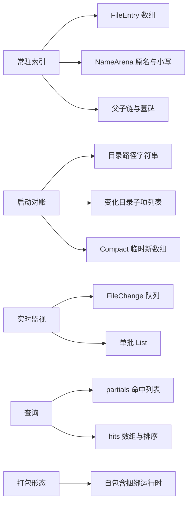

### 7.3 存在原因与原理

#### 7.3.1 为什么索引常驻内存会上升

M2.0 为了保住“关键词秒搜”，没有把索引搬进数据库，而是继续使用连续数组：

- `FileEntry[]` 保存父下标、名称偏移、大小、mtime、属性、分类。
- `NameArena` 保存原名与 lowercase 名的 UTF-8 字节，避免 1M 个 `string` 对象。
- M2.0 新增 `_dead`、`_firstChild`、`_nextSibling`、`_lastChild`，用来支持删除、目录子树和按父找子。
- 增量只追加，不搬动旧条目；删除只标墓碑。这个设计让写入便宜，但代价是数组和 arena 会随历史变化增长。

因此，M2.0 的常驻内存不是单纯“当前文件数”的函数，而是“当前活条目 + 历史墓碑 + arena 未回收尾部 + 缓存”的函数。

#### 7.3.2 为什么对账会制造内存峰值

启动对账要覆盖应用关闭期间的文件名变化。普通权限下没有 USN checkpoint，只能逐个目录比较 mtime：

1. 对每个目录还原完整路径。
2. 对每个目录调用 Win32 `GetFileAttributesExW`。
3. 对变化目录枚举直接子项。
4. 对新增目录递归扫描子树。
5. 对账后 `Compact` 重建数组与 arena。

其中路径字符串、子项列表、Compact 新数组都是短命对象。若一次性持锁做完，冷启动会被卡住；若分块太碎，又会反复分配。当前折中是：每块 512 个目录，块间 `Thread.Sleep(0)` 让锁，结束后 Compact + Aggressive GC。

#### 7.3.3 为什么 watcher 队列可能成为内存风险

`IndexWatcher` 的事件处理链路是：

```text
FileSystemWatcher 事件线程 → ConcurrentQueue<FileChange> → 500ms Timer → FileIndex.ApplyChanges
```

事件入队很快，但 `ApplyChanges` 需要拿 `FileIndex._gate`。如果此时后台对账正在一个变化目录里做 Diff，或一次大查询持锁排序，队列会等待。每个 `FileChange` 至少包含路径字符串，重命名还包含旧路径；在事件洪峰下，队列长度没有硬上限，就会把内存压力从“索引”转移到“待处理事件”。

当前缓解是：排除目录在入队前过滤，单批最多 20,000，timer 每 500ms 尝试排空。但这只能降低概率，不能证明极端场景下不会堆积。

#### 7.3.4 为什么缓冲区溢出是 M2.0 的结构性风险

`FileSystemWatcher` 的底层是 `ReadDirectoryChangesW`。它不是“每个事件一个可靠消息队列”，而是一个固定大小的内核/托管缓冲区。M2.0 对每个索引根创建一个递归 watcher：

- `InternalBufferSize = 64 * 1024`。
- `IncludeSubdirectories = true`。
- 默认根可能是 C:\、D:\、E:\ 全盘。

当文件事件产生速度超过消费速度，缓冲区来不及搬运事件，就会触发 `InternalBufferOverflowException`。溢出不是简单“慢一点”，而是**中间一段事件可能永久丢失**；后续事件仍可能到达，但索引已经和磁盘不一致。

### 7.4 出现场景

| 场景 | 为什么容易触发 | 预期表现 |
|---|---|---|
| 首次全盘构建 | 774k 级条目、数组/arena 同时分配，Build 的 `List` 与 ToArray 有峰值 | 构建后内存高于加载快照后的稳态 |
| 关闭应用后大量文件变化，再启动 | 对账发现很多目录 mtime 变化，枚举多个目录并 Compact | 后台校验期间私有内存上升 |
| 解压/复制包含几万文件的目录 | watcher 短时间收到大量 Created；子目录事件持续到达 | 队列增长，可能溢出 |
| `npm install`、构建输出、包缓存写入 | 大量小文件创建/删除/重命名；即使排除 `node_modules`，OS 事件仍先产生 | 溢出概率高 |
| Windows Update、浏览器缓存、杀软扫描 | 系统目录和缓存目录 churn，全盘递归监视会看到噪声 | overflow 或事件洪峰 |
| 同步盘/网盘占位符批量变化 | 文件名、属性、时间戳频繁变化 | Changed/Renamed 批次变大 |
| 空查询或高频词查询 | 命中几十万，排序和截断产生临时数组 | UI 延迟和查询内存上升 |
| 自包含单文件包 | 捆绑 .NET Desktop 运行时与原生库解包 | 私有内存比框架依赖包高约 50–100 MB |

### 7.5 缓冲区溢出原理图

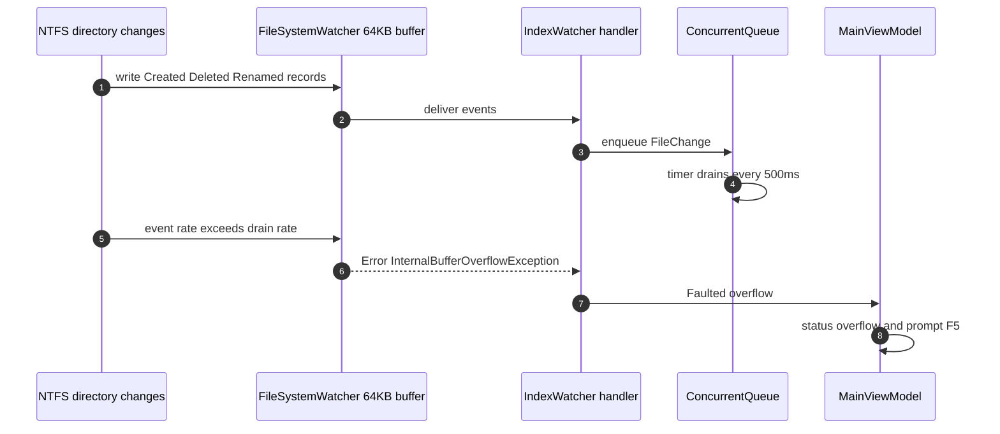

### 7.6 当前已实现的应对方案

| 方向 | 已实现 | 效果 |
|---|---|---|
| 降低数组翻倍峰值 | `EnsureCapacity` 从 2x 改为约 25% 增长 | 多几条不会把 76 万数组顶到 150 万 |
| 降低 arena 峰值 | `NameArena` 25% 增长，`Trim()` 回收尾部 | Compact 后旧名字与空容量可回收 |
| 降低对账缓存 | 对账用 `GetPathNoCacheLocked`，`_dirCache` 上限 5000 | 不再为 11 万目录常驻整张路径表 |
| 降低对账持锁 | 每 512 目录一块，块间 `Thread.Sleep(0)` | 查询/watcher 批次能插入，避免 UI 长时间无响应 |
| 降低短命对象 | 对账子项用 `DirectoryChildInfo` struct；Win32 stat | 少一层托管包装，降低分配量 |
| 对账后回收 | `TrimCapacity` → `Compact` → LOH compact → Aggressive GC | 实测把 no-runtime 私有内存压回 240–266 MB |
| 全局 GC 策略 | `System.GC.ConserveMemory=9` | 更积极归还空闲段，代价是 GC 更频繁 |
| watcher 事件过滤 | 入队前用只读排除表过滤路径/目录名 | 减少明显噪声进入队列 |
| watcher 批次 | 500ms timer，单批 20k | 合并高频事件，避免每个事件都触发搜索 |
| 溢出可见 | `Overflowed` + `Faulted` + UI 状态 `overflow` | 不假装实时，提示用户 F5 |
| 自身数据排除 | 排除 `%LOCALAPPDATA%\IndexApp`、`%APPDATA%\IndexApp`、快照文件 | 避免快照写入触发“自己监视自己”的反馈 |
| 结果内存控制 | MaxResults 200k，`VirtualizingRows` 只物化可见行 | 避免 20 万行对象常驻 UI |

### 7.7 仍存在的风险与后续建议

| 风险 | 当前缺口 | 建议方案 | 优先级 |
|---|---|---|---|
| watcher 队列无硬上限 | 极端事件洪峰仍可能堆积 `FileChange` | 给队列设上限；超限后主动置 overflow 并丢弃后续事件，要求 F5 | 高 |
| overflow 后仍继续运行 | 用户可能忽略提示，搜索继续基于落后索引 | overflow 后自动停止 watcher 或把搜索状态标为“结果可能过期” | 高 |
| 全盘递归 watcher 噪声 | 系统 churn 会制造大量被过滤前的 OS 事件 | 提供“只监视用户目录/指定根”的低噪声模式 | 中 |
| 对账仍要 stat 所有目录 | 11.5 万目录约 3s，且短命对象不可避免 | M2.1 用 USN checkpoint 替代全盘 stat；普通权限下可保留为兜底 | 高 |
| 自包含包内存超标 | 捆绑运行时抬高 50–100 MB | 发布说明以 no-runtime 为内存闸门；自包含包继续观察或减少常驻结构 | 中 |
| 空查询排序峰值 | 全量命中排序，UI 201–359 ms | top-K 选择或部分排序；或降低默认显示上限 | 中 |
| Compact 瞬时双份 | 大索引 Compact 会短暂同时持有旧/新结构 | 增加“仅在空闲且无查询时 Compact”的调度；或分代回收 | 中 |
| 内存读数波动 | 同机 self-contained 309–372 MB | 建立固定 60s 空闲采样脚本，纳入发布验收 | 中 |

### 7.8 运维判断口诀

| 看到什么 | 先判断 | 怎么做 |
|---|---|---|
| 状态 `实时刷新：溢出，请按 F5 重建` | watcher 已经丢过事件，不能相信实时性 | 按 F5；如果频繁发生，缩小索引根 |
| 状态 `后台校验` 持续数秒 | 正常：全盘目录 mtime 对账在后台跑 | 可先搜索，稍后结果会自动刷新 |
| 内存只在构建/对账后升高，之后回落 | 短命对象与 Compact 峰值 | 正常；若长期不回落，采集 `GetDiagnostics` |
| 内存持续随运行时间上涨 | 可能是 watcher 队列或墓碑/arena 累积 | 先 F5 重建；仍异常则检查事件洪峰与队列上限缺口 |
| no-runtime 达标、self-contained 超标 | 打包形态差异 | 内存闸门用 no-runtime；自包含作为免装运行时的便利包 |

---

## 8. 当前实测读数（2026-10-27）

| 项 | 读数 | 口径 |
|---|---|---|
| 引擎测试 | 70 PASS | `run-tests.cmd` |
| StartUI4 自测 | 70 PASS + 1 INFO，退出码 0 | `--selftest` |
| 默认快照 | 774,220 条目（658,993 文件 / 115,227 目录） | 本机 C:\、D:\、E:\ |
| 热启动到首屏 | no-runtime 1,476 ms；self-contained 1,605 ms | UIA `IndexStatus.HelpText=ready` |
| 后台对账完成 | no-runtime 2,690 ms；self-contained 2,860 ms | UIA 离开 `reconciling` |
| 关键词 UI 延迟 | report 101–127 ms；photo 111–121 ms；notes 105–122 ms；zzzz 97–102 ms | UIA SetValue 到 ResultCount 更新 |
| 空查询 UI 延迟 | 201–359 ms | 76.6 万命中，显示前 20 万；超过 200 ms 闸门 |
| UI 帧间隙 | 856 帧，max 42.3 ms，p95 7.7 ms，over100=0 | `--perf` |
| 私有内存 | no-runtime 240.3–265.9 MB；self-contained 316.5–371.6 MB | 启动后约 30s 空闲；自包含包超过 300 MB |
| 实时新增/删除 | 约 1.5 s 内 UI 结果变化 | 独立测试根手工验收 |
| 离线对账 | 新增/删除/重命名补齐 | 关闭应用后改文件再启动 |

---

## 9. 与 M1 / M2.1 的关系

| 维度 | M1 | M2.0 | M2.1 |
|---|---|---|---|
| 进程模型 | UI 进程内索引 | UI 进程内索引 + watcher | 服务 + 命名管道 + UI |
| 全量源 | 目录遍历 | 目录遍历 | `$MFT` |
| 实时源 | 无 | `FileSystemWatcher` | USN Journal |
| 离线变化 | F5 | 目录 mtime 对账 | checkpoint 回放 |
| 权限 | 普通用户 | 普通用户 | 管理员/LocalSystem |
| 主要收益 | 可用 | 运行中实时可见 | 更高吞吐、完整大小/时间、开机服务化 |
| 主要代价 | 不实时 | 全盘 watcher 可能溢出；对账仍要 stat 所有目录 | 安装/ACL/协议复杂度 |

M2.0 没有把 USN/MFT 代码“看起来能跑”地塞进仓库；它交付的是当前权限下能实测的实时路径。M2.1 的接口替换点仍在 `FileIndex` 的构建/查询/快照边界上。

---

## 10. 复现命令

```powershell
# 构建 + 引擎测试 + StartUI4 自测
.\run-tests.cmd

# 发布两档
'' | .\publish_no_runtime.cmd
'' | .\publish.cmd

# 引擎对账基准
dotnet run --project bench\IndexCore.Bench\IndexCore.Bench.csproj -c Release -- `
  "C:\Users\你的用户名" `
  "$env:LOCALAPPDATA\IndexApp\index.bin" --reconcile

# 实时验收：用一个独立测试根，避免污染默认全盘快照
$env:INDEXAPP_ROOT = "C:\Users\你的用户名\IndexAppM2Root"
$env:INDEXAPP_SNAPSHOT = "C:\Users\你的用户名\IndexAppM2Data\index.bin"
.\publish_no_runtime\IndexApp_v0.2.0_no_runtime_build_*.exe --softrender --path $env:INDEXAPP_ROOT
```

---

## 11. 术语

| 术语 | 含义 |
|---|---|
| M2.0 | 第二个发布里程碑中**无需管理员**的实时增量切片 |
| 墓碑 | 条目不立即从数组删除，只标记不可见；查询跳过 |
| 父子链 | 用 `firstChild/nextSibling/lastChild` 表示目录树，支持子树删除/重命名 |
| 对账 | 启动后比较快照目录 mtime 与当前目录 mtime，只重新枚举变化目录 |
| Compact | 丢墓碑、搬活名字、重建数组与 arena、清缓存 |
| watcher 溢出 | `FileSystemWatcher` 内部缓冲区来不及消费事件，索引可能落后 |
| 热启动 | 有有效快照，先加载再后台补齐 |
| 冷启动 | 无快照或快照不可用，必须全量构建 |
