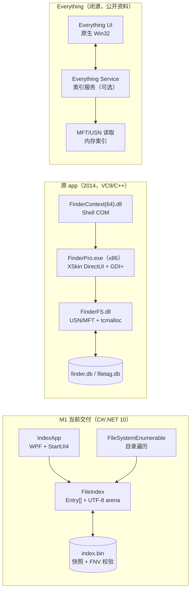
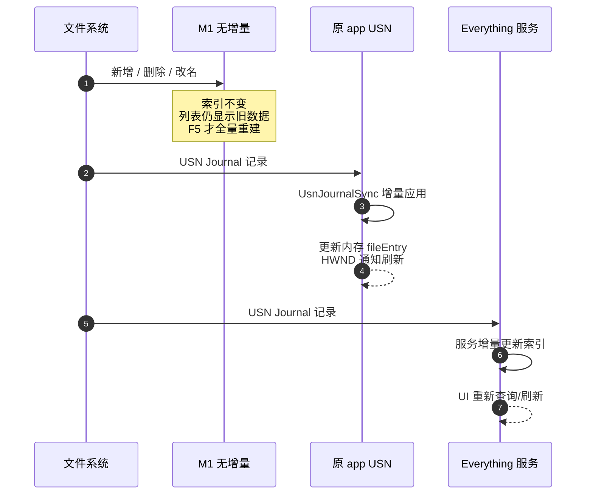

# M1 / 原 app / Everything 三方对比分析报告

> 文档编号：CMP-001 · 日期：2026-10-27 · 作者：IndexApp 架构组
> 对比对象：**当前项目 M1（IndexApp 0.1.0）**、**原软件 FinderPro v2.3.840.0426（闪电搜索）**、**Everything（voidtools，闭源免费）**
> 数据分级：**【实】**本机实测 / **【证】**逆向报告或源码证据 / **【公开】**官方或公开资料 / **【推】**基于机制的推断、未实测
> 重要边界：原 app 与 Everything **未在本机运行**；性能结论只在同口径内比较，跨数据集的数字不横向排名。

---

## 0. 一页结论

| 维度 | 当前 M1 | 原 app（2014） | Everything |
|---|---|---|---|
| 定位 | 开源、可审计、免管理员的首版文件名搜索 | 2014 年国产商业搜索工具；功能完整但已停更 | 成熟的 Windows 即时文件名搜索 |
| 索引来源 | 目录遍历（`FileSystemEnumerable`） | USN Journal + 内存索引 + 二次补元数据 | 公开资料：MFT/USN + 内存索引 |
| 实时刷新 | **无**，F5 全量重建 | **有**，`UsnJournalSync` 增量 | **有**，USN 增量 |
| 进程模型 | UI 进程内后台索引 | 32 位 UI + 进程内 DLL；x86/x64 两套 Shell COM | 索引服务 + UI（服务可选）【公开】 |
| 语言/栈 | C# / .NET 10 / WPF / StartUI4 | C++03 / VC9 / ATL / XSkin / GDI+ | 原生 C++/Win32（闭源）【公开】 |
| 权限 | 普通用户，无需管理员 | 读卷句柄，推测需管理员【证/推】 | 服务/管理员或便携模式【公开】 |
| 1M 查询 | **67.8 ms P95（引擎）**、71 ms（UI）【实】 | 未实测；报告称“秒搜”【证】 | 未实测；公开资料称即时【公开】 |
| 1M 内存 | 264 MB 私有工作集（60 s 空闲）【实】 | 未实测 | 未实测 |
| 安装体积 | 70.3 MB 自包含 / 1.72 MB 框架依赖【实】 | 2.33 MB 安装包 / ~5.88 MB 组件（不含 CRT）【证】 | 约 2 MB 量级（1.4.1 公开页面）【公开】 |
| 可维护性 | 高：源码、测试、文档 | 低：VC9/C++03、自研 UI、二进制被篡改 | 无源码；只能通过 SDK/外部集成 |
| 结论 | **可交付的 M1**；实时与 Shell 集成是 M2 缺口 | 只能当行为参考，**不可复用** | 性能/成熟度标杆；不作为可复用代码 |

一句话：**M1 赢在开源、可维护、免管理员；原 app 赢在 2014 年就有的 USN 实时能力；Everything 赢在成熟度、体积与原生性能。M1 要接近后两者，关键不是换 UI，而是补 M2 的 USN + 服务化 + MFT 元数据。**

---

## 1. 对象、口径与证据分级

### 1.1 三个对象

| 对象 | 版本/来源 | 本文使用的事实基础 |
|---|---|---|
| **M1** | `IndexApp 0.1.0`，当前仓库 | 源码、`run-tests.cmd`、`IndexCore.Bench`、1M 测试树、发布包实测【实】 |
| **原 app** | FinderPro v2.3.840.0426，`_rev/stage0_unpacked` | 技术栈报告、逆向报告、导入/导出表、截图【证】；未运行 |
| **Everything** | voidtools，闭源免费 | 官方下载页/公开 FAQ 与第三方公开分析【公开】；未安装、未运行 |

### 1.2 证据分级

| 标记 | 含义 | 本报告中的例子 |
|---|---|---|
| 【实】 | 本机实际跑过，能指回命令/结果 | M1 构建 1,187 ms、查询 P95 67.8 ms、264 MB |
| 【证】 | 逆向报告、PE 导入导出、字符串、源码 | 原 app 的 `UsnJournalSync.cpp`、`Finder2::Init`、VC9、HashMismatch |
| 【公开】 | 官方/公开资料，未在本机复现 | Everything 的 MFT/USN、服务、闭源 |
| 【推】 | 由机制推断，未实测 | 原 app 主进程可能需要管理员；“Everything 内存更低”这类未测结论 |

### 1.3 本报告刻意不做什么

1. **不把三家的性能数字直接排名**：M1 的 1M 是合成的 1000×1000 小文件树；原 app 的数字来自 2014 年报告与截图；Everything 没有本机读数。数据集、缓存、权限、文件大小都不同。
2. **不运行原 app**：该副本 `FinderPro.exe`/`FinderFS.dll` 的 HashMismatch，且有商业代码/供应链风险；只做静态参考。
3. **不把 Everything 的内部细节写成事实**：闭源产品，本文只使用公开资料能支撑的层级；具体数据结构、线程模型、缓存策略标注为未知或推断。

---

## 2. 新人小结：两种完全不同的“快”

### 2.1 目录遍历 vs MFT/USN

把磁盘想成一座图书馆：

- **目录遍历（M1）**：管理员从大门开始，逐个房间、逐个书架抄书名。能抄全，但书越多越慢；开门后新进来的书，不重新巡馆就不知道。
- **MFT/USN（原 app / Everything）**：MFT 是图书馆的总台账（每个文件一条记录），USN Journal 是门口的借还登记簿（每次新增/删除/改名都记一行）。读台账建索引、读登记簿追变化，不需要每次巡馆。

所以 M1 的查询可以很快（索引在内存里），但**首次建索引是巡馆，且没有登记簿，无法实时**。

### 2.2 进程内索引 vs 服务化索引

- **M1**：前台（UI）和后厨（索引）在同一个进程里。好处是无需管理员、部署简单；坏处是引擎崩溃会带走 UI，索引无法在 UI 启动前预跑，也无法给多个客户端共享。
- **Everything**：后厨独立成服务，前台通过 IPC 点菜；服务可以在开机时先建索引，UI 随开随用【公开】。
- **原 app**：引擎是进程内 DLL，UI 和索引同生共死；Shell 集成另做 x86/x64 COM，属于 2014 年的典型分层方式【证】。

---

## 3. 架构对比



| 架构层 | M1 | 原 app | Everything |
|---|---|---|---|
| UI | WPF + StartUI4Controls；x64 | XSkin DirectUI + GDI+；x86 | 原生 Win32；x86/x64【公开】 |
| 引擎 | `IndexCore` 进程内；目录遍历 + 内存索引 | `FinderFS.dll` 进程内；USN + 内存索引 + tcmalloc | 服务/客户端分离；MFT/USN + 内存索引【公开】 |
| 基础库 | .NET BCL | `Utility.dll`：libcurl/MD5/日志/线程池/崩溃上报 | 未知（闭源） |
| 持久化 | 自定义 `index.bin` + `.bak`，原子写 | `finder.db`、`filetag.db`、`Setting.ini`、`Excluded.txt` | 自有数据库/索引文件（格式未公开）【公开/未知】 |
| Shell 集成 | 无 Explorer 集成（M2）；应用内结果行右键已支持 | x86/x64 Shell COM | 右键菜单/SDK 等【公开】 |
| 更新/遥测 | 无网络、无遥测 | HTTP 更新 + `*.nxstatistic.com` 遥测 + 机器码 | 公开资料未见同等遥测描述；闭源不可审计 |
| 进程权限 | 普通用户 | 读卷句柄，推测需管理员【推】 | 服务/管理员或便携模式【公开】 |
| 位数 | x64 | 32 位主程序 + 64 位 Shell DLL | x86/x64【公开】 |

---

## 4. 实现方案对比

| 实现点 | M1 | 原 app | Everything |
|---|---|---|---|
| 全量索引来源 | `FileSystemEnumerable` 逐目录枚举 | `FileSystemLoadThread`：卷句柄 + `DeviceIoControl`（USN/MFT 路线）【证】 | 公开资料：NTFS MFT + USN【公开】 |
| 大小/时间 | 枚举时直接取得 | `GrabFileSizeAndTime`/`FileInfoGrabThread` 二次补元数据【证】 | MFT 记录直接取得【公开/推】 |
| 内存结构 | `Entry[]` + 父索引 + 原始/小写 UTF-8 arena | `fileEntry` 数组 + tcmalloc；`getFileByIndex/getFileByRefNum`【证】 | 闭源；公开分析称内存索引/B+树【公开/推】 |
| 查询匹配 | 并行分片 + `Span<byte>.IndexOf`；通配/全字/大小写；200k 命中上限 | `build_match_pattern`/`process_match_pattern` + `utf8_strlwr`；通配/大小写/全字【证】 | 闭源；公开资料称内建索引/即时过滤【公开】 |
| 排序 | 名称/大小/修改时间；`Array.Sort` | `FSResultSortImpl` 多线程排序 + HWND 回调【证】 | 闭源 |
| 持久化 | 快照（header + entries + arenas + FNV-1a + 原子替换） | `finder.db`/`filetag.db`；`FS_InitDB/FS_DBChange/FS_DBLock`【证】 | 自有格式（未公开） |
| 实时增量 | **无**；F5 全量重建 | `UsnJournalSync.cpp`；`UsnJournalID/FirstUsn/MaxUsn` 持久化【证】 | USN 增量 + 服务【公开】 |
| 非 NTFS | 目录遍历可覆盖；网络盘未默认 | 报告未给出非 NTFS 细节；USN 不可用时回退 `FindFirstFileW`【证】 | 文件夹索引支持 FAT/exFAT/网络【公开】 |
| 预览 | 图片 + 文本；PDF/视频暂无 | `PreviewGenerator` + Foxit `FPdfSdk`（VC6） | 使用系统/外部预览能力【公开/未核】 |
| 分类/标签 | 扩展名分类；无标签 | 7 类 + `filetag.db` 颜色标签 | 过滤/宏/书签等（版本而异）【公开】 |
| Shell 右键 | 无 Explorer 集成（M2）；应用内右键已有打开/定位/复制 | `FinderContext(64).dll` | 右键菜单/SDK【公开】 |
| 安装/分发 | 两档单文件 exe；无 MSI/签名 | 2.2 MB SFX 安装包；Regsvr32 注册 Shell；无签名外壳 | 安装版/便携版；官方分发【公开】 |

### 4.1 关键差异：M1 是“内存索引 + 目录快照”，不是“变更日志索引”

M1 的索引在构建时就固定下来，搜索只读 `FileIndex`；没有 watcher/USN，所以：

- 新增文件不会进入索引；
- 删除文件不会从索引移除；
- 改名/大小/时间不会更新；
- 重启只要快照根一致，仍加载旧快照。

这不是实现疏漏，而是 M1 的明确边界；实时能力在 M2（USN + 服务）才成立。详见 [`USN增量-原理与生效流程.md`](USN增量-原理与生效流程.md)。

---

## 5. 启动流程对比

| 步骤 | M1 | 原 app | Everything |
|---|---|---|---|
| 1 | 进程启动；主题/设置加载 | 互斥体单实例；XSkin/DirectUI 初始化 | UI/服务启动【公开】 |
| 2 | 读 `%LOCALAPPDATA%\IndexApp\index.bin`；校验 magic/version/校验和 | 加载 `finder.db`/`filetag.db`/配置 | 服务加载索引/读 MFT/USN【公开】 |
| 3 | 根目录一致则直接加载；否则全量扫描 | `Finder2::Init` + `FileSystemLoadThread` 枚举卷/USN | 服务建立/追平索引【公开】 |
| 4 | 查询首屏；空查询按修改时间排序（上限 200k） | `GrabFileSizeAndTime` 补元数据；`UsnJournalSync` 启动 | UI 连接服务/查询【公开】 |
| 5 | 之后靠 F5/重建更新 | USN 增量 + HWND 通知 | USN 增量 + UI 刷新 |
| 权限 | 普通用户 | 卷句柄；推测需管理员【推】 | 服务/管理员或便携【公开】 |
| 首次启动 | 全固定盘目录遍历（本机 C/D/E；未单独计时） | 全量加载 + 元数据补齐；报告称“秒级初始化”【证】 | 服务首次建索引【公开】 |

**读法**：M1 的“启动快”主要来自**快照**，不是因为它比 Everything 更会建索引；原 app 的“秒级”来自 USN/MFT 路线与 2014 年的数据集，不能与 M1 的目录遍历直接横比。

---

## 6. 刷新流程对比



| 刷新项 | M1 | 原 app | Everything |
|---|---|---|---|
| 新增文件 | 不出现，直到 F5 | USN `FILE_CREATE` 后进入索引【证】 | USN 增量【公开】 |
| 删除文件 | 仍显示，打开可能失败 | USN `FILE_DELETE` 后移除【证】 | USN 增量【公开】 |
| 改名 | 旧名 | USN old/new 成对处理【证】 | USN 增量【公开】 |
| 大小/时间 | 旧值 | 二次读 MFT/文件信息刷新【证/推】 | MFT/USN 更新【公开】 |
| UI 通知 | 查询时重查；无变化推送 | `onSearchFinished/onSortFinished` + `PostMessageW(HWND)`【证】 | 服务/UI 刷新【公开】 |
| 重启后的变化 | 根一致则加载旧快照，不感知 | 从 `UsnJournalID/FirstUsn/MaxUsn` 追平【证】 | 从 USN 追平【公开】 |
| 回退 | 手动 F5 全量重建 | 无 USN/回绕时全量重建【证/推】 | 文件夹索引/重建【公开】 |

**结论**：M1 的刷新模型是“**用户触发**”；原 app/Everything 是“**文件系统事件触发**”。这是当前最大的产品差距，不是 UI 细节。

---

## 7. 语言与技术栈对比

| 维度 | M1 | 原 app | Everything |
|---|---|---|---|
| 主语言 | C# 14（.NET 10） | C++03（MSVC 9） | 原生 C++/Win32【公开】 |
| UI | WPF + StartUI4Controls（纯 C# 模板） | XSkin DirectUI（自研 XML/.xf）+ GDI+ | 原生 Win32 控件【公开】 |
| 引擎 | 托管 C#；`Span<byte>`/`ArrayPool`/结构数组 | 原生 C++；tcmalloc；多线程排序 | 原生 C++；闭源 |
| 运行时 | .NET 10 Desktop Runtime | MSVCP90/MSVCR90（随包） | 静态/系统 CRT（公开资料未细述） |
| 第三方 | StartUI4Controls、AvalonEdit（lib 依赖） | libcurl 7.31.0、Foxit VC6、libcurl 等 | 闭源依赖（未公开） |
| 位数 | x64 | x86 主程序 + x64 Shell DLL | x86/x64【公开】 |
| 部署 | 自包含单文件 70.3 MB / 框架依赖 1.72 MB | 2.33 MB SFX + 注册 Shell | 约 2 MB 量级安装/便携包【公开】 |
| 可审计性 | 源码 + 测试 + 文档 | 二进制 + 报告；副本被篡改 | 闭源，只能外部验证 |

**为什么 M1 选 C#/WPF**：开发速度、WPF 虚拟化/IME/高 DPI、StartUI4 组件、你现有 WPF 经验；代价是运行时体积和 GC 内存。若引擎闸门不过，方案给 Rust cdylib 留了逃生门；当前 1M 查询 P95 67.8 ms，未触发。

---

## 8. 性能多角度对比

### 8.1 读表口径（先看这一节）

| 列 | 回答什么问题 | 基准/读法 | 最容易怎么读错 |
|---|---|---|---|
| 指标 | 比较的是什么 | 启动/构建/查询/内存/体积/增量/帧间隙 | 把“引擎内部耗时”当“用户到屏耗时” |
| 对象 | 测的是谁 | M1【实】、原 app【证/未运行】、Everything【公开/未运行】 | 把公开宣传当本机实测 |
| 读数 | 具体数值 | 带单位；M1 带数据集 | 1M 合成小文件树 ≠ 真实 C/D/E |
| 口径 | 数据怎么来的 | 1M 生成树、NVMe、Debug/Release、快照热/冷 | 拿冷启动比热启动、拿框架依赖比自包含 |
| 证据 | 可信级别 | 【实】/【证】/【公开】/【推】 | 把【推】写成【实】 |
| 不可比点 | 为什么不能横比 | 数据集、缓存、权限、版本 | 只看数字大小下结论 |

### 8.2 性能表

| 指标 | M1【实】 | 原 app【证/未运行】 | Everything【公开/未运行】 | 读法/不可比点 |
|---|---|---|---|---|
| 安装/分发体积 | 自包含 70,317,005 B；框架依赖 1,717,794 B | 2,326,174 B 安装包；~5.88 MB 组件（不含 CRT） | 公开页面约 1.86–1.95 MB（1.4.1 便携/安装）【公开】 | 自包含含 .NET/WPF；框架依赖需目标机 Runtime；不能只比 exe |
| 启动到窗口（有快照） | 750 ms（Debug，1M）/ 890 ms（发布包，小根） | 未实测；报告称“秒级初始化”【证】 | 未实测；公开资料称快速【公开】 | 数据集、磁盘缓存、是否首次解包均不同 |
| 1M 全量构建 | 1,187 ms（合成 1000×1000 小文件） | 未实测；原报告只有“秒级”描述 | 未实测；公开资料称即时初始化 | 合成树、NVMe、目录缓存；真实 C/D/E 未计时 |
| 1M 查询 P95 | 67.8 ms（report；引擎） | 未实测 | 未实测 | M1 为名字子串扫描；原/Everything 内部算法未知 |
| 1M UI 端到端查询 | 71 ms（Debug，1M 快照） | 未实测 | 未实测 | 不含原/Everything 的 IPC/渲染差异 |
| 空查询（排序 1M） | 470 ms P95；截断 200k | 未实测 | 未实测 | 空查询是特殊路径，不计入关键词 200 ms 闸门 |
| 1M 私有内存 | 264 MB（60 s 空闲，1M）；全盘加载 265.4 MB | 未实测 | 未实测；通常被认为更省，但本机未验证【推】 | 私有工作集 vs 工作集 vs 提交；不可与任务管理器单值混用 |
| 构建峰值内存 | 502.8 MB（全盘构建刚结束，含临时对象） | 未实测 | 未实测 | 临时值，不是常驻 |
| 增量追平 | **无**；F5 全量（1M 引擎 1.19 s） | USN 增量【证】 | USN 增量【公开】 | M1 的全量重建不能当“增量”数字 |
| UI 长帧 | UI 定时器最大 45.3 ms，0 次 >100 ms；帧间隙原判据未验证（本会话合成器 ~10 Hz） | 未实测 | 未实测 | 不能拿“UI 定时器”冒充“CompositionTarget 帧间隙” |
| 权限/磁盘 I/O | 普通用户；首次全固定盘元数据枚举 | 卷句柄，推测需管理员【推】；USN/MFT 读卷 | 服务/管理员；MFT/USN | 权限影响可测范围和启动方式 |
| 规模化 | 1M 实测；索引上限 4M 条 | 截图 1,277,759 项【证】 | 公开资料支持百万级【公开】 | 原/Everything 的实际规模与内存未在本机复测 |
| 预览延迟 | 图片/文本；未做 PDF/视频 | Foxit/PreviewGenerator | 系统/外部预览【公开/未核】 | 功能范围不同，不能只比“有没有预览” |

### 8.3 结论：不要用一张表给三家排名

- **M1 的数字是本机实测**，但数据集是合成小文件树；它的价值是证明“1M 级文件名扫描方案可行”，不是证明“比 Everything 快”。
- **原 app 的数字是 2014 年报告/截图口径**，没有可复现的运行环境和可信二进制；不能用来证明今天的速度。
- **Everything 没有本机读数**；公开资料能支持“MFT/USN + 服务 + 实时”的架构判断，不能支持具体毫秒数。
- 真正可比的实验应当是：同一台机器、同一块 NTFS 卷、同一组 1M/5M 文件、同样权限、冷/热缓存分开、查询到首屏与帧间隙都记录。这是 M2 的对比测试计划。

---

## 9. 可靠性、安全与合规

| 维度 | M1 | 原 app | Everything |
|---|---|---|---|
| 快照/崩溃 | 原子写 + FNV-1a 校验；损坏则重建 | `CCrashHandler` + `finder.db`；崩溃上报 | 闭源；公开资料未细述 |
| 供应链 | 源码、seed 48/48、两档 selftest | 副本 `FinderPro.exe`/`FinderFS.dll` HashMismatch；VC6 PDF 无 ASLR/DEP | 闭源官方分发；需自行校验来源 |
| 网络/遥测 | 无网络、无遥测、无机器码 | HTTP 更新 + 遥测 + 机器码 | 闭源；未在本报告做流量审计 |
| 许可 | MIT（当前 LICENSE；最终待确认） | 商业代码 + 二次打包副本 | 免费闭源；SDK/再分发按官方许可 |
| 权限面 | 普通用户；无服务 | 卷句柄/管理员；Shell COM 注册 | 服务/管理员（可选便携） |
| 索引隐私 | 本地快照，ACL 由用户目录权限决定 | `%AppData%` 明文索引 | 本地索引；闭源不可审计 |
| 可维护性 | 高 | 低（C++03/自研 UI/VC6 第三方） | 无源码 |

---

## 10. 适用场景与结论

### 10.1 当前 M1 适合什么

- 需要一个**开源、可审计、免管理员**的 Windows 文件名搜索；
- 能接受“启动/手动刷新”的静态索引，不需要文件变化秒级可见；
- 1M 级文件、查询 200 ms 内、私有内存 300 MB 内的桌面场景；
- 希望后续能按源码演进（USN、服务、Shell、标签）而不是被闭源绑定。

不适合：把 Everything 的实时性/体积/成熟功能当作验收线；需要全盘实时增删改、Explorer 右键、标签、自动更新的场景。

### 10.2 原 app 的评价

- **历史价值**：2014 年就采用 USN/MFT + 内存索引 + tcmalloc + 多线程排序，架构判断正确；`filetag.db`、分类、预览、Shell 集成完整。
- **不可复用**：VC9/C++03、XSkin 自研 UI、Foxit VC6、32 位主程序；且当前副本签名 HashMismatch，不能当可信基座。
- **适合**：作为行为契约、Parity 清单、性能/交互参考；不适合直接运行/分发或当差分 oracle。

### 10.3 Everything 的评价

- **优势**：原生、体积小、成熟、USN/MFT 实时、服务化、文件夹索引、SDK/生态；是 M1 的性能/产品标杆。
- **限制**：闭源，不能作为可复用代码；内部数据结构/线程模型/缓存策略无法审计；深度定制受 SDK/官方能力约束。
- **适合**：用户只想要成熟工具时；M1 不应试图复制代码，而应复制其**架构原则**（MFT/USN + 服务 + 内存索引）。

### 10.4 M1→M2 的优先级（按收益/代价）

| 优先级 | 事项 | 目标 | 验收 |
|---|---|---|---|
| P0 | USN 增量 + checkpoint | 新增/删除/改名 ≤2 s 可见 | 10k 次增删改；不触发全量遍历 |
| P0 | Windows 服务 + 命名管道 | 无每次 UAC；多客户端；卷句柄 | 服务 ACL/重启/回绕重建 |
| P1 | `$MFT` 全量元数据 | 取代二次逐文件 stat；提高构建/内存 | 1M 构建、硬链接/ATTRIBUTE_LIST 对照 |
| P1 | UI `IndexChanged` 重查 | 查询结果自动刷新 | 首屏/滚动帧间隙 |
| P2 | 托盘/Explorer 右键/标签 | 对齐原 app 的日常入口 | 安装/卸载/注册 |
| P2 | 安装器/MSI/签名 | 可分发 | 干净虚拟机 |
| P3 | 与 Everything 的同机对比 | 可复现的基准 | 同卷同数据、冷/热分开 |

---

## 11. 验证与复现

### 11.1 M1 的实测命令

```powershell
# 构建 + 两套测试
.\run-tests.cmd

# 1M 基准（先生成 1000×1000 测试树）
dotnet run --project tools\TestDataGen\TestDataGen.csproj -- "C:\Temp\IndexApp1M" 1000 1000
dotnet run --project bench\IndexCore.Bench\IndexCore.Bench.csproj -- "C:\Temp\IndexApp1M" "C:\Temp\IndexApp1M.idx" --rebuild

# 范围/全固定盘冒烟
$env:INDEXAPP_ROOT="D:\IndexAppScopeTest"
$env:INDEXAPP_SNAPSHOT="C:\Temp\scope.idx"
.\publish\IndexApp_v0.1.0_self_contained_build_*.exe --path "D:\IndexAppScopeTest"
```

### 11.2 未验证项（必须随报告一起读）

- 原 app 未运行：所有原 app 性能/刷新数字来自报告与静态证据，非本机实测。
- Everything 未运行：仅使用公开资料；MFT/USN/服务是公开描述，具体内部实现未知。
- M1 的全固定盘首次构建耗时、5 分钟内存口径、PDF/视频预览、UI 原始帧间隙未验证；详见 [`验证台账.md`](验证台账.md)。
- 1M 是合成小文件树，不是用户的真实 C/D/E；真实全盘查询/内存以全盘 265.4 MB 加载读数为参考，构建耗时未单列。

---

## 12. FAQ（10 条）

**1. M1 为什么不直接上 USN/MFT？**
- 机制：USN/MFT 需要卷句柄，通常要管理员/服务；本机进程非管理员，无法验证。
- 数字：M1 目录遍历 1M 构建 1,187 ms；USN 的价值是“增量 ≤2 s”，不是首次构建。
- 自查：`docs/adr/0001-adopt-vs-build.md`；`src/IndexCore/FileIndex.cs` 的 `Build` 没有 USN 代码。

**2. M1 为什么用 C#/WPF，而不是 C++？**
- 机制：WPF 的虚拟化/IME/高 DPI/托盘/Shell 集成成熟，StartUI4 可直接复用；开发速度远高于 VC9/C++。
- 数字：1M 查询 P95 67.8 ms、私有内存 264 MB；代价是自包含 70.3 MB。
- 自查：`app/MainWindow.xaml`、`lib/StartUI4Controls`；如果引擎闸门不过，方案预留 Rust cdylib。

**3. M1 为什么比 Everything 大这么多？**
- 机制：自包含包把 .NET/WPF 运行时打进去；Everything 是原生 + 约 2 MB。
- 数字：M1 自包含 70.3 MB；框架依赖 1.72 MB（目标机需 .NET 10 Desktop Runtime）。
- 自查：`publish\` 与 `publish_no_runtime\` 两档；不要拿自包含比原生。

**4. M1 的 264 MB 内存算高吗？**
- 机制：`Entry[]` + 原始/小写 UTF-8 arena + .NET 运行时；1M 条目。
- 数字：264 MB 私有（60 s 空闲）；构建峰值 502.8 MB 是临时值；工作集 356 MB 含共享页。
- 自查：用私有工作集，不用任务管理器“内存”单值；见 `docs/验证台账.md` §2。

**5. M1 查询 67.8 ms 能算“秒搜”吗？**
- 机制：名字子串是内存线性扫描 + 并行分片；200k 命中上限。
- 数字：P95 67.8 ms（引擎）、71 ms（UI，1M）；空查询 470 ms 是特殊路径。
- 自查：看 P95 到首屏，不看平均；不要把空查询混进关键词闸门。

**6. 为什么 M1 看不到新增/删除的文件？**
- 机制：没有 watcher/USN；快照加载后索引固定；F5 才全量重建。
- 数字：M1 无增量；原 app/Everything 有 USN。
- 自查：新增文件后按 F5；重启若根一致仍加载旧快照，必须手动刷新。

**7. 原 app 的 DLL 为什么不能直接拿来用？**
- 机制：32 位、C++ 修饰名、依赖 `Utility.dll` 的类布局、无头文件；副本 HashMismatch；商业代码。
- 数字：FinderFS 75 个导出全是修饰名；原 app 主程序 x86。
- 自查：`_rev/analysis/exports_FinderFS.dll.txt`、`imports_FinderFS.dll.txt`、技术栈报告 §5。

**8. Everything 开源吗？能复制它的实现吗？**
- 机制：闭源免费；只能通过官方 SDK/外部集成；没有源码可复用。
- 数字：公开安装/便携包约 2 MB 量级；本报告未运行它。
- 自查：看官方发布与许可；不要把它当开源项目。

**9. M2 做到什么程度才算接近 Everything？**
- 机制：USN 增量 + 服务/命名管道 + `$MFT` 元数据 + UI 变化通知；不是“换 UI”。
- 数字：目标 10k 次增删改 ≤2 s；1M 查询/内存沿用现有闸门；同机同卷对比。
- 自查：`docs/USN增量-原理与生效流程.md` §6 验收判据。

**10. 这份报告的数字怎么复核？**
- 机制：M1 数字有命令/结果；原 app 只有静态证据；Everything 只有公开资料。
- 数字：M1 1,187 ms/67.8 ms/264 MB 来自 `docs/验证台账.md`；原/Everything 标注【证/公开】。
- 自查：先看每行的证据标记与“不可比点”，再做同机同数据集实验；不要拿不同数据集排名。

---

## 附录 A：证据索引

| 证据 | 位置 |
|---|---|
| 原 app 技术栈/签名/第三方库 | [`../_rev/技术栈分析报告.md`](../_rev/技术栈分析报告.md) |
| 原 app 组件/导入导出/行为 | [`../_rev/逆向分析报告.md`](../_rev/逆向分析报告.md)、`../_rev/analysis/` |
| M1 实测与未验证项 | [`验证台账.md`](验证台账.md) |
| USN 原理/流程 | [`USN增量-原理与生效流程.md`](USN增量-原理与生效流程.md) |
| M1 架构与里程碑 | [`续命方案-架构设计.md`](续命方案-架构设计.md) |
| M1 源码/测试/发布 | `src/IndexCore/`、`app/`、`tests/`、`publish/`、`publish_no_runtime/` |
| Everything 公开资料 | voidtools 官方下载/FAQ；公开的 Everything 索引机制分析（MFT/USN、服务、内存索引） |

## 附录 B：术语

| 术语 | 解释 |
|---|---|
| MFT | NTFS 主文件表；每个文件/目录一条记录，含名称、父目录、大小、时间等 |
| USN Journal | NTFS 卷级变更日志；按 USN 递增记录创建/删除/改名/写等事件 |
| FRN | File Reference Number；卷内文件 ID |
| Checkpoint | `JournalID + NextUsn`；下次增量读取的起点 |
| 私有工作集 | 进程独占物理内存；不含共享页/文件缓存 |
| P95 | 95% 样本不超过该值；用于盯长尾，不用平均值代替 |
| 【实】/【证】/【公开】/【推】 | 本报告的证据分级，详见 §1.2 |
