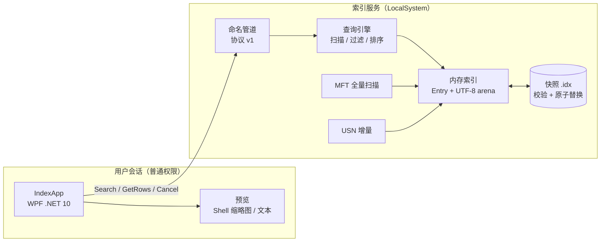
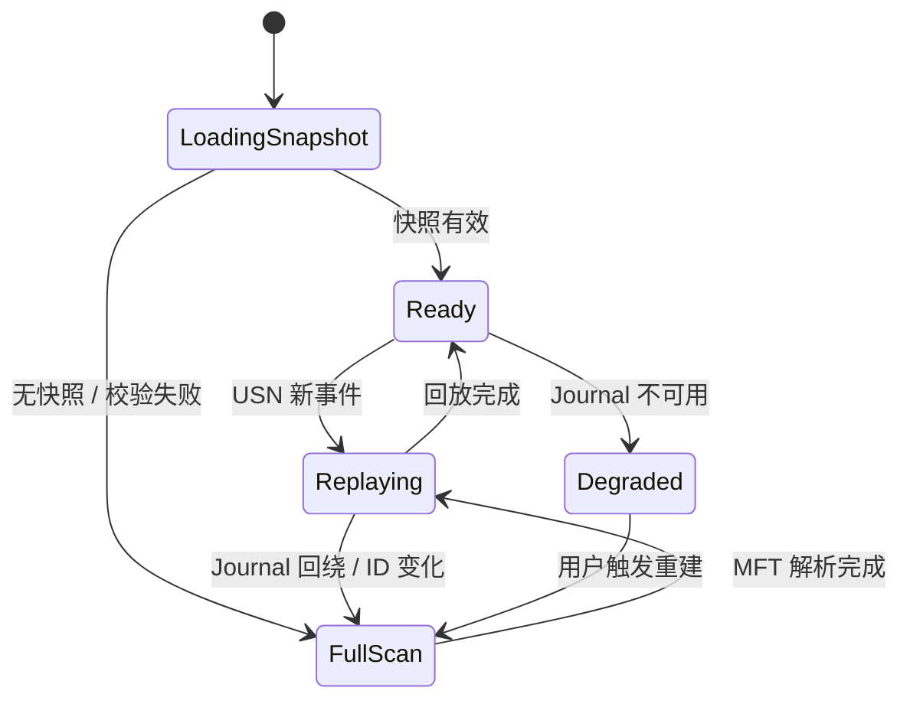
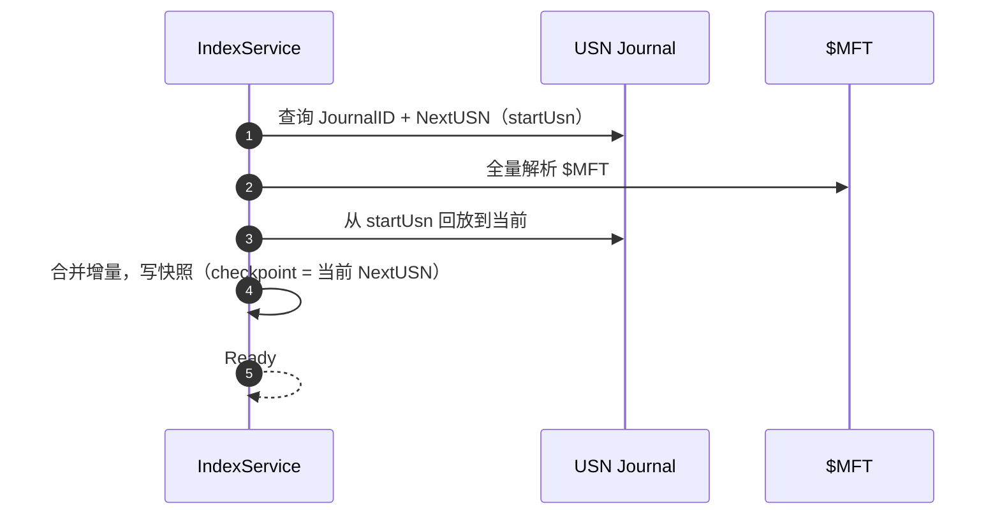
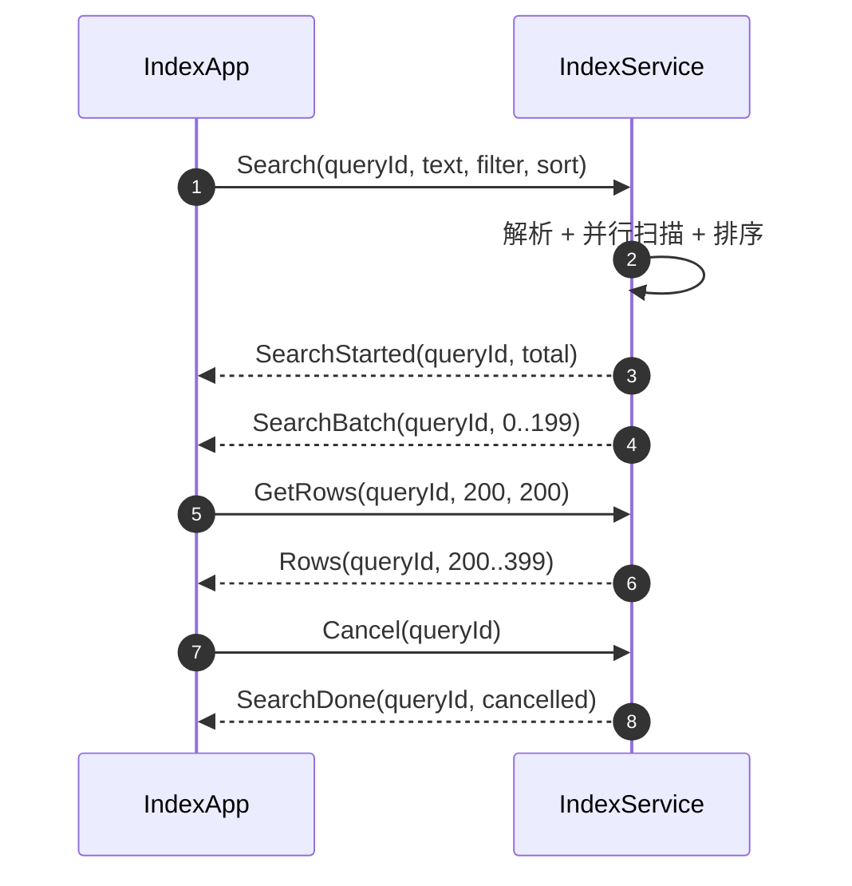

# 续命方案：闪电搜索（FinderPro v2.3.840.0426）开源重写架构设计

> 文档编号：ARCH-001 · 状态：M1 已实现（2026-10-27），M2 待做
> 日期：2026-10-27
> 依据：`_rev/技术栈分析报告.md`、`_rev/逆向分析报告.md`、`原文件搜索工具主界面图片.png`、GitHub API 元数据、Microsoft Learn 的 USN/MFT 文档
> 对象：2013–2014 年的 Windows 文件名搜索工具：VC9 + ATL + 自研 DirectUI + NTFS USN/MFT 内存索引
> 一句话：**不复用原二进制、皮肤与 SDK 资产；按行为契约 clean-room 重写；C#/.NET 10 + WPF + Windows 服务；首版 M1 + 预览；按 1M 中档闸门验收。**
> 实现偏差（2026-10-27）：M1 未做 Windows 服务与 MFT/USN；采用 UI 进程内后台目录遍历 + 快照（本机非管理员，无法验证卷句柄）。原因与后果见 ADR-0001。

---

## 0. 决策卡

| 决策项 | 本轮选择 | 一句话理由 | 代价与风险 | 复核点 |
|---|---|---|---|---|
| 路线 | 开源 clean-room 重写 | 原二进制不可复用，且被二次打包篡改 | 索引引擎要自己写 | P0 的 adopt-vs-build |
| 引擎 | C# / .NET 10，MFT 全量 + USN 增量 | 单语言；同赛道已有 MIT 的 C#/WPF 实现；你的 WPF 经验可直接复用 | GC 与内存余量小于 Rust | P1 五项闸门；失败换 Rust cdylib |
| UI | WPF | 原生虚拟化列表、IME、托盘、热键、高 DPI 都成熟 | 没有跨平台 UI 路径 | P3 可用性与帧间隙 |
| 进程模型 | Windows 服务（LocalSystem）+ 命名管道 | 读卷句柄需要管理员；服务化免每次 UAC，崩溃隔离 | 服务安装、ACL、升级复杂度 | P2 |
| 索引存储 | 自定义快照 + USN checkpoint，不用 SQLite 做主索引 | 1M 文件名是线性扫描问题，不需要数据库 | 快照格式、校验、迁移要自己维护 | P1/P2 |
| 首版 | M1 + 预览 | 4–6 周可发布，覆盖原软件日常使用 | 右键菜单、标签、自动更新后置 | P4 |
| 验收闸门 | 1M 中档 | 你已确认；见 §7.1 | 300MB 与查询 200ms 可能贴边 | P1 实测，只收紧不放宽 |
| 许可证 | 建议 MIT（待你确认） | 与 .NET/WPF/CsWin32 生态兼容 | 需第三方 NOTICE 与资产审查 | P0 |
| 公开名称 | 待定 | 避免原商标与二次打包副本的牵连 | 发布前商标检索 | P4 |
| 明确不做 | 原二进制、XSkin、Foxit、RAR、libcurl、遥测、静默升级、内容检索、跨平台、32 位 | 合规、可维护性与首版范围 | 功能比原版少（M1） | 全部阶段 |

### 0.1 本轮已拍板（原样记录）

| 轮次 | 问题 | 你的选择 |
|---|---|---|
| 1 | 续命路线 | **开源重写（推荐）** |
| 2 | 数值闸门 | **1M 中档（推荐）**：查询 P95 ≤200ms、冷启动 ≤3s、增量追平 ≤2s、常驻 ≤300MB、UI 最长帧 ≤100ms |
| 2 | 技术栈 | **C# WPF + NT 服务（推荐）** |
| 2 | 首版范围 | **M1 + 预览（推荐）** |

### 0.2 两条原路线的对比

| 路线 | 做法 | 成本 | 主要风险 | 结论 |
|---|---|---|---|---|
| 原架构升级 | 保留 FinderFS.dll，写 32 位 broker，新 UI 走 IPC | 低（1–2 周可出壳） | 32 位 + 无头文件 ABI + 被篡改 + 不可开源 | 仅适合个人自用，**否决** |
| 站在现有开源项目上 | fork Lertaro/SwiftList 等 MIT 项目，移植分类/预览/中文 UX | 低–中（2–4 周可用） | 受上游架构与路线约束，长期主导权弱 | P0 评估，必要时降级为 fork |
| 现代栈 clean-room 重写 | C# 引擎 + WPF + 服务，按本报告的行为契约实现 | 中（4–6 周 M1） | 索引引擎与内存闸门 | **采用** |

### 0.3 结论先行

1. **逆向报告能复用 0 行代码**。它给的是导出名、字符串、组件分层、主界面截图；这些足够写行为契约和 parity 清单，不够当源码基座。
2. **值得继承的是架构骨架**：USN/MFT 全量 + 增量、内存索引、路径按 FRN 还原、快照、服务化、UI 与引擎分层。**不值得继承的是实现**：32 位、VC9/ATL/XSkin、Foxit、libcurl、HTTP 遥测、静默升级。
3. **核心风险在索引层，不在 UI**。所以 P1 先做无 UI 的引擎 PoC；闸门不过就不进 P2，不靠“先把界面做出来”掩盖引擎风险。
4. **选 C# 不是图省事**。2026 年同赛道的两个 MIT 项目（Lertaro、SwiftList）就是 C#/WPF + NT 服务，说明这条路能走通；Rust cdylib 是闸门失败时的逃生门，UI 与协议不动。

---

## 1. 这份“老软件”到底是什么

### 1.1 原技术栈（证据）

| 层 | 原实现 | 证据 | 判断 |
|---|---|---|---|
| 编译器 | Visual Studio 2008 SP1（VC9） | LinkerVersion 9.0、Rich build 30729、随包 `msvcp90/msvcr90` 9.0.30729.1 | C++03 时代产物 |
| 主程序 | C++/ATL/Win32 + XSkin DirectUI + GDI+ | `FinderPro.exe` 导入、`XSkin.dll` 391 导出、`ShanDian.xf` 皮肤包 | 自研 UI 框架，已不可维护 |
| 引擎 | C++，NTFS USN + 内存索引 + tcmalloc | `FinderFS.dll` 75 导出、`DeviceIoControl`、`UsnJournalSync.cpp` 字符串、tcmalloc 路径 | 与 Everything 同路线 |
| 基础库 | `Utility.dll`：libcurl 7.31.0、MD5、日志、线程池、崩溃上报 | 导入/字符串、`YaoUtil::LogFactory`、`CCrashHandler` | 自研 + 静态第三方 |
| 预览 | `PreviewGenerator.dll` + `FPdfSdk.dll`（Foxit，VC6） | 12 导出、280 个 `FPDF_*` 导出、VC6 指纹 | 商业 SDK，不可再分发 |
| Shell 集成 | `FinderContext.dll`（x86）+ `FinderContext64.dll`（x64）COM | `regsvr32`、`IContextMenu` | 双位数，注册/卸载麻烦 |
| 更新/遥测 | WinInet + libcurl，HTTP 明文 | `shandian.u.qiniudn.com`、`*.nxstatistic.com` | 端点已死，且不合规 |
| 构建 | SVN trunk + AutoBuild 流水线 | PDB 路径 `E:\NiuFinder\trunk\AutoBuild\...` | 2014 年的自动化构建 |

### 1.2 逆向报告给了什么、没给什么

| 产物 | 有什么 | 能用来做什么 | 不能做什么 |
|---|---|---|---|
| 技术栈分析报告 | 编译器指纹、PDB、链接时间线、导入导出、字符串、签名状态 | 判断年代、依赖、行为、供应链风险 | 不能生成源码 |
| 逆向分析报告 | 组件清单、导入、75 个导出、关键字符串、风险 | 写 parity 清单与模块映射 | 不能当 API 文档（无头文件/结构体） |
| `stage0_unpacked/` | 12 个二进制、皮肤包、CRT | 只做证据 | 不开源分发、不调 DLL |
| 主界面截图 | 布局、文案、分类、状态栏、设置项 | UI parity 与验收 | 不能证明交互细节 |

### 1.3 为什么不能“调原 DLL 续命”

| 硬约束 | 证据 | 后果 |
|---|---|---|
| **32 位** | `FinderFS.dll` 是 x86 PE | 新 UI 若 x64，必须多一个 32 位 broker 进程；32 位进程还有 2GB/4GB 地址空间与长期兼容性问题 |
| **C++ ABI + 依赖** | 导入表含 `Utility.dll` 的 `CFileProperty`/`PathHelper`/`TimeHelper` 修饰名与 `MSVCP90.dll`；导出是 `?doSearch@KeywordSearchContext@@...` | 要调用就得复刻 `fileEntry`、`TAG_FINDERFS_CONFIG`、`std::string` 的布局与 VC9 ABI；报告里没有这些结构体定义 |
| **被篡改** | `FinderPro.exe` 与 `FinderFS.dll` 的 Authenticode 均为 HashMismatch（技术栈报告 §5） | 不能当可信基座，也不适合当差分测试的“标准答案” |
| **许可证** | 原厂商业代码 + 无签名二次打包副本 | 开源项目没有合法分发路径 |
| **可维护性** | VC9/C++03、自研 DirectUI、VC6 PDF SDK | 即使跑起来，也没有社区能接手的工具链 |

**结论**：原 DLL 只能在“个人自用、隔离、不发布”的场景里当参考；本项目选的是开源，因此 **0 行复用**。

### 1.4 原引擎的关键行为（从导出名读出来的）

| 原符号 | 行为 | 新项目对应 |
|---|---|---|
| `Finder2::Init(HWND, vector<string>, bool)` | 初始化索引与 UI 通知窗口 | `IIndexService.InitializeAsync(volumes, excludes)` |
| `FileSystemLoadThread` | 全量加载线程 | `MftScanner` |
| `UsnJournalSync.cpp`（字符串） | USN 增量同步 | `UsnReader` |
| `GrabFileSizeAndTime` | 单独补大小/时间（USN 记录没有这些字段） | 新设计直接从 MFT 记录取，取消二次逐文件 stat |
| `FS_InitDB` / `FS_DBChange` / `FS_DBLock` | 索引库操作与锁 | `IndexStore` + `SnapshotStore` |
| `build_match_pattern` / `process_match_pattern` / `is_empty_pattern` | 查询编译与匹配 | `QueryParser` + `Matcher` |
| `utf8_strlwr` | UTF-8 小写折叠 | `Utf8Lower` |
| `getFileEntryPathUTF8` | 按 FRN 还原路径 | `PathResolver` |
| `FSResultSortImpl` + `create_thread` | 多线程排序 | 并行扫描 + 排序 |
| `get_loadStatus` / `updateStatus` / `onSearchFinished` / `onSortFinished` | 状态与消息回调 | IPC 事件 |
| `getFileByRefNum` / `getFilePosition` | FRN 索引 / 位置 | FRN 排序数组 + 二分 |
| `TAG_FINDERFS_CONFIG` | 配置结构 | `IndexOptions` |

这张表是“行为契约”的核心：它表明原引擎是 **两段式**（先拿名称，再补大小/时间），也表明路径是按 FRN 还原而不是每条存全路径。新设计沿用骨架、去掉第二段逐文件 stat。

> **新人小结：把报告当“说明书”，不是“零件”**
> 逆向报告像一份拆车记录：它告诉你这辆车是 2008 年的发动机、2014 年的变速箱、哪根管子接哪。它没有给你能直接装到新车上的零件。你可以沿用它的布置图，但不能把旧发动机的锈蚀缸体直接焊上去。

---

## 2. 目标、范围与非目标

### 2.1 目标（可验收）

- 1M 文件/文件夹规模，文件名秒搜；**查询 P95 ≤200ms**（按键到首屏）。
- **冷启动（有快照）端到端 ≤3s**；**增量追平 ≤2s**；**服务+UI 私有工作集 ≤300MB**；**UI 最长帧 ≤100ms**。
- 分类过滤（全部/图片/文档/视频/音频/手机/目录）、结果排序、打开/定位、预览（缩略图/文本）、设置（开机启动/热键/排除目录）、托盘、全局热键、单实例。
- 无遥测、无联网、无机器码；开源许可（建议 MIT，待确认）；可复现构建。
- Windows 10 1809+ / Windows 11，x64；M2 再评估 arm64。

### 2.2 M1 / M2 / 非目标

| 范围 | 内容 | 说明 |
|---|---|---|
| **M1（本方案）** | 文件名搜索、分类、排序、打开/定位、预览、设置、托盘/热键、单实例、安装包 | 4–6 周，可发布 |
| **M2** | Explorer 右键菜单、颜色标签、自动更新、暗色主题、多语言、便携模式、网络盘/exFAT、arm64 | 另开 ADR，不在 M1 偷跑 |
| **非目标** | 内容全文检索、正则搜索、驱动级索引、原皮肤/原图标、XP/32 位、遥测、静默升级、Foxit/RAR 预览 | 明确不做 |

### 2.2.1 术语澄清：M1/M2 与 P0–P4

**M1/M2 是发布里程碑（Milestone），不是 Model 1/2，也不是版本号；P0–P4 是执行阶段。** 两者不是同一维度：

| 术语 | 含义 | 本项目内容 | 当前状态 |
|---|---|---|---|
| **M1** | 第一个可发布里程碑 | 目录遍历 + 快照 + StartUI4 WPF；搜索/分类/排序/范围/打开定位/图片与文本预览/设置/热键/单实例；两档单文件 exe | **已交付**，版本 `0.1.0` |
| **M2** | 第二个发布里程碑 | USN 增量 + 服务/命名管道 + `$MFT` 全量（实时刷新、checkpoint、日志回绕重建）；Explorer 右键、标签、自动更新、暗色、多语言、便携、网络/exFAT、arm64；托盘/MSI 等收尾项 | **未开始** |
| **P0** | 执行阶段 0 | 是否复用现有开源项目的 adopt-vs-build 调研与 ADR | 已完成（ADR-0001） |
| **P1** | 执行阶段 1 | 引擎 PoC：构建、查询、快照、1M 基准 | 已完成 |
| **P2** | 执行阶段 2 | 服务 + IPC + 快照 | **未执行，归入 M2** |
| **P3** | 执行阶段 3 | WPF UI + StartUI4 接线 | 已完成 |
| **P4** | 执行阶段 4 | 预览、两档发布、T0Level 文档 | 已完成 |

口径更正：方案初稿把 `$MFT`/USN/服务写在 M1 架构里；`ADR-0001` 因本机非管理员、无法验证卷句柄，把这三项延后到 M2，M1 实际以**目录遍历 + 快照**交付。因此：

- 当前 M1 **没有**实时刷新、USN、MFT、服务/命名管道；
- 当前 M1 的“托盘 / MSI 安装器”也**未做**（交付的是单文件 exe + 热键/单实例），归入 M2；
- 上文“USN 增量是 M2 方案”指的就是这张表里的 M2，而不是某个文件或模型编号。

### 2.3 Parity 清单（截图 + 报告）

| 原功能 | 证据 | M1 | M2 |
|---|---|---|---|
| 搜索框占位“请输入需要搜索的内容” | 截图 | 有 | — |
| 搜索框右侧目录范围按钮 | 截图 | 有（选择目录） | 拖动目录 |
| 分类：全部/图片/文档/视频/音频/手机/目录 | `btnAllType`…`btnFolderType` | 有 | 可自定义分类 |
| 列：文件名/文件路径/文件大小/修改时间 | 截图 | 有 | 列设置 |
| 排序（修改时间等） | 截图 | 有 | 多列排序 |
| 预览“暂无预览” | `frmPreview`/`imgPreview` | 有（缩略图/文本） | PDFium/压缩包内预览 |
| 标记文件颜色 | 截图 | — | 有 |
| 设置：开机启动/热键 Alt+`/排除目录/确定取消应用 | 截图 | 有 | 更多索引选项 |
| 状态栏：总文件/文件夹数、版本 | 截图 | 有 | — |
| 托盘/全局热键/单实例 | 报告 | 有 | — |
| 右键菜单（资源管理器） | `FinderContext` | — | 有 |
| 标签 `filetag.db` | 报告 | — | 有 |
| 自动更新/静默升级 | `AutoUpdate`/`CCReport` | — | 有（签名、非静默） |
| 遥测/机器码 | `CCReport`/`MachineID` | **不做** | **永不做** |

### 2.4 三个典型场景

**场景 A：找昨天改过的 PDF**

- 目标/痛点：记得文件名里有“报告”，但不在同一个目录；旧工具要先想目录。
- 设计与取舍：全盘索引 + 文件名子串 + 分类过滤 + 修改时间排序；不做内容检索，避免首版把索引复杂度翻倍。
- 流程：输入“报告” → 点“文档” → 按修改时间排序 → 选中看缩略图 → Enter 打开。
- 判据：从按键到首屏 ≤200ms；分类过滤后结果集合与朴素遍历一致；预览 300ms 内出现或显示“暂无预览”。
- 坑：PDF 缩略图依赖系统 PDF 处理器；没有处理器时必须回退图标，不能卡 UI。

**场景 B：只在某个目录里找**

- 目标/痛点：同名文件太多，全盘结果噪音大。
- 设计与取舍：目录范围过滤（前缀）而不是全文路径子串搜索；路径子串会让每个候选都还原全路径，1M 规模下拖慢首屏。
- 流程：点文件夹图标选目录 → 输入关键词 → 结果只在该前缀下。
- 判据：范围过滤后结果集合 = 朴素遍历该目录的结果；切换范围后首屏 ≤200ms。
- 坑：目录被删除/重命名后索引里的旧前缀；用 FRN 校验 + 失效提示。

**场景 C：开机后第一次搜索**

- 目标/痛点：旧工具开机后要等索引；等待时界面像卡死。
- 设计与取舍：服务开机加载快照 + USN 回放；UI 先出窗口，显示“索引就绪中”，就绪后启用搜索；首次无快照时显示进度，不假装可用。
- 流程：开机 → 服务加载快照 → 回放 USN → Ready → UI 搜索。
- 判据：有快照端到端 ≤3s；首次建索引显示进度，不纳入 3s 闸门；UI 不出现 >100ms 长帧。
- 坑：BitLocker 锁定的卷、刚拔插的移动盘、USN 被禁用；都要显示降级状态，不能静默空结果。

---

## 3. 总体架构

### 3.1 组件图



### 3.2 为什么是“服务 + 命名管道”

- **痛点**：读卷句柄 `\\.\C:` 需要管理员。如果 UI 直接提权，每次启动都 UAC；如果进程内引擎崩溃，UI 一起死；如果沿用 32 位引擎，还要 broker。
- **设计**：UI 普通权限；服务以 LocalSystem 只做索引/查询；命名管道传结果；服务崩溃由 SCM 重启，UI 重连。
- **替代方案**：

| 方案 | 优点 | 缺点 | 结论 |
|---|---|---|---|
| 进程内引擎（UI 提权） | 无线程间协议 | 每次 UAC；崩溃耦合；UI 权限过大 | 否决 |
| 每次启动提权助手 | 不装服务 | UAC 频繁；仍然崩溃耦合 | 否决 |
| Windows Search | 系统自带 | 覆盖不全、排序/过滤不可控、无法保证 200ms | 否决 |
| 服务 + 命名管道 | 一次安装、无 UAC、可测试、崩溃隔离 | 安装/ACL/IPC 复杂度 | **采用** |

- **流程**：安装 → 注册服务 → 开机启动 → UI 连接 → Hello/Status → 搜索。
- **安全边界**：服务不执行文件、不联网、不返回文件内容；只返回索引中的路径与元数据。

> **新人小结：前台、后厨与传菜窗口**
> 前台（UI）没有厨房钥匙，不能直接碰热油（卷句柄）；后厨（服务）有权限，但只做菜（索引/查询）；传菜窗口（命名管道）只递菜单和成品，不允许外人进后厨。这样即使后厨换班（崩溃重启），前台也不会跟着关门。

### 3.3 工程结构

```text
/
├─ docs/
│  ├─ 续命方案-架构设计.md
│  └─ adr/
├─ src/
│  ├─ IndexContracts/      # IPC DTO、协议版本、校验
│  ├─ IndexCore/           # MFT/USN/索引/查询/快照（unsafe 仅此）
│  ├─ IndexService/        # Windows 服务 + 管道服务器
│  ├─ IndexClient/         # 管道客户端
│  └─ IndexApp/            # WPF UI
├─ tests/
│  ├─ IndexCore.Tests/
│  └─ IndexService.Tests/
├─ bench/
│  └─ IndexCore.Benchmarks/
├─ tools/
│  ├─ New-TestVolume.ps1
│  └─ Measure-Gates.ps1
├─ Directory.Build.props
├─ LICENSE
└─ README.md
```

`_rev/` 不进入公开仓库；`stage0_unpacked/`、`installer_sfx.7z`、原 exe/dll/xf 全部加入 `.gitignore`。原因见 §10。

### 3.4 依赖与许可证

| 依赖 | 用途 | 许可 | 备注 |
|---|---|---|---|
| .NET 10 | 运行时 | MIT | LTS；WPF 随附 |
| WPF | UI | MIT | 仅 Windows |
| Microsoft.Extensions.Hosting.WindowsServices | 服务宿主 | MIT | 支持 `--console` 开发模式 |
| Microsoft.Windows.CsWin32 | P/Invoke 生成 | MIT | 卷/USN/Shell/托盘/hotkey |
| System.IO.Pipes.AccessControl | 管道 ACL | MIT | Windows 专用 |
| System.IO.Hashing | 快照校验（XxHash64） | MIT | 无第三方依赖 |
| xUnit | 单元/集成测试 | Apache-2.0 | — |
| BenchmarkDotNet | 微基准 | MIT | 不跑在 CI 快路径 |
| WiX Toolset | MSI | MS-RL | 构建工具；产物归项目 |
| Serilog | 文件日志 | Apache-2.0 | 可选；也可用 BCL 日志 |
| Lertaro / SwiftList | 架构参考 | MIT | **若复用代码必须保留 NOTICE** |
| Foxit / RAR / 7-Zip | PDF/压缩包预览 | 商业 / 非自由 / LGPL | M1 不使用；M2 另评估 |

### 3.5 设计原则

1. **单写者**：只有服务写索引与快照；UI 只读。
2. **不可变快照**：每次查询拿到一个一致性视图；增量变更走 overlay，定期合并。
3. **最新查询优先**：任何时刻只有一个活动查询；新查询取消旧查询，旧批次按 `queryId` 丢弃。
4. **无网络**：M1 的服务与 UI 都不含 HTTP 客户端。
5. **不执行外部命令**：打开/定位走 Shell API，不拼命令行字符串。
6. **可测试**：引擎可在控制台模式无 UI 跑；服务可 `--console` 启动。

---

## 4. 索引引擎（核心）

### 4.1 为什么不用 SQLite / FTS / Tantivy

- **痛点**：文件名搜索要的是“子串”，不是分词。FTS5 的 `unicode61` 会把中文按标点切段，单字/子串行为不可控；可加载分词器扩展在某些宿主里被禁用；`LIKE '%x%'` 在 1M 行上要全表扫，还要处理事务、WAL、排序。
- **设计**：索引常驻内存的定长 `Entry` 数组 + UTF-8 名称 arena；查询是 SIMD 子串扫描 + 并行分片 + 排序；快照落盘，启动读回。
- **对比**：

| 方案 | 1M 文件名查询 | 内存 | 中文子串 | 复杂度 | 结论 |
|---|---|---|---|---|---|
| SQLite FTS5 | 依赖 tokenizer | 中 | 分词限制 | 中 | 不用于主索引 |
| SQLite `LIKE` | 100–300ms+ | 中 | 可用 | 低 | 不作为主路径 |
| Tantivy | 建索引慢、体积大 | 高 | 需 tokenizer | 高 | 过度设计 |
| Windows Search | 不可控 | — | 取决于系统 | 低 | 不采用 |
| 内存数组 + 快照 | 30–60ms 预算 | 100–150MB | 字节子串 | 中 | **采用** |

- **流程**：MFT 扫描 → `Entry[]` + arena → 查询扫描 → 命中索引 → 排序 → IPC。

> **新人小结：索引卡与翻箱倒柜**
> 每次搜索都全盘翻箱，当然慢；索引就是开馆前把每本书的书名抄到卡片盒里，按柜子分好。搜索时只翻卡片，不搬书。卡片盒本身要占地方（内存），但比每次翻箱快几个数量级。

### 4.2 数据模型

| 字段 | 类型 | 含义 | 读法 / 坑 |
|---|---|---|---|
| `Frn` | `ulong` | 卷内文件引用号 | **跨卷不唯一**，必须带 `VolumeId` |
| `ParentFrn` | `ulong` | 父目录 FRN | 根目录通常是 5；硬链接有多个名称 |
| `Size` | `long` | 逻辑大小 | 目录为 0；压缩/稀疏仍用逻辑大小 |
| `MTime` | `long` | 修改时间（FILETIME） | 用 `$STANDARD_INFORMATION`，**不要用 USN 事件时间** |
| `NameOffset` | `int` | 原始名称在 UTF-8 arena 的偏移 | 保留大小写用于显示 |
| `LowerOffset` | `int` | 小写 arena 偏移 | 用于大小写不敏感匹配 |
| `NameLength` | `ushort` | UTF-8 字节数 | NTFS 名称上限 255 UTF-16 码元，UTF-8 最多约 765 字节 |
| `Flags` | `ushort` | 目录/隐藏/系统/重解析/硬链接/分类位 | 位域，查询时先按位过滤 |
| `Attributes` | `uint` | Windows 文件属性 | 展示与“显示隐藏/系统”设置 |
| `VolumeId` | `byte` | 卷序号 | 路径根与 FRN 解析范围 |
| `Entry` 总大小 | 56 B | 1M ≈ 56MB | 预算值，P1 实测 |

其他结构：

| 结构 | 1M 估算 | 说明 |
|---|---|---|
| 原始名称 arena | ~30MB | 平均 30B/文件名；长文件名更高 |
| 小写名称 arena | ~30MB | 非 ASCII 小写可能变长，所以单独偏移/长度 |
| FRN 排序数组 | 8MB | `ulong[]`，二分查找；用于路径与增量 |
| 分类位 | 含在 `Flags` | 扩展名 → 分类位，建索引时预计算 |
| 路径缓存 | ~5–10MB | 目录全路径 LRU；避免每条存全路径 |
| 运行时/查询 scratch | ~50MB | .NET 运行时、USN 缓冲、命中索引、排序 |
| **服务总计** | **~180–200MB** | 估算；P1 实测 |

设计取舍：

- **不存全路径**：每条只存 `ParentFrn` + 名称；路径按需还原。1M 条全路径约多 60MB，且目录改名后要批量更新。
- **硬链接**：一个 FRN 的多个 `$FILE_NAME` 生成多条 Entry；删除按 FRN 清空全部名称；重命名只改对应名称。
- **大小写折叠**：ASCII 走字节快路径；非 ASCII 用 `Rune.ToLowerInvariant` 写小写 arena；不做土耳其语等区域特殊规则（文档记录边界）。
- **未配对代理项**：NTFS 名称理论上可含未配对 UTF-16 代理项，转 UTF-8 会替换；极少数文件名可能打开失败，列为已知限制。

### 4.3 全量索引：$MFT 解析


关键点：

1. **为什么用 MFT，而不是 `FSCTL_ENUM_USN_DATA`**：USN 记录只有名称/FRN/父 FRN/属性与事件时间戳，**没有文件大小与文件修改时间**。原引擎的 `GrabFileSizeAndTime` 表明它需要第二段补元数据；1M 文件逐个打开太慢。MFT 记录本身就有 `$STANDARD_INFORMATION` 与 `$DATA`，一次顺序读全拿到。
2. **记录大小**：引导扇区里 `clusters per file record` 是有符号值；负数表示 `2^-n` 字节。不要硬编码 1024。
3. **记录修复**：`FILE` 记录尾部有 USA（Update Sequence Array）fixup；不处理会把最后两个字节读错。
4. **`ATTRIBUTE_LIST`**：属性多到一条记录放不下时，真实属性在扩展记录里；不合并会漏大小/名称。
5. **硬链接**：一个记录可有多个 `$FILE_NAME`；每个名称都是一条可搜索的结果，但指向同一 FRN。
6. **压缩/稀疏**：逻辑大小取 `$DATA` 的 logical size，不读内容。
7. **删除记录**：`IN_USE` 为 0 的跳过。
8. **系统文件**：M1 默认纳入（与原版一致）；“显示隐藏/系统”设置放 M2。
9. **权限**：服务 LocalSystem 读卷；若卷被 BitLocker 锁定/未挂载，标记离线，不阻塞其他卷。

边缘情况与对策：

| 边缘情况 | 风险 | 对策 |
|---|---|---|
| 硬链接 | 漏结果/重复 | 多 Entry；按“卷 + 完整路径”去重 |
| `ATTRIBUTE_LIST` | 漏名称/大小 | 解析扩展记录；测试集覆盖 |
| 压缩/稀疏 | 大小不对 | 取 logical size；不读内容 |
| `$MFT` 碎片化 | 读不全 | 按 runlist 读；不假设连续 |
| 记录大小非 1024 | 解析错位 | 从引导扇区计算 |
| 未配对代理项 | 打开失败 | UTF-8 替换；记录限制 |
| 卷在扫描中变化 | 索引不一致 | §4.5 的 checkpoint + 回放 |
| MFT 读取失败 | 无索引 | 降级目录遍历；显示状态 |

**降级路径**：非 NTFS、ReFS、MFT 解析失败时，退回 `NtQueryDirectoryFile` 批量遍历 + `ReadDirectoryChangesW`；速度慢一个量级，状态栏显示“降级模式”。M1 不索引网络盘与可移动盘。

### 4.4 增量：USN Journal



- **启动**：`FSCTL_QUERY_USN_JOURNAL` 取 `JournalID / FirstUsn / NextUsn`；快照里存 checkpoint（`JournalID` + `NextUsn`）。
- **回放**：`FSCTL_READ_USN_JOURNAL` 从 checkpoint 读到当前；1MB 缓冲，循环处理 `ERROR_MORE_DATA`；500ms 轮询。
- **失效**：`JournalID` 变化、`checkpoint < FirstUsn`（日志回绕）→ 全量重建。
- **不可用**：`ERROR_JOURNAL_NOT_ACTIVE` → 降级遍历 + `ReadDirectoryChangesW`。

USN 事件处理：

| Reason 标志 | 含义 | 处理 |
|---|---|---|
| `FILE_CREATE` | 新建 | 读 MFT 记录，插入 Entry |
| `FILE_DELETE` | 删除 | 按 FRN 删除全部名称 |
| `RENAME_OLD_NAME` + `RENAME_NEW_NAME` | 重命名 | 配对更新名称/父 FRN |
| `DATA_OVERWRITE` / `DATA_EXTEND` | 内容变化 | 读 MFT 记录刷新 size/mtime |
| `BASIC_INFO_CHANGE` | 属性/时间 | 刷新 |
| `HARD_LINK_CHANGE` | 硬链接 | 增删名称 |
| `CLOSE` | 关闭 | 合并/忽略 |
| 日志回绕 | — | 全量重建 |

实现要点：

- **按 FRN 合并**：一次批处理内同一 FRN 的多个事件只刷新一次 MFT 记录；避免 10k 事件触发 10k 次重复 IOCTL。
- **读取单条 MFT 记录**：`FSCTL_GET_NTFS_FILE_RECORD`（按 FRN）或直接从 `$MFT` 数据流按偏移读；P1 实测哪种更快。
- **预算**：10k 次增删改，从最后一次操作到索引一致 ≤2s（§7.1）。
- **实时 UI**：服务在批次应用后发 `IndexChanged(rev)`；UI 若开启“实时更新”，防抖 500ms 重跑当前查询。
- **多卷**：每卷独立 journal/checkpoint；状态分卷展示。

### 4.5 一致性：扫描期间的变化怎么办



| 场景 | 处理 | 用户可见 |
|---|---|---|
| 扫描中新建文件 | 回放补上 | 搜索能看到 |
| 扫描中删除 | 回放删除 | 看不到 |
| 扫描中重命名 | 回放改名 | 新名可见 |
| 回放时日志回绕 | 全量重建 | 显示“正在重建” |
| 快照损坏 | 重建 | 显示进度 |
| 卷卸载 | 标记离线 | 该卷结果消失，其他卷正常 |

**快照只在回放完成后写**；启动校验 `magic/version/checksum/volumeSerial`，失败就重建。这样“扫描中变化”不会留下永久空洞。

### 4.6 查询

**语法（M1）**：

- 空格分隔 = AND；引号 = 短语；`!term` = 排除；`*` / `?` = 通配；大小写/全字匹配是开关；最多 16 个词、1024 字符；M1 不支持正则。
- 默认搜索**文件名**；目录范围用文件夹选择器做前缀过滤，不做全路径子串搜索（理由见场景 B）。
- 分类是扩展名位掩码；目录单独一类。

**算法**：

```csharp
ReadOnlySpan<byte> needle = Utf8Lower(query);
foreach (var range in Partition(entries.Length, Environment.ProcessorCount)) {
    for (int i = range.Start; i < range.End; i++) {
        ref readonly Entry e = ref entries[i];
        if ((e.Flags & categoryMask) == 0) continue;
        if (!InPathPrefix(e, prefix)) continue;
        var name = lowerArena.AsSpan(e.LowerOffset, e.NameLength);
        if (name.IndexOf(needle) >= 0) hits.Add(i);
    }
}
```

1. 归一化/小写（大小写敏感时不折叠）。
2. 分类位 + 目录前缀过滤（最便宜的先做）。
3. 并行分片扫描；多词先匹配第一个词，再验证剩余词；短语用 `IndexOf`；通配用自定义 glob 匹配器。
4. 命中索引合并；总数在截断前统计。
5. 排序：名称（UTF-8 小写字节序）、大小、修改时间；默认修改时间降序。
6. **结果上限 200,000**：返回总数 + 前 200 行；超出时 UI 显示“结果过多，请细化关键词”。这样 1M 行不会被完整排序拖过 200ms。
7. 取消：每 4096 条检查一次 `queryId`；新查询直接取代旧查询。
8. 空查询：不扫描；按修改时间取前 200k；显示提示；不纳入关键词 P95 闸门。

> **新人小结：为什么 P95 比平均值重要**
> 平均 50ms、但每 20 次卡 1 秒，用户记住的是那 1 秒。P95 专门盯“最差的那一小撮”，UI 长帧也是同一个道理：平均帧率再高，一次 300ms 的卡顿就会被看见。

### 4.7 快照

| 区段 | 内容 | 说明 |
|---|---|---|
| Header | magic `IDX1`、version、volumeSerial、journalId、nextUsn、entryCount、arena 长度、FRN 数组长度、flags、createdUtc、xxHash64 | 校验失败就重建 |
| Entries | 定长 56B 记录数组 | 按 FRN 排序，便于二分 |
| Upper arena | 原始 UTF-8 名称 | 偏移/长度指向这里 |
| Lower arena | 小写 UTF-8 名称 | 同上 |
| FRN array | `ulong[]` | FRN → Entry 下标 |
| Checksum | XxHash64 | 覆盖 header 之后的所有数据 |

- **原子写**：写 `index.tmp` → `Flush(true)` → 首次 `File.Move`、已存在则 `File.Replace(tmp, final, backup)`；保留上一份 `.bak`。
- **频率**：全量构建后、服务停止时、脏数据超过 5 分钟、增量批次超过阈值；不是每次变更都写盘。
- **加载**：校验 header/长度/校验和/卷序列号；版本不兼容或卷重格式化 → 重建。
- **大小**：1M 约 110MB/卷；磁盘占用可接受；ACL 只允许 SYSTEM/Administrators。
- **M2 优化**：若内存闸门贴边，改为 mmap 零拷贝读快照；M1 先实测再决定。

### 4.8 多卷 / 非 NTFS / 网络

| 卷类型 | M1 行为 | 说明 |
|---|---|---|
| NTFS 固定卷 | MFT 全量 + USN 增量 | 主路径 |
| ReFS | 降级目录遍历 | 不保证 USN；M2 评估 |
| exFAT / FAT | 降级遍历 + `ReadDirectoryChangesW` | 慢；可选索引 |
| 网络盘 | 不索引 | M2 评估 |
| BitLocker 锁定 | 跳过 + 状态提示 | 解锁后重建/回放 |
| 可移动盘 | 不索引 | M2 评估 |
| 卷格式化/序列号变化 | 快照校验失败 → 重建 | 自动 |

### 4.9 内存预算（1M）

| 项 | 估算 | 说明 | 最容易怎么读错 |
|---|---|---|---|
| `Entry[]` | 56MB | 56B × 1M；struct 数组无对象头 | 不要把 56B 当成托管对象大小 |
| 原始 arena | 30MB | 平均 30B/名称 | 长文件名会拉高 |
| 小写 arena | 30MB | 同上；非 ASCII 可能变长 | 不能按“字符数 × 1”估 |
| FRN 数组 | 8MB | 8B × 1M | — |
| 路径缓存 | 5–10MB | 目录路径 LRU | 不存每一条全路径 |
| 服务运行时/缓冲 | ~40MB | .NET + USN 缓冲 | 随运行时版本变化 |
| 查询 scratch | ~10MB | 命中/排序 | 大结果更高 |
| 增量 overlay | ~10MB | 未落盘变更 | 批量时升高 |
| **服务小计** | **~190MB** | 估算 | P1 实测 |
| UI | 80–120MB | WPF + 缩略图缓存 | 大图预览更高 |
| **合计** | **~270–310MB** | 与 300MB 闸门贴边 | 用私有工作集，不用任务管理器“内存”列 |

如果实测超 300MB，按顺序优化：缩略图缓存上限 → 查询 scratch 复用 → 快照零拷贝 mmap → 小写 arena 延迟构建。**不通过放宽闸门解决。**

### 4.10 失败与降级矩阵

| 失败 | 检测 | 行为 | 用户可见 | 恢复 |
|---|---|---|---|---|
| MFT 读取失败 | 异常/IOCTL 错误 | 降级遍历 | “降级模式” | 修复后重建 |
| USN 不可用 | `ERROR_JOURNAL_NOT_ACTIVE` | 遍历 + watcher | “无增量日志” | 定期重扫 |
| USN 回绕 | checkpoint < FirstUsn | 全量重建 | 进度 | 自动 |
| 快照损坏 | magic/CRC | 重建 | 进度 | 自动 |
| 卷卸载 | IO 错误 | 标记离线 | 该卷结果消失 | 重新挂载后重建 |
| 服务崩溃 | SCM | 重启 | UI 重连 | 自动 |
| 管道断开 | IO 异常 | UI 重连 | 状态提示 | 自动 |
| 内存超限 | 监控 | 清缓存/降级 | 提示 | 优化 |
| 权限不足 | 打开卷失败 | 服务未正确安装 | 提示重装 | 安装器修复 |

---

## 5. 服务与 IPC

### 5.1 服务生命周期

| 项 | 设计 |
|---|---|
| 服务名 | `IndexService`；显示名“IndexApp 索引服务” |
| 账户 | LocalSystem（读卷句柄所需；最小代码面见 §5.5） |
| 启动 | MSI 注册为 Automatic；快照加载快，不延迟 |
| 开发模式 | `IndexService.exe --console`，控制台跑同一套逻辑 |
| 崩溃恢复 | SCM recovery：5s/10s/30s 重启；日志 + 快照 checkpoint |
| 升级 | MSI 停止 → 替换 → 启动；快照版本不兼容则重建 |
| 卸载 | 停止/删除服务；删除 `%ProgramData%\IndexApp`（安装器确认） |
| 不做 | 不联网、不执行文件、不注册 Shell、不下载更新 |

### 5.2 管道协议

- 名称：`IndexApp.Index.v1`；仅本地；ACL：安装用户 SID + SYSTEM + Administrators；不允许网络管道。
- 帧格式：`4B length | 2B type | 2B version | UTF-8 JSON payload`；单帧 ≤4MB；`System.Text.Json` source-generated；禁止多态反序列化。
- 为什么 M1 用 JSON：每批 200 行，量级几十 KB；可读、好调试。P2 若 IPC 成为瓶颈，再切 MessagePack（另开 ADR）。

| 消息 | 方向 | 载荷 | 说明 |
|---|---|---|---|
| `Hello` / `HelloAck` | UI → S / S → UI | protocolVersion, clientName | 版本不匹配拒绝 |
| `Status` | UI → S / S → UI | volumes[], state, total, degraded | 就绪/重建/降级 |
| `Search` | UI → S | queryId, text, scope, category, flags, sort, pathPrefix | 新查询取代旧查询 |
| `Cancel` | UI → S | queryId | 取消 |
| `SearchStarted` | S → UI | queryId, total, elapsedMs | 总数 |
| `SearchBatch` | S → UI | queryId, start, rows[200] | 首屏/流式 |
| `SearchDone` | S → UI | queryId, cancelled, elapsedMs | 结束 |
| `GetRows` | UI → S | queryId, start, count | 滚动取窗 |
| `Rows` | S → UI | queryId, start, rows[] | 窗口结果 |
| `UpdateConfig` | UI → S | excludes, volumes | 服务校验/持久化 |
| `ConfigAck` | S → UI | ok, error | — |
| `IndexChanged` | S → UI | revision | UI 防抖重查 |
| `Error` | S → UI | code, message | 不返回堆栈 |
| `Ping` / `Pong` | 双向 | — | 心跳/重连 |

- **背压**：结果只在 UI 请求时按窗口发送；批大小 200；UI 预取 3 屏。
- **超时**：Hello/Status 5s；搜索不设总超时，用 Cancel；管道断开指数退避重连。
- **校验**：长度、枚举、query 长度 ≤1024、词数 ≤16；不合法直接 `Error`。

### 5.3 搜索会话



- 任意时刻一个活动查询；新查询取消旧查询；旧批次按 `queryId` 丢弃（latest-wins）。
- 索引变更时发 `IndexChanged`；UI 若开启实时更新，防抖 500ms 重跑当前查询。
- 服务不保存 UI 的历史结果，只保存当前会话的命中索引；UI 断开即释放。

### 5.4 结果传输

- `SearchStarted` 带总数；`SearchBatch` 只发前 200 行；滚动时 `GetRows` 取窗口。
- 服务端按需还原路径（`PathResolver`），缓存 10k 条目录路径；不预生成 1M 全路径。
- 上限 200k 命中；总数仍是真实值；UI 显示“共 X 项，显示前 200,000 项，请细化关键词”。
- UI 用占位行 + 预取，**绝不在 UI 线程同步等管道**。

### 5.5 安全边界

| 威胁 | 对策 |
|---|---|
| 本地其他用户读索引 | 管道 ACL 只允许安装用户 SID + SYSTEM + Administrators；快照 ACL 只允许 SYSTEM/Administrators |
| 恶意客户端发超大消息 | 单帧 ≤4MB；查询 ≤1024 字符/16 词；批大小固定 |
| 路径注入/命令执行 | 服务不执行、不打开文件；打开/定位由 UI 走 Shell API |
| 服务被利用 | 无网络、无子进程、无动态代码、签名发布；最小代码面 |
| 快照篡改 | ACL + XxHash64；启动校验失败重建 |
| 更新供应链 | M2：签名清单 + HTTPS + 非静默；M1 无更新 |

隐私：

- 索引只含路径与元数据，不含文件内容；仍然敏感。
- 日志默认不打印完整路径；调试级才打印，且本地保存。
- 崩溃转储本地保存，不上传；用户可删除。
- 无机器码、无 MAC、无遥测。

> **新人小结：传菜窗口的名单**
> 传菜窗口不是谁都能伸手。管道 ACL 就是门口那张名单：只有安装这台机器的那个人、管理员和系统能递菜单；其他人连窗口都摸不到。

---

## 6. WPF 客户端

### 6.1 布局 parity

| 区域 | 原版 | M1 | 备注 |
|---|---|---|---|
| 标题栏/窗口 | “闪电搜索” | “IndexApp”（新名待定） | 不复用原图标/字体资产 |
| 搜索栏 | 占位 + 文件夹图标 | 同 + 清除 + 选项 | 键盘优先 |
| 左侧分类 | 全部/图片/文档/视频/音频/手机/目录 | 同 | Segoe Fluent Icons |
| 结果表 | 文件名/路径/大小/修改时间 | 同 + 排序 | `ListView` + `GridView` |
| 预览 | 右栏“暂无预览” | 同 + 元数据 | Shell 缩略图/文本 |
| 设置 | 开机启动/热键/排除目录 | 同 | 模态对话框 |
| 状态栏 | 总数/版本 | 同 + 索引状态 | 就绪/重建/降级 |
| 标记颜色 | 底栏 | — | M2 |

### 6.2 虚拟化：1M 行只创建可见行

- **痛点**：WPF 的 `ListView` 只虚拟化“容器”，不虚拟化“数据”。给 1M 行建 1M 个 ViewModel，启动就爆内存；给 `ObservableCollection` 逐条 Add，UI 线程直接卡死。
- **设计**：`IList<Row>` 适配器，底层是命中索引 `int[]` + 当前窗口的行缓存（可见区 ±3 屏）+ 占位行；`Count` 已知；索引器 O(1)；滚动到未加载区时显示占位并异步 `GetRows`；行对象实现 `INotifyPropertyChanged`，缓存上限 1000。
- **XAML 关键设置**：

```xml
<ListView ItemsSource="{Binding Rows}"
          VirtualizingPanel.IsVirtualizing="True"
          VirtualizingPanel.VirtualizationMode="Recycling"
          VirtualizingPanel.ScrollUnit="Pixel"
          ScrollViewer.CanContentScroll="True"
          SelectionMode="Extended">
  <ListView.View>
    <GridView>
      <GridViewColumn Header="文件名" Width="320" DisplayMemberBinding="{Binding Name}" />
      <GridViewColumn Header="文件路径" Width="520" DisplayMemberBinding="{Binding Folder}" />
      <GridViewColumn Header="文件大小" Width="100" DisplayMemberBinding="{Binding SizeText}" />
      <GridViewColumn Header="修改时间" Width="150" DisplayMemberBinding="{Binding MTimeText}" />
    </GridView>
  </ListView.View>
</ListView>
```

- **不要做**：`DataGrid`（更重）、自动列宽量所有行、1M 个 `ObservableCollection` 项、在 UI 线程同步等管道。
- **验收**：快速滚动 10 秒，`CompositionTarget.Rendering` 的帧间隔最大值 ≤100ms；无 >100ms 的连续卡顿。

> **新人小结：便利店只摆当前货架**
> 仓库里有 100 万件商品，店里只摆当前货架上的几十件；顾客往里走，店员再去仓库补下一段货架。WPF 的虚拟化就是这个货架，行缓存就是补货员。

### 6.3 搜索交互

- 防抖 60ms；新输入取消旧查询；显示“搜索中…”；“最新查询优先”，旧批次丢弃。
- 中文输入法：防抖放宽到 150–200ms，避免拼音中间态疯狂查询；P3 用微软拼音实测，必要时在组合输入期间暂停触发。
- 键盘：`Ctrl+L`/`F2` 聚焦搜索；`Esc` 清空/隐藏；`Enter` 打开；`Ctrl+Enter` 定位；`Ctrl+C` 复制路径；`F5` 刷新；`Alt+\`` 呼出/隐藏窗口。
- 选项：大小写、全字、通配；分类；目录范围；排序。
- 空查询：显示全部（上限 200k）+ 提示；不假装“没结果”。
- 状态：索引重建中禁用搜索并显示进度；降级模式在状态栏常驻提示；服务离线显示修复指引。
- M1 不做匹配高亮（大结果下高亮会拖慢渲染）；M2 评估仅对可见行高亮。

### 6.4 预览

| 类型 | M1 实现 | 说明 |
|---|---|---|
| 图片 | WPF `BitmapImage`，`DecodePixelWidth=256` | 只解码缩略尺寸；异常回退 |
| PDF / 视频 / Office | Shell `IShellItemImageFactory` 缩略图 | 依赖系统处理器；没有就回退图标 |
| 文本/代码/日志 | 读前 64KB，检测 BOM/编码 | `CodePagesEncodingProvider` 注册 GB18030 等 |
| 压缩包/未知 | 系统图标 + 文件信息 | M2 再考虑 7-Zip/PDFium |
| 无预览 | “暂无预览” | 与原版一致 |

- 预览在独立 STA 线程执行；选中变化取消上一个；防抖 150ms；LRU 缓存 100 条（键：路径 + mtime + size）。
- 不加载整文件；文本截断 64KB；图片按缩略尺寸解码；任何异常都回退，不弹堆栈。
- 预览在 UI 进程读文件（普通权限），服务不读内容；权限不足显示“无权预览”，不自动提权。

### 6.5 设置 / 托盘 / 热键 / 单实例

| 项 | 设计 |
|---|---|
| UI 设置 | `%AppData%\IndexApp\ui.json`：窗口位置、列宽、排序、主题、热键、预览开关、关闭到托盘 |
| 服务设置 | `%ProgramData%\IndexApp\service.json`：卷、排除目录、索引参数；由服务写，UI 通过 `UpdateConfig` 修改 |
| 开机启动 | UI：HKCU `Run` + `--autostart`；服务：MSI 注册 Automatic |
| 热键 | `RegisterHotKey`，默认 `Alt+\``；冲突检测并提示；保存后重注册 |
| 托盘 | `Shell_NotifyIcon`（CsWin32）；菜单：显示/设置/暂停索引/退出 |
| 关闭行为 | 默认最小化到托盘；设置可改为退出；托盘退出才停 UI（服务继续） |
| 单实例 | 命名互斥体 + UI 管道；第二次启动把 `--search`/`--path` 转给首个实例并激活 |

- 排除目录：查询时前缀过滤 + 遍历时跳过；MFT 扫描仍会看到，但不出现在结果里；修改后无需重建。
- 卷选择：M1 默认所有固定 NTFS 卷；设置里可勾选（M1 可只读展示，M2 完整编辑）。
- 主题：M1 浅色 + 蓝色强调；暗色 M2；用资源字典，不用实验性 API。
- DPI：PerMonitorV2；`app.manifest` 开 `longPathAware`；100/125/150/200% 实测。
- 无障碍：`AutomationProperties.Name`、Tab 顺序、键盘全覆盖、对比度；屏幕阅读器冒烟。

### 6.6 打开 / 定位

- 打开：`Process.Start(new ProcessStartInfo(path) { UseShellExecute = true })`；`Win32Exception`/文件不存在 → 提示并刷新该条。
- 定位：`SHParseDisplayName` + `SHOpenFolderAndSelectItems`（COM，避免拼 `explorer.exe /select,` 的引号问题）；长路径 `\\?\`。
- 复制路径：`Clipboard.SetText(fullPath)`，捕获剪贴板占用异常。
- 安全：路径只来自索引；只在用户动作时打开；不拼 shell 命令字符串；不自动提权。
- 权限不足：显示“无权访问”，保留结果（索引里仍有名称），不崩溃。

### 6.7 UI 性能预算

| 指标 | 目标 | 说明 |
|---|---|---|
| UI 首屏 | ≤1.5s | 进程启动到主窗口可见（服务已就绪） |
| 搜索到首屏 | ≤200ms | 端到端 P95；见 §7.1 |
| 滚动 | 最大帧间隔 ≤100ms | 快速滚动 10s |
| 预览 | ≤300ms 或占位 | 不阻塞 UI |
| UI 私有内存 | ≤120MB | 不含服务 |
| 大结果 | 200k 上限 | 超出显示提示 |

---

## 7. 数值闸门与验收

### 7.1 闸门表

| 指标 | 回答什么问题 | 闸门 | 测量起点 → 终点 | 基准/读法 | 最容易怎么读错 |
|---|---|---|---|---|---|
| 查询 P95 | 用户按键到首屏有多快 | **≤200ms** | `TextChanged` → 首批 200 行渲染完成 | 1M NTFS；100 次混合查询；报 P50/P95 | 只报服务端 `elapsed`，不含 IPC/渲染；平均值掩盖长尾 |
| 冷启动（端到端） | 开机后第一次可用要多久 | **≤3s** | 服务停止 + UI 启动 → 可搜索（快照有效） | 3 次；冷/暖分开 | 只量 UI 启动（服务已热）；首次建索引混进来 |
| 增量追平 | 文件变化多久可见 | **≤2s** | 最后一次文件操作 → 哨兵文件可搜到、已删文件消失 | 10k 次增删改 | 只量 USN 读取，不量应用/MFT 刷新 |
| 常驻内存 | 长期占用是否可接受 | **≤300MB** | 空闲 5 分钟后服务的私有工作集 + UI 私有工作集 | 3 次中位数；分开报 | 任务管理器“内存”含共享页；只报服务不报 UI |
| UI 最长帧 | 会不会卡 | **0 个 >100ms 间隙** | `CompositionTarget.Rendering` 全程 | 首屏 + 快速滚动 + 连续输入 | 只看平均 FPS；单次 300ms 卡顿被平均掉 |
| 正确性 | 结果集是否可信 | **0 差异** | 50 条查询 → 与朴素递归遍历结果集合比较 | 50k 测试树；独立代码路径 | 只比总数；用索引自身当 oracle |
| UI 首屏 | 打开窗口快不快 | ≤1.5s | UI 进程启动 → 主窗口首次呈现 | 服务已就绪 | 与冷启动端到端混为一谈 |
| 全量重建（非闸门） | 第一次建索引多久 | ≤15s 目标 | 服务启动（无快照）→ Ready | 1M；显示进度 | 把首次重建算进 3s 冷启动 |

**口径说明**：

- 以上是**闸门/预算**；M1 实测读数见 §7.5（完整原始输出见 `docs/验证台账.md`）。闸门只允许收紧，不允许放宽。
- “查询 P95”是端到端：输入框事件到首批结果渲染；服务端搜索耗时只作为分项诊断。
- “常驻内存”用私有工作集（Private Working Set），服务与 UI 分别记录再相加；不使用任务管理器“内存”列的单值。
- “冷启动”区分：有快照的端到端 ≤3s；首次无快照重建 ≤15s 且显示进度，不混算。

### 7.2 测量协议

1. **每个关键项跑 3 次**，报中位数与 P95；第一次单独标“冷”，不静默丢弃异常值，异常要解释。
2. **分段计时**：输入 → 查询编译 → 扫描 → 排序 → IPC → UI 渲染；每段都落 CSV。
3. **独立真值**：正确性用朴素递归遍历（不复用索引代码）做集合相等；测试树含中文/英文/emoji/长路径/硬链接/隐藏/系统文件。
4. **帧间隙**：用 `CompositionTarget.Rendering` 记录相邻帧时间，统计 >100ms 的次数与最大值；不看平均 FPS。
5. **内存**：`GetProcessMemoryInfo` 读 `PROCESS_MEMORY_COUNTERS_EX2.PrivateWorkingSetSize`（或 VMMap）；服务与 UI 分别记录；不要用 `WorkingSetSize` 代替私有工作集。
6. **增量**：脚本执行 10k 次创建/重命名/删除/修改；最后写哨兵文件；轮询搜索直到哨兵可见且已删文件消失。
7. **可复现**：硬件、卷类型、Windows 版本、数据集校验和、脚本版本全部记录；脚本放 `tools/`，原始结果放 `bench/results/`。
8. **探针自身要能失败**：先用已知会失败的用例验证测量脚本；如果探针错了，作废该表并说明，不用错数据下结论。

### 7.3 测试矩阵

| 层 | 内容 | 工具 | 时机 |
|---|---|---|---|
| 单元 | MFT/USN 记录解析、查询语法、通配、大小写、路径还原、快照读写、IPC 帧 | xUnit | 每个 PR |
| 集成 | 服务 + 管道 + 快照 + 10k 增量 + 重连 | xUnit + 脚本 | P2 |
| 故障注入 | journal 禁用/回绕、快照损坏、卷卸载、服务崩溃、管道断开 | 脚本 | P2/P4 |
| 性能 | 1M 数据集五项闸门 | `Measure-Gates.ps1` + BenchmarkDotNet | P1/P4 |
| UI | 首屏、滚动、预览、IME、DPI、键盘 | 手工 + FlaUI 冒烟 | P3/P4 |
| 安全 | 管道 ACL、消息上限、无网络/无执行 | 静态检查 + 手工 | P2/P4 |
| 兼容 | Win10 1809/21H2、Win11 23H2/24H2 | 虚拟机 | P4 |
| 回归 | 50 条查询集合相等 | 脚本 | 每个 PR（引擎） |

### 7.4 测试数据集

- 20GB VHDX，NTFS，1M 个文件/文件夹；包含深目录、中文、emoji、长路径、1k 硬链接、隐藏/系统文件。
- 另建 50k 测试树用于正确性对照；10k 次增删改脚本用于增量。
- **不索引用户的真实磁盘**做自动化测试（隐私 + 不可复现）；用 VHDX 挂载/卸载。
- 首次生成 1M 文件可能需要 10–30 分钟；保留 VHDX 与校验和，后续复用。
- 如果 VHDX 不可用，选一个专用数据卷并记录；不得把系统盘当性能数据集。

### 7.5 验证台账（M1 已填）

> 完整原始输出与命令见 [验证台账](验证台账.md)。这里只抄结论，避免两处数字漂移。

| 日期 | 阶段 | 指标 | 实测读数 | 命令/脚本 | 结论 |
|---|---|---|---|---|---|
| 2026-10-27 | P1 | 1M 全量构建（目录遍历） | 1,187 ms / 1,001,001 条目 | `IndexCore.Bench --rebuild` | 通过（目标 ≤15s） |
| 2026-10-27 | P1 | 快照写入 | 733 ms / 79,551,206 B | 同上 | 通过 |
| 2026-10-27 | P1 | 1M 查询 P95（report/photo/notes） | 67.8 / 61.1 / 60.8 ms | 同上 | 通过（闸门 ≤200ms） |
| 2026-10-27 | P1/UI | 1M 端到端查询（report） | 71 ms（Debug）/ 23 ms（发布包热态） | UIA 读 `共 *` | 通过（闸门 ≤200ms） |
| 2026-10-27 | UI | 1M 启动到窗口 | 750 ms（Debug）/ 890 ms（自包含单文件，--path 小根） | Start-Process + MainWindowTitle | 通过（闸门 ≤3s） |
| 2026-10-27 | UI | 私有内存（1M，空闲 60s） | 233 MB（Debug）/ 264 MB（发布包） | `Get-Process.PrivateMemorySize64` | 通过（闸门 ≤300MB；工作集 356MB 含共享页，不混用） |
| 2026-10-27 | UI | UI 线程定时器迟到 | 最大 45.3 ms，>100ms 0 次 | `--perf` DispatcherTimer | UI 线程无长阻塞 |
| 2026-10-27 | UI | `CompositionTarget.Rendering` 帧间隙 | 本会话约 10 Hz，max 211 ms | `--perf` | **未验证**：合成器节流，原判据不可测 |
| 2026-10-27 | 测试 | 引擎测试 | 31 PASS / 0 FAIL | `run-tests.cmd` | 通过 |
| 2026-10-27 | 测试 | StartUI4 自测 | 68 PASS + 1 INFO / 退出码 0 | `run-tests.cmd` | 通过 |
| 2026-10-27 | 发布 | 两档单文件 | 1,717,794 B / 70,317,005 B；selftest 0 | `publish*.cmd` | 通过 |
| 2026-10-27 | 合规 | StartUI4 种子 | LOCAL 48/48，未联网 | `fetch-source.ps1` | 通过 |

**已核（方法/事实）**

| 项 | 依据 | 结论 |
|---|---|---|
| 原程序 VC9/32 位/依赖 Utility.dll | 技术栈报告 + `imports_FinderFS.dll.txt` | 成立 |
| 原 exe/dll 签名 HashMismatch | 技术栈报告 §5 | 成立 |
| Lertaro / SwiftList 许可与语言 | GitHub API（2026-10-27） | MIT / C# / 活跃 |
| `mft` crate 许可与活跃度 | GitHub API | Apache-2.0 / 活跃 |
| 1M 构建/查询/内存 | `docs/验证台账.md` §1–§3 | 按本机口径成立 |

**未验证 / 未实现（原因）**

| 项 | 原因 | 何时验证 |
|---|---|---|
| MFT 全量 + USN 增量 | 本机进程非管理员，无法验证卷句柄/USN；M1 用目录遍历 | M2 |
| Windows 服务 + 命名管道 | M1 为进程内后台索引；无需管理员是当前交付路径 | M2 |
| 增量追平 ≤2s | 无 USN；M1 刷新是全量重建（1M 1.19s） | M2 |
| UI 帧间隙原判据 | 本会话合成器约 10 Hz；UI 线程定时器 45.3ms 通过 | 普通交互桌面复跑 |
| 托盘/右键菜单/标签/自动更新/MSI/签名/多用户 ACL | M1 未实现或未验证 | M2/P4 |
| 自包含首次运行时包下载耗时 | 本机包已缓存 | 干净机器复测 |
| 字号 12–28 / 缩放 150–200% 目测 | 机器断言覆盖，逐档观感未人工看 | 交付验收 |

---

## 8. 里程碑

### P0（5 天）adopt-vs-build

- **目标**：核实 Lertaro / SwiftList 的血缘、许可证、架构、代码质量与 MFT 覆盖；决定 clean-room、fork 还是 vendor。
- **任务**：clone；读 LICENSE/README/依赖；确认 .NET 版本；检查硬链接/`ATTRIBUTE_LIST`/USN 处理；检查服务 ACL；跑测试；尽可能在同一 1M VHDX 上量基线；对比 UI/交互。
- **验收**：`docs/adr/0001-adopt-vs-build.md` 有证据与结论；若 fork，列 NOTICE/许可证方案；若 clean-room，确认不复制代码；**不写 M1 实现代码**。
- **风险**：两个仓库描述完全相同，可能是同源/改名；查 commit 历史与作者，不要用星数代替质量。

### P1（1 周）引擎 PoC

- **目标**：无 UI 控制台程序：MFT 全量 + USN 增量 + 查询 + 快照；1M 数据集；引擎侧五项闸门。
- **交付**：`IndexCore`、单元测试、`bench/results/p1.csv`、MFT 边缘用例报告。
- **验收**：查询 P95 ≤200ms（引擎侧首批）；快照加载 ≤3s；10k 增量 ≤2s；服务侧内存 ≤300MB；50k 树正确性 0 差异。
- **退出**：通过 → P2；不通过 → 先做 1 周 Rust cdylib spike，再决定；**不放宽闸门**。

### P2（1–2 周）服务 + IPC + 快照

> 交付口径更正（2026-10-27）：M1 实际未执行 P2；服务化、USN/MFT 增量归入 M2（ADR-0001）。当前 M1 为进程内后台目录遍历 + 快照。

- **目标**：Windows 服务、命名管道、ACL、配置、快照原子写、崩溃恢复、实时更新。
- **交付**：`IndexService`、`IndexClient`、集成测试、开发安装脚本、服务日志。
- **验收**：服务重启/崩溃恢复；10k 增量 ≤2s；管道重连；UI 无需管理员；ACL 拒绝其他用户；快照损坏自动重建；端到端（引擎+IPC，无 WPF）≤200ms。
- **退出**：通过 → P3。

### P3（2 周）WPF UI

- **目标**：parity 布局、虚拟化、搜索交互、分类、排序、设置、托盘/热键、单实例、打开/定位。
- **交付**：`IndexApp`、UI 冒烟、截图、性能日志。
- **验收**：1M 列表滚动最长帧 ≤100ms；查询端到端 P95 ≤200ms；首屏 ≤1.5s；IME/DPI 正常；场景 A/B 走通；无 UI 线程阻塞。
- **退出**：通过 → P4；UI 问题修完再进。

### P4（1 周）预览 + 安装包

- **目标**：Shell 缩略图/文本预览；MSI；服务安装；代码签名（如可用）；README/LICENSE/T0Level 文档；干净虚拟机验收。
- **交付**：MSI、安装/卸载说明、SBOM、校验和、发布说明。
- **验收**：Win10 1809 与 Win11 干净安装 → 服务运行 → 搜索；卸载无残留；图片/PDF/文本预览；断网可用；UI 不提权；签名有效。
- **退出**：发布候选。

### P5（M2）后续

- Explorer 右键菜单、颜色标签、自动更新、暗色主题、多语言、便携模式、网络盘/exFAT、arm64、内容全文检索（单独 ADR）。
- 每一项先 ADR，不塞进 M1。

### 阶段汇报规则

- 每阶段结束交：交付物 + 闸门表 + 未验证清单 + 风险；**等你确认再进下一阶段**。
- 不跨阶段预写代码；P0 不写实现；P1 不做 UI。

---

## 9. 风险与对策

| 风险 | 概率/影响 | 触发信号 | 对策 | 回退 |
|---|---|---|---|---|
| MFT 解析边缘情况 | 中/高 | 漏硬链接/`ATTRIBUTE_LIST` 文件 | 测试集 + 降级遍历 + Rust `mft` 备用 | P1 |
| C# GC/内存 | 中/高 | P95 抖动、>300MB | struct 数组/ArrayPool/ReadyToRun/零拷贝 mmap | P1/P2 |
| USN 增量延迟 | 中/中 | 追平 >2s | 按 FRN 合并、批量 MFT 读取、直读优化 | P2 |
| 服务权限/安全 | 中/高 | ACL 漏洞、AV 误报 | 最小代码面、签名、管道 ACL、威胁建模 | P2/P4 |
| 索引隐私 | 中/中 | 多用户可读 | 安装用户 ACL、文档、M2 按用户隔离 | P2 |
| 快照损坏 | 低/中 | 重建 | 校验和、`.bak`、原子替换 | P2 |
| .NET 部署体积 | 高/低 | 安装包 >150MB | 自包含实测；必要时框架依赖 + 运行时引导 | P4 |
| 原二进制/商标 | 中/高 | 公开仓库出现原资产 | `_rev` 排除、新名称、法务审查 | P0/P4 |
| 范围蔓延 | 高/中 | M1 加功能 | 冻结 M1；M2 走 ADR | 全程 |
| UI 虚拟化/IME | 中/中 | 帧间隙 >100ms、拼音噪声 | 行缓存、防抖、实测微软拼音 | P3 |
| Shell 缩略图慢/崩 | 中/低 | 预览卡住 | STA 线程、超时、回退图标 | P4 |
| AV 误报 | 中/中 | 安装被拦 | 签名、无注入、无驱动 | P4 |
| Win10 兼容 | 中/低 | API 缺失 | 最低 1809、虚拟机矩阵 | P4 |
| 许可证 | 低/高 | 第三方资产 | NOTICE、法务、替换 | P0/P4 |

---

## 10. 许可证与合规

### 10.1 新项目

- **建议 MIT（待你确认）**；确认后加 SPDX 标识、`THIRD-PARTY-NOTICES.md`、`LICENSE`。
- 版本语义化；CHANGELOG；可复现构建；`packages.lock.json`；Dependabot；SBOM（CycloneDX）。
- CI：构建、测试、格式、静态分析（CodeQL/NetAnalyzers）；发布件签名与校验和。

### 10.2 不继承的资产

| 资产 | 处理 |
|---|---|
| `FinderPro.exe` / `FinderFS.dll` / `FinderContext*.dll` / `Utility.dll` / `XSkin.dll` / `Guid.dll` / `PreviewGenerator.dll` / `FPdfSdk.dll` | 不复制、不链接、不分发；公开仓库 `.gitignore` 排除 |
| `ShanDian.xf` / `ShanDian.xml` / 原图标/Logo/皮肤 | 不使用；新 UI 用新资源 |
| Foxit PDF SDK / RAR 解压 | 不使用；M1 用 Shell 缩略图 |
| libcurl / tcmalloc / WinInet 更新 | 不使用；BCL + 无网络 |
| CCReport / AutoUpdate / 机器码 | 永不实现 |
| 原商标“闪电搜索/ShanDian/FinderPro/宁乐” | 不使用；新名称待商标检索 |
| `_rev/` 中的二进制、PDB 路径、专有字符串 | 不进入公开仓库；报告如需公开先脱敏/法务审查 |

### 10.3 Clean-room 声明

- 本项目的规格来自公开可观察行为（截图、导出名、字符串、Windows 文档），不复制反编译代码（本次逆向也没有产出可编译源码）。
- 若 P0 决定复用 Lertaro/SwiftList 的 MIT 代码：保留版权声明、NOTICE、许可证兼容；若 clean-room，则只做架构对照，不复制实现。
- 原报告引用的 `stage0_unpacked` 仅作为内部证据，不随开源仓库发布。

### 10.4 隐私与签名

- 无遥测、无机器码、无网络请求（M1）；M2 自动更新必须 HTTPS + 签名清单 + 用户确认，不静默。
- 索引本地存储，ACL 限制；日志默认脱敏；崩溃转储本地、不上传。
- 代码签名：MSI、服务、UI 都签；开源项目可评估 SignPath / Azure Trusted Signing 等方案（P4 前确认资格与费用，不在本文假设一定免费）。

---

## 11. 与原报告的映射

| 原组件/符号 | 证据 | 新模块 | 决定 |
|---|---|---|---|
| `FinderPro.exe` | 导入/字符串 | `IndexApp` | 重写 |
| `XSkin.dll` / `ShanDian.xf` | 391 导出 / 皮肤包 | WPF 资源字典 | 不复用 |
| `FinderFS.dll` / `Finder2` | 75 导出 | `IndexCore` | clean-room |
| `KeywordSearchContext::doSearch` | 导出 | `QueryEngine` | clean-room |
| `FSResultSortImpl` | 导出 | 并行扫描 + 排序 | clean-room |
| `FileSystemLoadThread` | 字符串 | `MftScanner` | clean-room |
| `fileEntry` / `getFileEntryPathUTF8` | 导出 | `Entry` + `PathResolver` | clean-room |
| `build_match_pattern` | 导出 | `QueryParser` | clean-room |
| `utf8_strlwr` | 导出 | `Utf8Lower` | clean-room |
| `GrabFileSizeAndTime` | 导出 | 取消（MFT 直取） | 改进 |
| `FS_InitDB` / `FS_DBChange` | 导出 | `IndexStore` + `SnapshotStore` | clean-room |
| `Utility.dll`（libcurl/日志/线程池/崩溃） | 导入/字符串 | BCL + Serilog + WER | 替换 |
| tcmalloc | 字符串 | .NET GC + `ArrayPool` | 去掉 |
| `PreviewGenerator.dll` / `FPdfSdk.dll` | 12 / 280 导出 | Shell 缩略图 + 文本预览 | 替换 |
| `FinderContext(64).dll` | COM 导出 | M2 registry verb / `IExplorerCommand` | 后置 |
| `Guid.dll` / `MachineID` | 单导出 / 字符串 | 无 | 删除 |
| `CCReport.dll` / `AutoUpdate.dll` | 字符串 | 无 | 删除 |
| `finder.db` / `filetag.db` | 字符串 | 新快照 / M2 标签 | 索引不迁移 |
| 注册表 `SOFTWARE\ShanDian` / Run | 字符串 | JSON + HKCU Run | 替换 |
| 单实例互斥体 | 字符串 | 新命名 + UI 管道 | 替换 |

---

## 12. 待决问题

| 编号 | 问题 | 影响 | 建议 | 决策点 |
|---|---|---|---|---|
| Q1 | 公开名称/商标 | 发布 | 商标检索后定；不复用“闪电搜索/ShanDian” | P0 |
| Q2 | 是否公开逆向报告 | 合规 | 不公开二进制；报告脱敏或仅内部 | P0 |
| Q3 | 服务是否强制安装 | 安装体验 | M1 强制；便携模式 M2 | P2 |
| Q4 | 结果上限 200k | 体验 | 先 200k + 提示；P1 后按数据调整 | P1 |
| Q5 | 空查询显示全部还是提示 | 体验 | 显示全部但 cap + 提示 | P3 |
| Q6 | 默认文件名还是路径搜索 | 体验 | 文件名；目录范围用文件夹选择 | P3 |
| Q7 | 隐藏/系统文件默认 | 体验 | 默认显示（与原版一致） | P3 |
| Q8 | 多用户 ACL | 隐私 | M1 仅安装用户；M2 评估按用户隔离 | P2 |
| Q9 | 自动更新渠道 | 分发 | M2：签名清单 + WinGet | P5 |
| Q10 | 代码签名方案 | 分发 | P4 评估 SignPath/Azure 资格 | P4 |
| Q11 | 最低 Windows 版本 | 兼容 | 1809+；P4 虚拟机验证 | P0 |
| Q12 | arm64 | 兼容 | M2 | P5 |
| Q13 | 是否复用 Lertaro/SwiftList 代码 | 许可/速度 | P0 决策 | P0 |
| Q14 | 旧设置/排除目录迁移 | 体验 | M1 导入 `Excluded.txt`/`Setting.ini`；`filetag.db` M2 | P3 |
| Q15 | 暗色主题 | 体验 | M2 | P5 |
| Q16 | 新项目许可证 | 合规/生态 | 建议 MIT；确认后写 NOTICE | P0 |

---

## 13. FAQ（10 条）

**1. 为什么不直接调用 FinderFS.dll？**

- **机制**：它是 32 位 C++ DLL，导出是 MSVC 修饰名，导入还依赖 `Utility.dll` 的 C++ 类布局与 `MSVCP90` ABI；没有头文件/结构体定义。更关键的是它与 `FinderPro.exe` 的签名都是 HashMismatch（二次打包）。
- **数字**：可复用代码 **0 行**；要调用需复刻至少 `fileEntry`、`TAG_FINDERFS_CONFIG`、`std::string` 三个布局 + 32 位 broker。
- **自查**：打开 `_rev/analysis/imports_FinderFS.dll.txt`，看是否出现 `Utility.dll` 的 `?GetStrTime1@TimeHelper@@...`；再看 `exports_FinderFS.dll.txt` 是否全是 `?` 开头的修饰名。

**2. 为什么不用 Rust / Tauri？**

- **机制**：Rust 引擎 + WPF 需要双工具链与 C ABI/IPC；Rust + Tauri 引入 WebView2，并把输入法、百万行虚拟列表、Shell 集成都变成 Web 侧工作。
- **数字**：同赛道 MIT 项目用 C#/WPF + NT 服务做到 1M 级（Lertaro 1305★，SwiftList 457★，均 2026 活跃）；你的 WPF/StartUI4 经验可直接复用。
- **自查**：如果 P1 的 C# 引擎闸门不过，按方案切 Rust cdylib，UI/协议不动；不是现在先上 Rust。

**3. 为什么不用 SQLite FTS5？**

- **机制**：文件名是子串查询，不是分词；FTS5 中文分词/单字行为不可控，`LIKE '%x%'` 要全表扫；SQLite 还带事务/WAL/排序开销。
- **数字**：1M 文件名约 30MB，内存 SIMD 子串扫描预算 30–60ms；SQLite `LIKE` 通常 100–300ms+。
- **自查**：P1 用同一 1M 数据集跑内存索引 vs SQLite `LIKE` 的对照；SQLite 只用于 M2 的小数据（标签/设置），不做主索引。

**4. 服务跑 LocalSystem 安全吗？**

- **机制**：服务只做“读卷 + 内存索引 + 管道查询”，不联网、不执行文件、不加载第三方 DLL、不注册 Shell；管道 ACL 只允许安装用户 + 管理员 + SYSTEM。
- **数字**：单帧 ≤4MB；查询 ≤1024 字符/16 词；无动态代码；签名发布。
- **自查**：P2 用另一个本地用户尝试连接管道，必须被拒绝；用 Process Monitor 看服务是否有网络/子进程行为。

**5. 300MB 内存够吗？**

- **机制**：1M × 56B 的 `Entry[]` 约 56MB，原始/小写 arena 各约 30MB，FRN 8MB，运行时/缓冲/缓存约 60MB；UI 另 80–120MB。
- **数字**：服务约 190MB + UI 约 100MB ≈ 290MB，贴边；这是预算不是实测。
- **自查**：P1/P3 用私有工作集分别记录；超了先降缩略图缓存/查询 scratch、再零拷贝 mmap；不放宽闸门。

**6. 为什么查询 P95 是 200ms 而不是 500ms？**

- **机制**：500ms 会让“按键到首屏”明显滞后；本设计是内存扫描，不是磁盘查询，200ms 是可达的工程预算。
- **数字**：预算拆分：解析 <1ms + 扫描 30–60ms + 排序 20–50ms + IPC/渲染 50–80ms。
- **自查**：P1 报分项；如果扫描就超 100ms，先查是否走了磁盘/逐文件打开，而不是放宽闸门。

**7. 冷启动 3s 到底指什么？**

- **机制**：服务停止状态下启动 UI，服务加载快照 + USN 回放 → Ready → UI 可搜索；不是“首次全量建索引”。
- **数字**：快照加载 ~1–2s + USN 回放 ≤0.5s + UI 首屏 ~0.5s；首次无快照重建目标 ≤15s 且显示进度。
- **自查**：测试时先 `sc stop IndexService`，再启动 UI 计时；不要把已热的服务算冷启动。

**8. 旧 `finder.db` / 标签能迁移吗？**

- **机制**：`finder.db` 是原引擎的私有二进制索引，格式未知且原二进制不可信；重建更便宜、更安全。`Setting.ini`/`Excluded.txt` 是文本，可导入。
- **数字**：1M 重建目标 ≤15s；导入排除目录是毫秒级。
- **自查**：M1 首次启动检测 `%AppData%\ShanDian\Excluded.txt`，提示导入；`filetag.db` 放 M2，单独逆向/格式评估。

**9. 预览为什么不用 Foxit / PDFium？**

- **机制**：Windows Shell 已安装的 PDF/图片/视频缩略图处理器可以直接用 `IShellItemImageFactory`；M1 不需要内置 PDF 渲染器。
- **数字**：缩略图 256px；300ms 内出图或回退图标；不加载整文件。
- **自查**：在干净 Win10/11 上测试无 PDF 处理器时的回退；M2 若需要页级渲染，再评估 PDFium（BSD-3）。

**10. 为什么右键菜单放 M2？**

- **机制**：Explorer 右键菜单涉及 COM/注册表/32-64 位/Win11 新菜单（`IExplorerCommand` + 稀疏包），失败会拖慢 Explorer 或被安全软件拦截；M1 先把搜索主路径做稳。
- **数字**：M1 用全局热键 + 托盘 + `--path` 命令行即可覆盖 80% 场景；右键菜单估计 1–2 周额外工作。
- **自查**：M2 先做 `HKCU\Software\Classes\Directory\shell` 经典 verb 验证需求，再决定是否上 Win11 新菜单。

---

## 14. 附录

### A. 证据索引

| 文件 | 用途 |
|---|---|
| `_rev/技术栈分析报告.md` | 编译器指纹、链接时间线、第三方库、签名状态、原架构 |
| `_rev/逆向分析报告.md` | 组件清单、导入、导出、字符串、风险 |
| `_rev/analysis/imports_FinderFS.dll.txt` | 证明依赖 `Utility.dll` C++ ABI、`DeviceIoControl`、`FindFirstFileW` |
| `_rev/analysis/exports_FinderFS.dll.txt` | 75 个修饰名导出；行为契约来源 |
| `原文件搜索工具主界面图片.png` | UI parity |
| GitHub API（2026-10-27） | Lertaro/SwiftList/mft 的许可、语言、活跃度 |
| Microsoft Learn：USN/MFT | `FSCTL_QUERY_USN_JOURNAL`、`FSCTL_READ_USN_JOURNAL`、`FSCTL_GET_NTFS_FILE_RECORD` |

### B. 术语

| 术语 | 含义 |
|---|---|
| MFT | NTFS 主文件表；每个文件/目录一条记录 |
| USN Journal | NTFS 变更日志；记录创建/删除/重命名/修改 |
| FRN | File Reference Number；卷内唯一，跨卷不唯一 |
| Runlist | `$DATA` 的簇范围列表；用于读 `$MFT` 数据流 |
| `ATTRIBUTE_LIST` | 属性溢出到扩展记录的列表 |
| 私有工作集 | 进程独占的物理内存；不含共享页/文件缓存 |
| P95 | 95% 的样本不超过该值；用于盯长尾 |
| 快照 | 索引的磁盘副本；启动时读回，避免重扫 |

### C. 参考资料

- Microsoft Learn：`FSCTL_READ_USN_JOURNAL`、`FSCTL_QUERY_USN_JOURNAL`、`FSCTL_GET_NTFS_FILE_RECORD`
- Microsoft Learn：NTFS 文件系统格式（`[MS-NTFS]`）
- Tauri 2 WebView2 要求（未选型，用于对比）
- GitHub：Lertaro、SwiftList、omerbenamram/mft（P0 评估）

### D. 文档维护

- 本文件是方案基线；任何栈/协议/闸门变更先改本文或新增 ADR，再改代码。
- 每个里程碑结束更新 §7.5 验证台账与 §12 待决问题。
- 原逆向报告保留在 `_rev/`，不随公开仓库发布。

---

*本文的数值分为两类：标注“实测”的来自 `docs/验证台账.md`；其余为闸门/预算，尚未实测。*
