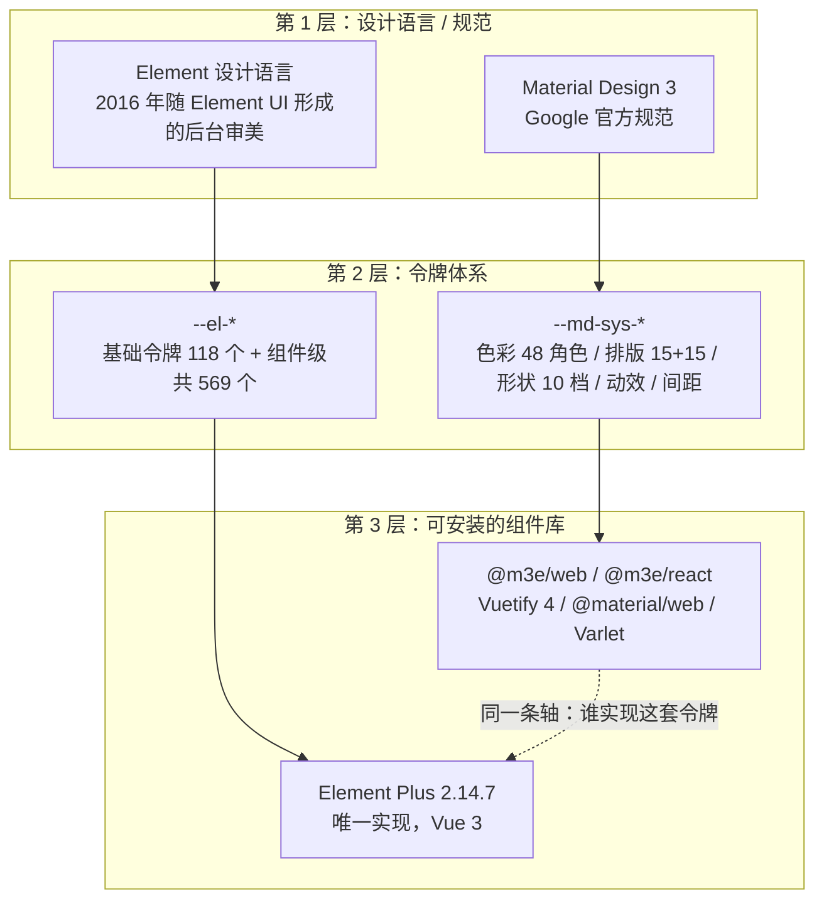
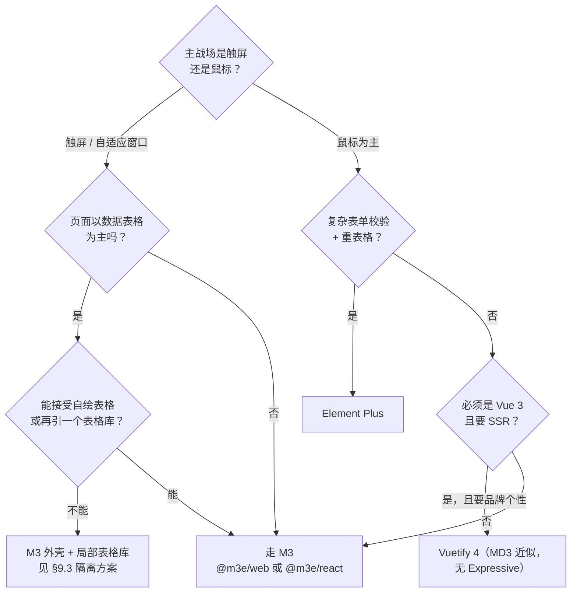

# Material 3 风格 vs Element Plus 风格 · 详细对比

> 对象：**Material Design 3（M3 / Material You，含 2025-05 的 Expressive）** 与 **Element Plus 2.14.7**。
> M3 侧的落地参照本项目内的 `material-3-react/SKILL.md`、`material-3-vue/SKILL.md`（`@m3e/web` 2.10.2 / `@m3e/react` / Vuetify 4）。
> 本文所有 Element Plus 数值都是 2026-10-24 从 npm 包产物实测得到，取数方法见 §11；不是凭印象写的。

---

## 0. 给刚接手的人：30 秒结论

| 你要判断的 | 结论 |
|---|---|
| M3 是什么 | Google 的**设计语言 + 令牌规范**：从 1 个主色生成整套调色板，用**色调表面**而不是阴影表达层级，**大圆角 + 弹簧动效**，48dp 触达，三档用户可控对比度。它不是某个库。 |
| Element Plus 是什么 | Vue 3 的**中后台组件库实现**：继承 Element UI 的审美，#409EFF 蓝 + 4px 圆角 + 14px 基准字号 + 32px 控件高度，层阶靠 `box-shadow`，响应式靠 24 栅格 + 5 断点。它有规范文档但没有独立的跨端设计语言。 |
| 最本质的差别 | **服务对象的密度取向不同**。M3 为"手指 + 触屏 + 个性化消费端"设计（48dp 起）；EP 为"鼠标 + 长表格 + 后台运营"设计（32px 控件、14px 字、8px 单元格内边距）。这不是"好不好看"，是**同一屏能塞多少信息**的两种答案。 |
| 选型口诀 | C 端 / 移动 / 要动态主题 → M3；后台 / 数据表格 / 复杂表单校验 / Vue 栈无设计资源 → Element Plus。**反过来选都会付代偿**。 |
| 最容易被忽略的坑 | ① M3 生态**没有数据表格组件**（`@m3e/web` 导出清单里没有 `table`），重表格后台选 M3 路线必须自绘或再引第三方。② 两者**不能"先用 EP 占位再换 M3"**——插槽机制、v-model 语义、层阶语言全都不兼容，§9 给了具体冲突清单。 |

---

## 1. 先把层级对齐：这两个名字不在同一条轴上

### 1.1 分层关系



### 1.2 所以"对比"必须拆成两问

| 问题 | 比的是 | 结论会不一样 |
|---|---|---|
| **Q1 风格基因**：M3 视觉语言和 Element 视觉语言差在哪？ | 层阶表达方式、形状语言、色彩生成模型、密度、动效语义 | 决定"看起来像什么产品" |
| **Q2 实现能力**：`@m3e/web` 路线和 Element Plus 谁能把活干完？ | 组件覆盖、表单校验、数据表格、SSR、主题接入成本、框架绑定机制 | 决定"能不能按期上线、要写多少胶水" |

**常见事故**：只比 Q1（"M3 更现代""EP 太老"）就做技术选型，上线前才发现 Q2 里 EP 的 `el-table` + `el-form` 校验是自己根本补不齐的洞；反过来只比 Q2（"EP 组件多"）会做出一个"消费级 App 长着一张后台脸"的产品。

---

## 2. Material 3 风格是什么

### 2.1 一句话定义

M3 是 Google 在 MD2 之上重构的**参数化设计系统**：设计不再是"一套固定颜色 + 一套固定组件"，而是**一个种子色 → 一套令牌 → 一整套自适应外观**（明/暗、三档对比度、多种屏幕尺寸类别）。

### 2.2 六条设计基因

1. **色调表面取代阴影做层阶。** 元素"抬多高"用背景色的**明度偏移**表达（`surface-container-low` → `high`），阴影只在需要脱离繁忙背景时才加。这是 M3 与 MD2 最直观的分界。
2. **单一种子生成整套调色板。** 一个主色经 Material Color Utilities 展开成 neutral / neutral-variant / primary / secondary / tertiary 色调色板，落成 **48 个色彩角色**，成对使用（`primary` + `on-primary`）。
3. **形状默认圆润，Expressive 把它变成表达工具。** 形状是 10 档令牌（0 → 9999px），按钮/徽章走 `full`，卡片 `medium`，对话框 `extra-large`；Expressive 还带来形状变换（morph）。本项目内额外强制：**所有非零圆角必须配 `corner-shape` 达到 G2 曲率连续**。
4. **动效是弹簧物理，不是曲线。** Expressive 默认弹簧；退回实用型才有 emphasized / standard 两组缓动 + 20 档时长令牌。
5. **屏幕尺寸类别驱动布局形态。** 不是"手机/平板/PC"三档，而是 compact / medium / expanded / large / extra-large 的**窗口尺寸类别**，导航形态按类别在底部栏 → 侧栏（rail）→ 抽屉之间切换。
6. **个性化与无障碍是一等公民。** 用户可选动态取色（Android），可选三档对比度；最小触达 48×48，相邻热区 ≥8，焦点环可加强（`strong-focus`）。

### 2.3 令牌长什么样（语法先行）

```css
:root {
  /* 色彩：成对使用，X 上只能放 on-X */
  --md-sys-color-surface: #FEF7FF;
  --md-sys-color-on-surface: #1D1B20;
  --md-sys-color-primary: #6750A4;
  --md-sys-color-surface-container-high: #E6E0E9; /* 层阶 = 色调，不是阴影 */

  /* 排版：role × size × 4 轴向，无 -size/-weight 简写 */
  --md-sys-typescale-title-large-font-size: 22px;
  --md-sys-typescale-title-large-line-height: 28px;

  /* 形状：半径档位 */
  --md-sys-shape-corner-value-medium: 12px;
  --md-sys-shape-corner-value-full: 9999px;

  /* 动效 */
  --md-sys-motion-easing-emphasized: cubic-bezier(0.2, 0, 0, 1);
  --md-sys-motion-duration-medium-2: 300ms;
}
```

```html
<!-- 组件消费令牌，不写死值 -->
<m3e-theme color="#6750A4" scheme="auto" motion="expressive" strong-focus>
  <m3e-card variant="outlined">…</m3e-card>
</m3e-theme>
```

**关键写法约定**：语义令牌优先；单组件覆盖走公开变量 `--m3e-<component>-*`（如 `--m3e-card-shape`），不去戳 Shadow DOM 内部结构。

### 2.4 一眼识别 M3 的特征

- 大面积**带色相的灰**（不是纯白纯黑），暗色下背景偏紫/偏蓝而非 #000。
- 按钮是**胶囊**，主按钮实心、次按钮是"色调"（tonal，浅色容器 + 深色文字），不是描边。
- 卡片圆角明显（12–28px），容器边界靠**底色加深**而不是画线。
- 选中态是**色块 + 图标一起变**（导航项的 pill 指示块），不是底部一根线。
- 动效"有重量"：元素弹跳、形状形变，而不是 0.3s 淡入。

---

## 3. Element Plus 风格是什么

### 3.1 一句话定义

Element Plus 是 **Element UI 的 Vue 3 续作**，一套面向**桌面中后台**的组件库实现。它的"风格"是十年前国内后台审美沉淀（清晰的灰阶层级 + 蓝色主色 + 紧凑行高）加上 Vue 3 的 Composition API 工程化改造，**不是一套可跨端的设计语言**。

### 3.2 六条设计基因

1. **语义色只有 5 个族。** `primary / success / warning / danger(=error) / info`，每个族配 **机械亮度阶梯** `light-3/5/7/8/9` 与 `dark-2`——即与原色按固定比例混白/混黑，**不是按感知均匀性生成的调色板**。全库 `--el-color-*` 去重共 52 个。
2. **中性色分四个独立家族。** `--el-bg-*`(3)、`--el-text-*`(7)、`--el-border-*`(14)、`--el-fill-*`(7)。后台界面的"面板灰、斑马纹、边框线"全来自这四族，彼此不配对、靠约定使用。
3. **层阶靠阴影。** `--el-box-shadow` / `-light` / `-lighter` / `-dark` 四档，配 `--el-bg-color-overlay: #fff` 表达浮层；`--el-index-normal:1 / -top:1000 / -popper:2000` 三档 z-index 承担堆叠语义。
4. **形状基线是 4px。** `--el-border-radius-base: 4px`，只有 4 个令牌（base 4 / small 2 / round 20 / circle 100%），大量组件直接引用 `var(--el-border-radius-base)`（实测 71 处），但仍有 **43 处硬编码 `border-radius`、14 种不同值**（1/2/3/4/6/15/18/24px…）散落在组件里。
5. **排印以 14px 为轴。** `--el-font-size-base: 14px`，六档（12/13/14/16/18/20），`--el-font-weight-primary: 500`，`--el-font-line-height-primary: 24px`，字体族是 `-apple-system` 系 + `PingFang SC / Microsoft YaHei`——**为中文桌面环境优化，不引入 Web 字体**。
6. **动效是工具，不是表达。** 只有两个时长（`.3s` / `.2s`）+ 两条贝塞尔曲线 + 一组预设过渡类（`el-fade-in`、`el-zoom-in-top/bottom/center`、`el-collapse-transition`…）。没有"进场/退场/共享轴"的语义分工。

### 3.3 令牌长什么样（实测值）

```css
/* 摘自 element-plus@2.14.7/theme-chalk/base.css 的 :root（共 118 个 --el-* 声明） */
:root {
  --el-color-primary: #409eff;         /* 经典"Element 蓝" */
  --el-color-primary-light-9: #ecf5ff; /* hover 底色 */
  --el-color-success: #67c23a;
  --el-color-warning: #e6a23c;
  --el-color-danger: #f56c6c;          /* --el-color-error 同值 */
  --el-color-info: #909399;

  --el-bg-color: #fff;      --el-bg-color-page: #f2f3f5;   --el-bg-color-overlay: #fff;
  --el-text-color-primary: #303133;   /* regular #606266  secondary #909399 */
  --el-border-color: #dcdfe6;         /* light #e4e7ed  lighter #ebeef5 */
  --el-fill-color: #f0f2f5;           /* light #f5f7fa  blank #fff */

  --el-border-radius-base: 4px;
  --el-font-size-base: 14px;
  --el-font-line-height-primary: 24px;
  --el-component-size-large: 40px;  --el-component-size: 32px;  --el-component-size-small: 24px;
  --el-transition-duration: .3s;    --el-transition-duration-fast: .2s;
  --el-box-shadow: 0px 12px 32px 4px #0000000a, 0px 8px 20px #00000014;
}

/* 暗色不是"重新生成"，而是另贴一张覆盖表：选择器是 html.dark */
html.dark { color-scheme: dark; --el-color-primary: #409eff; --el-color-primary-light-3: #3375b9; }
```

组件级还能再覆盖一层，形如 `--el-<component>-<part>-<prop>`：`--el-button-bg-color`、`--el-menu-item-height`、`--el-table-border-color`。

### 3.4 一眼识别 Element Plus 的特征

- 表单和表格**行高紧、字小、边框实**；卡片/弹窗都是 4px 圆角 + 一道浅灰描边。
- 主按钮实心蓝、次按钮白底蓝边（`type="primary"` / 默认 `type`），**没有"tonal 容器色按钮"这一档**。
- 下拉、弹窗、抽屉靠**阴影**浮起，暗色模式下阴影几乎看不出来，边界靠 `--el-border-color` 补。
- 状态色非常"业务化"：绿=成功、橙=警告、红=危险、灰=信息，直接进 Tag/Badge/Alert。
- 整体是"工具感"：可信、克制、不抢注意力，但**放到 C 端会显得像管理面板**。

---

## 4. 适用场景

### 4.1 Material 3

**适合（优先）**

1. **消费级 Web / PWA / 混合 App**：账号中心、内容浏览、订单流、设置面板——触屏优先、需要 48dp 触达与大圆角的亲和感。
2. **需要"一个主色长出整套主题"的产品线**：白标/多品牌、动态取色、明暗双主题 + 高对比模式作为合规要求；令牌驱动的 M3 让主题成本接近 O(1)。
3. **跨端一致性**：同一个产品要同时有 Android（Compose M3）与 Web，用 M3 令牌能把"看起来不是一个团队做的"这个问题消掉。
4. **平板 / 折叠屏 / 桌面窗口自由缩放**：尺寸类别 + 导航形态切换（bar → rail → drawer）是规范内置的，不是自己发明的。
5. **动效承担反馈的产品**：Expressive 的形状变换与弹簧天然适合"操作要有回应"的场景。

**不适合 / 代价高**

1. **重数据表格后台**：`@m3e/web` 2.10.2 的 72 个导出子路径里**没有数据表格模块**（有 `list` / `tree` / `paginator`，无 `table`）。多级表头、固定列、单元格合并、行内编辑都要自绘或另引库。
2. **强校验的长表单业务**：M3 只给 `form-field` 的错误插槽，**没有校验引擎**，要自己接 zod / vee-validate。
3. **SSR 首屏有内容要求**：自定义元素需要浏览器升级，Nuxt/Next 服务端渲染拿不到有意义的首屏，必须 client-only。
4. **超高密度键鼠工作台**（Excel-like、交易面板、审计对照台）：48dp 触达与 56px 表单控件在这里是负担，不是优点。
5. **没有设计资源承接色彩系统的团队**：种子色生成方案是算法，但"哪块表面用哪档 container"仍需人判断，误用会做出灰紫糊成一片的界面。

### 4.2 Element Plus

**适合（优先）**

1. **中后台管理系统 / 运营平台 / 内部工具**：这是它的主场，也是它所有密度、组件、状态色的设计目标。
2. **数据密集的 CRUD**：`el-table`（固定列、多级表头、树形、展开行、`table-v2` 虚拟滚动）、`el-pagination`、`el-descriptions`、`el-transfer`、`el-cascader`、`el-tree-v2`、`el-select-v2`。
3. **复杂表单流程**：`el-form` + `el-form-item` 直接吃 `async-validator` 规则声明（该依赖就在 EP 的 `dependencies` 里），联动校验、异步校验、字段级错误展示是开箱的。
4. **Vue 3 技术栈 + 无专职设计**：拿来就能上线；SCSS 变量 + CSS 变量两层覆盖，改品牌色的成本是"改几个变量"。
5. **需要 SSR / Nuxt 首屏**：它是普通 Vue 组件，服务端渲染无障碍。
6. **中文为主的国内业务**：字体族含 PingFang SC / Microsoft YaHei，`zh-cn` `zh-tw` 语言包内置。

**不适合 / 代价高**

1. **移动端 H5**：控件默认 32px 高、小档 24px，够不到 48×48 的触达底线；也没有底部导航/抽屉这类移动端导航规范（要靠 `el-menu` 自己拼）。
2. **面向 C 端的品牌型产品**：4px 圆角 + 52 个色彩角色的"业务语义色"模型撑不出个性化，容易做成"穿了品牌皮的后台"。
3. **需要动态取色 / 对比度档位**：EP 的明暗切换是**手工贴一张覆盖表**（`html.dark`），没有从种子生成方案的机制，加一档"高对比"就要再写一张表。
4. **要与 Android/iOS 原生观感对齐**：语言体系不同源，视觉上不会"像同一个产品"。
5. **强动效表达**：只有两档时长，做不出形变与弹簧反馈，硬做就是自己写 keyframes。

### 4.3 场景 → 推荐

| 场景 | 推荐 | 理由（一句话） | 代价 |
|---|---|---|---|
| 电商 C 端 H5 / PWA | **M3** | 触达、圆角、导航形态切换都是为触屏准备的 | 表格类页面（订单列表）要自绘 |
| 企业后台（ERP/CRM/工单） | **Element Plus** | 表格 + 校验 + 密度，直接命中需求 | 视觉上"像工具"，且只能是工具 |
| SaaS 多租户白标主题 | **M3** | 一个种子色生成整套，主题成本 O(1) | 需要设计侧确认色板可用 |
| SaaS 后台 + 品牌调性要求 | **EP + 令牌定制**，或 **Vuetify 4** | 表格生态不能丢 | 严格 M3 合规做不到，Vuetify 无 Expressive |
| 平板/桌面自适应生产力工具 | **M3**（轻表格）/ **EP**（重表格） | 按表格比重切 | — |
| 跨端产品（Android + Web） | **M3** | 与 Compose M3 同令牌体系 | SSR 与表格两处要专门处理 |
| 内容站 / 官网 / 文档站 | **两者都不是最优** | 这类页面更需要排版系统与自由布局 | 硬选则 M3 观感更贴合 |
| 数据大屏 / 实时看板 | 自绘 + 图表库 | 两套规范都不是为此设计的 | EP 可只承担外围表单 |

---

## 5. 硬指标对照（实测值）

| 维度 | Material 3（`@m3e/*`，本项目 skill） | Element Plus 2.14.7（产物实测） |
|---|---|---|
| 令牌命名空间 | `--md-sys-*` 语义层 + `--m3e-<comp>-*` 覆盖层 | `--el-*` 基础 118 个 + 全量去重 569 个 |
| 色彩模型 | 种子色 → 色调调色板 → **48 角色**，成对 `X`/`on-X` | **5 个语义族** × 机械 `light-3/5/7/8/9` + `dark-2`，共 52 个 `--el-color-*` |
| 中性/表面 | `surface` + 5 档 `surface-container-*` + `dim/bright/variant`（色调表达层阶） | `bg`(3) / `fill`(7) / `border`(14) / `text`(7) 四族并列 |
| 层阶 | Level 0/1/2/3 = 0/1/3/6dp → 色调表面；阴影仅用于脱离繁忙背景 | 阴影 4 档（`box-shadow` / `light` / `lighter` / `dark`）+ z-index 3 档（1/1000/2000） |
| 圆角 | 10 档：0/4/8/12/16/20/28/32/48/9999px，本项目强制 G2 `corner-shape` | 4 个令牌：base 4 / small 2 / round 20 / circle 100%；另有 43 处硬编码、14 种值 |
| 排版 | 5 族 × 3 档 × 基线/强调 = 30 角色，每角色 4 轴向令牌；默认 Roboto Flex | 6 档字号 12/13/14/16/18/20px；基准 14px；行高 24px；字重 500；系统字体栈 |
| 控件尺寸 | button small 40 / form field 56 / list 56·72·88 / app bar 64·112·120 / nav bar 64 | **3 档 40 / 32 / 24**（button 默认硬编码 `height:32px`）；menu item 56 / 横向 menu 60 / tabs header 40 |
| 触达底线 | **≥48×48**，相邻热区 ≥8 | 默认 32px（小档 24px）——**低于触屏底线** |
| 间距体系 | 4dp 子集 0/4/8/12/16/24/32/48/64；`--md-sys-measurement-space*` 令牌 | **没有间距令牌族**（`:root` 里无 spacing/padding 基线），靠组件内 `--el-*-padding` 与 `el-space` / `gutter` |
| 动效 | 弹簧（Expressive 默认）；否则 2 组缓动 + short/medium/long/extra-long 共 20 档时长 | 2 个时长（.3s/.2s）+ 2 条贝塞尔 + 1 条 linear + 一组预设过渡类 |
| 响应式 | 窗口尺寸类别驱动，断点 600 / 840 / 1200 / 1600，导航形态随类别切换 | 24 栅格 `el-col` + 5 断点（≤767 / ≥768 / ≥992 / ≥1200 / ≥1920），只切 `span` |
| 主题切换 | `m3e-theme`（color / scheme / contrast / variant / motion / density / strong-focus），作用域可嵌套 | SCSS `@use … with`（编译期）或运行时改 `--el-*`；暗色靠 `html.dark` 类 |
| 渲染模型 | Web Components + Shadow DOM（Lit 3.3 为 peer） | Vue 3 SFC 组件，light DOM，`peer vue ^3.3.7` |
| 运行时依赖 | 3 个：`@floating-ui/dom`、`composed-offset-position`、`@material/material-color-utilities`（+ peer `lit`、`tslib`） | 16 个（含 `dayjs`、`lodash`/`lodash-es`/`lodash-unified`、`@vueuse/core`、`@popperjs/core`、`@floating-ui/dom`、`async-validator`、`@ctrl/tinycolor`、`normalize-wheel-es`、`memoize-one` 等） |
| 图标 | Material Symbols **字体**（需 `<link>` 或自托管） | `@element-plus/icons-vue`（SVG 组件，2.3.2，需另装） |
| 校验 | 无，需自接 | 内置 `async-validator` |
| 日期 | `datepicker` / `date-input` 分段输入，格式化自理 | 内置 `dayjs`，本地化随语言包 |
| 虚拟滚动 | 无表格；`list`/`tree` 无 v2 变体 | `table-v2` / `tree-v2` / `select-v2` + `virtual-list` |
| SSR | 需 client-only（自定义元素要 DOM 升级） | 正常支持 |
| 组件规模 | 72 个导出子路径 = `./all` + 5 个 `core*` + 9 个 `gestures*` + **57 个组件/功能模块** | 111 个 `El*` 注册名（含 `ElFormItem`/`ElTableColumn` 等子件），源码目录 122 个 |

---

## 6. 组件能力映射与缺口

### 6.1 一一对应（能换的部分）

| 能力 | Element Plus | M3（`@m3e/web` 标签） | 换过去要注意 |
|---|---|---|---|
| 按钮 | `el-button`（type + plain/round/circle） | `m3e-button`（variant filled/tonal/elevated/outlined/text + size xs–xl） | EP 的 `plain` ≈ `outlined`，但 **EP 没有 tonal 档**；EP 无 size 与 shape 独立轴 |
| 图标按钮 | `el-button icon` / `circle` | `m3e-icon-button`（filled/tonal/outlined/elevated + toggle） | toggle 态（收藏、暗色开关）在 EP 要自己写状态样式 |
| 分段/群组 | `el-segmented`、`el-button-group` | `m3e-segmented-button`、`m3e-button-group` | 基本对齐 |
| 文本输入 | `el-input`（自带 size/prefix/clearable） | `m3e-form-field` 包 **原生** `input` + label/error/hint 插槽 | 结构差异最大的一项：EP 是属性驱动，M3 是插槽 + 原生元素；M3 的 `form-field` 高 56px |
| 选择器 | `el-select` / `el-select-v2` | `m3e-select` + `m3e-option` | M3 无虚拟滚动版；多选走 `multi` + chips |
| 自动完成 | `el-autocomplete` | `m3e-autocomplete`（4 种过滤模式） | 对齐 |
| 日期/时间 | `el-date-picker` / `el-time-picker` / `el-date-picker-panel` | `m3e-datepicker` / `m3e-timepicker` + toggle，`m3e-date-input` 分段输入，`m3e-calendar` | M3 弹层**不是受控组件**，要用 trigger + `for`；EP 直接 `v-model` |
| 开关/复选/单选/滑块 | `el-switch` `el-checkbox` `el-radio` `el-slider` | `m3e-switch`（可选图标）`m3e-checkbox`（indeterminate）`m3e-radio-group` `m3e-slider`（范围靠两个 thumb） | 滑块"范围=两个 thumb"与 EP 的 range 组件形态不同 |
| 标签 | `el-tag`（含 `check-tag`） | `m3e-assist/filter/input/suggestion-chip` + 对应 set | M3 把 chip 分成 4 类语义，EP 只有 4 种 type 色 |
| 列表 | `el-table`（≈）| `m3e-list` / `m3e-action-list` / `m3e-selection-list` | **列表 ≠ 表格**：M3 的 list 是"一行一项 + 前后缀槽"，无列概念 |
| 卡片 | `el-card`（radius 4px） | `m3e-card`（filled/outlined/elevated + media/header/actions/footer） | 层阶语义不同：EP 的 `shadow="always/hover/never"` vs M3 的 variant |
| 弹层 | `el-dialog` `el-drawer` `el-popover` `el-tooltip` `el-popconfirm` `el-message` `el-notification` `el-message-box` | `m3e-dialog` `m3e-drawer-container` `m3e-menu` `m3e-tooltip` / `m3e-rich-tooltip` `m3e-snackbar` | **Snackbar ≠ MessageBox**：M3 只有一个反馈通道（含 action 插槽），EP 分成 4 个组件 |
| 导航 | `el-menu`（56/60px，含 `el-sub-menu`）+ `el-header`/`el-aside` 自己搭壳 | `m3e-app-bar` `m3e-nav-bar` `m3e-nav-rail` `m3e-nav-menu` `m3e-tabs` `m3e-breadcrumb` `m3e-toc` | EP **没有底部导航 / Nav rail / FAB** 这三个移动与自适应关键件 |
| 步骤/进度 | `el-steps` `el-progress` | `m3e-stepper` + `m3e-step-panel` `m3e-linear/circular-progress-indicator` | 对齐 |
| 骨架/空态/结果 | `el-skeleton` `el-empty` `el-result` | `m3e-skeleton` `m3e-callout` | M3 无 `el-result` 的"图标+标题+副文本+操作"四段式，`callout` 更像提示块 |
| 树 | `el-tree` / `el-tree-v2` / `el-tree-select` | `m3e-tree` + `m3e-tree-item`（`multi` / `cascade`） | M3 无虚拟滚动版 |
| 面板 | `el-collapse` `el-splitter` | `m3e-expansion-panel` / `m3e-accordion` `m3e-split-pane` | 对齐 |
| 布局 | `el-container` 系（`header/aside/main/footer`）+ `el-row/el-col` 栅格 + `el-space` | 无对应"栅格组件"，用 CSS Grid + 4dp 间距令牌 + `m3e-drawer-container` | EP 的栅格是**属性 API**（`span=12 :xs=24`），M3 侧是**布局约定** |

### 6.2 EP 有、M3 生态没有

`el-table` / `el-table-column` / `el-table-v2`、`el-form`（校验容器）、`el-descriptions`、`el-transfer`、`el-pagination`（有 `m3e-paginator`，功能面窄）、`el-upload`、`el-image` + `el-image-viewer`、`el-color-picker`、`el-watermark`、`el-tour`、`el-anchor`、`el-affix`、`el-backtop`、`el-infinite-scroll`、`el-scrollbar`、`el-statistic` / `el-countdown`、`el-mention`、`el-input-otp`、`el-input-tag`、`el-text`、`el-config-provider`（i18n + 全局尺寸/z-index）。

> 这里面每一项都是"后台系统刚需"。**这就是 §4.1 里"重表格后台不要走 M3 路线"的根据。**

### 6.3 M3 有、EP 没有

FAB（7 种 variant + extended）、`fab-menu`、Nav bar / Nav rail / Drawer 三形态自适应导航、Expressive 形状变换与弹簧动效、Loading indicator（含多浏览态）、`slide-group`（未包含/英雄态）、`content-pane`、`shape`（抽象形状装饰）、三档对比度与 `strong-focus`、动态取色（`@material/material-color-utilities`）、`gestures` 模块（pan/tap/swipe/scale/rotate/repeat/sequence/long-press 一整套手势库）、`autocomplete` 的显式过滤模式。

> `gestures` 那一条对 EP 用户特别有价值：**M3 生态自带手势系统，EP 里做拖拽/捏合要靠 `@vueuse` 的 `useDraggable` 或自写 pointer 事件。**

---

## 7. 工程接入差异

### 7.1 绑定机制：这是最容易被低估的成本

```vue
<!-- Element Plus：属性 + 原生 v-model，插槽是 Vue 插槽 -->
<el-select v-model="plan" placeholder="方案">
  <el-option label="Free" value="free" />
</el-select>

<!-- @m3e/web：自定义元素。裸 v-model 静默不更新（不报错、不生效） -->
<!-- 必须：isCustomElement 配置 + 入口先注册再 mount + slot 用真实元素 + 包装层提供 v-model -->
<M3eSelect id="plan" v-model="plan">
  <m3e-option value="free">Free</m3e-option>
</M3eSelect>
```

| 环节 | Element Plus | `@m3e/web` |
|---|---|---|
| 构建配置 | 无特殊要求；按需引入靠 `unplugin-vue-components` | **必须**配 `isCustomElement: tag => tag.startsWith('m3e-')` |
| 注册时机 | 组件导入即用 | 每个 `m3e-*` 模块必须在 `mount()` **之前**导入，否则元素未升级，`:prop="[1,2]"` 会被写成 `"1,2"` 字符串属性 |
| v-model | 原生 | 需包装工厂（本项目 `assets/vue/use-m3e-model.js`）；只读集合类组件（tabs / nav-bar / radio-group / selection-list）**不能设初值**，初始态写子项 `selected` |
| 插槽 | `<template #header>` | **必须用真实元素** `<div slot="header">`；Vue 的 `#slot` 语法不投影且多数情况不报错 |
| SSR / Nuxt | 正常服务端渲染 | 需要 `.client` 插件 + `<ClientOnly>`，服务端拿不到有意义 HTML |
| 样式覆盖 | light DOM，CSS 选择器直达（也意味着能"不小心"戳坏库内部） | Shadow DOM，只能走语义令牌与 `--m3e-<comp>-*`；`corner-shape` **不继承**，需 `assets/g2/g2-shadow.js` 注入 |
| E2E / DOM 断言 | `document.querySelector('.el-button')` 直接命中 | 内部结构不承诺，断言要走可访问性语义（ARIA/role）而不是 class 名 |
| TypeScript | Vue 组件类型完整 | React 侧（`@m3e/react`）完整 TS；Vue 侧自定义元素的 props 类型要靠包装层收窄 |

### 7.2 主题与多品牌

| | Element Plus | M3 |
|---|---|---|
| 改一个主色 | SCSS `@use "element-plus/theme-chalk/src/index.scss" as * with ($colors: (...))` 编译期；或运行时覆 `--el-color-primary` **并手工补齐 light-3/5/7/8/9 与 dark-2**（不改就是 hover/禁用态还是原色） | 改 `m3e-theme` 的 `color`，48 角色由 `material-color-utilities` 整套重算 |
| 暗色 | `import 'element-plus/theme-chalk/dark/css-vars.css'` + `html.dark` 类；本质是**再贴一张手工表** | `scheme="auto"` 跟随系统，或令牌覆盖；`surface` 系列随方案翻转 |
| 局部主题 | 靠 CSS 变量作用域自己隔离 | 嵌套 `m3e-theme` 即作用域主题 |
| 对比度档位 | 无内置机制 | 三档用户可控（标准 / 中等 / 高） |
| 从图片取色 | 无 | `@material/material-color-utilities` 是依赖，方案生成能力现成 |

### 7.3 体积与依赖

- **EP** 是"全家桶"路线：运行时 `dependencies` 16 项，其中 `dayjs`、`lodash` + `lodash-es` + `lodash-unified`（三份 lodash 门面）、`@vueuse/core`、`@popperjs/core` **与** `@floating-ui/dom` 同时存在。功能换宽度，按需引入 + 分包是默认动作。
- **`@m3e/web`** 是"薄核心"路线：3 项运行时依赖 + `lit`/`tslib` peer；但**桶导入 `./all` 会把 57 个组件全打包**，必须按模块导入。
- 图标：EP 要额外装 `@element-plus/icons-vue`；M3 要额外准备 Material Symbols 字体（离线场景得自托管，否则首屏图标是空白框）。

### 7.4 无障碍与合规

| 判据 | Element Plus | M3 |
|---|---|---|
| 触摸目标 ≥48 | 默认不满足（32/24px），要显式加大 size 或改 `--el-component-size` | 规范要求 ≥48×48，相邻热区 ≥8；组件热区已按此设计 |
| 对比度 | 靠 `text-color-primary #303133` 之类固定值；`--el-text-color-placeholder: #a8abb2` 在白底上偏浅，**是常见的 WCAG 失败点** | 由 `on-X` 配对 + 三档对比度系统保证，但**配对错了就成批失效** |
| 焦点可见 | 各组件自带，强度不一 | `strong-focus` 可全局加强 |
| 键盘导航 | `el-table` 行内键盘、`el-menu` roving-focus 组 | `core/a11y` 模块 + 焦点环 |

> 两边都要**实测**才算合规，任何一边写"内置无障碍"都不能替代页面级检查（对比度数值、Tab 顺序、读屏语义）。

---

## 8. 选型判据

### 8.1 决策树



### 8.2 七个闸门问题（按顺序问，任一命中就改方向）

1. **最小可用触控尺寸是多少？** 若必须 ≥44px → M3；若 24–32px 是可接受的（后台键盘流）→ EP 更省布局。
2. **一屏要显示多少条记录？** 超过 15 行/屏的数据列表 → EP；M3 的 list 56–88px 行高会把同一批数据摊成两屏。
3. **有没有多级表头 / 固定列 / 单元格合并 / 行内编辑？** 有 → EP（或直接引专业表格库）。**M3 生态这一项是空的。**
4. **表单校验规则有多重？** 跨字段联动、异步校验、动态增减字段 → EP 的 `el-form` + `async-validator` 直接可用；M3 要自己搭校验层。
5. **主题要不要"从一个主色长出整套"？** 要（多品牌、动态取色、三档对比度）→ M3；只是"把蓝色换成我们的红"→ EP 的令牌覆盖就够。
6. **首屏是否必须服务端渲染？** 必须 → EP 或 Vuetify；`@m3e/web` 路线首屏拿不到内容。
7. **团队里有人能维护一套色彩系统吗？** 没有 → EP（它的 5 语义族更容易"不出错"）；有 → M3 的令牌模型回报更高。

### 8.3 与本项目 SKILL.md 的 ❌ 口径对齐

`material-3-react/SKILL.md` 与 `material-3-vue/SKILL.md` 的实现库选择表里，Element Plus 标的是 **❌「不是 MD3，不要用其组件冒充 MD3」**。这句话的准确含义是：

- ✅ 成立的部分：EP 的令牌体系（`--el-*`、5 语义族、4px 圆角、阴影层阶）与 MD3 规范不同构，**用 EP 组件拼出来的界面不能声称是 MD3**，本项目的 MD3 合规审查（10 类评分）会直接判失败。
- ⚠️ 需要补充的部分：它**不是**"EP 不该用"。EP 该用的是 §4.2 的那批场景——那里的正确答案本来就是 EP，而 M3 生态缺表格、缺校验、缺 SSR 这三件事会让 M3 路线交付失败。
- 🚫 会出事的读法："先上 EP，之后再换 M3 皮肤"。见 §9。

---

## 9. 混用与迁移风险

### 9.1 五种"同屏打架"

| # | 冲突 | 具体表现 | 触发条件 |
|---|---|---|---|
| 1 | **两套主色** | `--md-sys-color-primary` 改了，`el-button type="primary"` 还是 #409EFF；反过来也是。同页出现两种蓝/紫 | 页面里 M3 壳 + EP 局部组件，只改了其中一套变量 |
| 2 | **两种层阶语言** | M3 面板靠底色加深分界，EP 浮层靠阴影。暗色模式下 EP 的 `box-shadow: 0 0 12px #0000001f` 几乎不可见，浮层"漂不起来" | 明暗双主题 + 混用 dialog/drawer |
| 3 | **圆角语言不一致** | EP 全线 4px（G1 圆弧）+ M3 12/16/28px + G2 `corner-shape` 曲率连续 → 同一屏"硬角"和"软角"并存，接缝处观感割裂 | 表单（EP）嵌在 M3 卡片里 |
| 4 | **密度不对齐** | M3 `form-field` 56px vs EP `el-input` 32px；M3 网格用 4dp 子集（gap 16/24），EP 的 `el-form-item` margin-bottom 是自己的一套。并排就是"高矮不齐、松紧不匀" | 同表单区混用两套输入组件 |
| 5 | **动效语汇互相拆台** | M3 弹簧（Expressive）+ EP `all .3s cubic-bezier(.645,.045,.355,1)`；同一次开合里一个弹跳一个线性淡入，观感"卡顿" | M3 dialog 里放 EP `el-collapse` / `el-table` 展开行 |

### 9.2 "先用 EP 占位，再迁 M3"为什么不成立

插槽机制、绑定语义、弹层控制模型三处是**结构性不兼容**，不是样式问题：

- 插槽：EP 用 Vue 的 `<template #x>`；`@m3e/web` 用真实元素的 `slot="x"` 属性投影进 Shadow DOM。前者写法搬过去**不报错也不渲染**。
- 绑定：EP 全组件原生 `v-model`；M3 侧裸 `v-model` **静默失效**，且只读集合类组件根本不接受初值设置。
- 弹层：EP 是受控（`v-model:visible` / `open`）；M3 的 dialog/drawer/menu/datepicker 走 **trigger 元素 + `for`** 或 `toggle` 事件。
- 校验：EP 的字段错误由 `el-form-item` 驱动样式；M3 的 `form-field` 只吃 `error` 插槽内容。

**结论**：迁移不是"换 CSS"，是**逐组件重写模板 + 重写绑定层 + 重写校验层**。若立项时已定 M3，就不要用 EP 起步。

### 9.3 必须共存时（M3 外壳 + EP 表格）的隔离方案

只有一条路是可控的：**把 EP 当成"局部数据视图控件"，并把它的令牌从 M3 令牌派生，禁止全局混用。**

```css
/* 作用域隔离：只在 .grid-host 内桥接，不外溢 */
.grid-host {
  /* 1. 颜色派生：EP 的 5 族从 M3 角色取，主色只有一份真相 */
  --el-color-primary: var(--md-sys-color-primary);
  --el-color-primary-light-9: var(--md-sys-color-primary-container);
  --el-color-primary-light-8: var(--md-sys-color-primary-container);
  --el-color-primary-light-3: var(--md-sys-color-primary);   /* 浅化在 M3 里不成立，改为同主色 */
  --el-text-color-primary: var(--md-sys-color-on-surface);
  --el-text-color-regular: var(--md-sys-color-on-surface-variant);
  --el-text-color-secondary: var(--md-sys-color-on-surface-variant);
  --el-border-color: var(--md-sys-color-outline);            /* 交互边界用 outline */
  --el-border-color-lighter: var(--md-sys-color-outline-variant); /* 分隔线用 outline-variant */
  --el-bg-color: var(--md-sys-color-surface);
  --el-bg-color-overlay: var(--md-sys-color-surface-container-high); /* Level 3 对应浮层 */
  --el-fill-color-light: var(--md-sys-color-surface-container);
  --el-fill-color-blank: var(--md-sys-color-surface);

  /* 2. 形状：把 4px 抬到 M3 档位，并让圆角落进 G2 规则 */
  --el-border-radius-base: var(--md-sys-shape-corner-value-small, 8px);
  --el-card-border-radius: var(--md-sys-shape-corner-value-medium, 12px);

  /* 3. 排印：统一到 typescale */
  --el-font-size-base: 14px;   /* 与 body-medium 对齐；不要引 Roboto 变量去覆盖系统字体栈 */

  /* 4. 密度：这是有意保留的例外，见下 */
  /* --el-component-size: 32px;  ← 不放大。放大就不是"重表格后台"了 */
}

/* 5. 阴影 vs 色调：关掉 EP 的浮层阴影，靠 surface-container 表达层阶 */
.grid-host .el-table__fixed,
.grid-host .el-drawer { box-shadow: none; }
```

四条硬规矩（照抄前先读理由）：

1. **派生而不是复制。** 主色/文字/边框/表面**必须**写成 `var(--md-sys-*)`，不要在这里贴十六进制——否则 M3 侧改主题时 EP 区域不会跟着动，两套真相迟早分叉。
2. **`light-3/5/7/8/9` 无法一一对应。** EP 的浅化阶梯是"混白比例"，M3 的 `primary-container` 是感知调色板里的另一档，两者**不同构**。上表把它们折叠到同一容器色是取舍，不是等价映射；hover/active 态要单独验收。
3. **密度保留 32px 是刻意的。** M3 的 48dp 触达在这里必须让位（否则表格退化成卡片流）。把它写成评审例外项，而不是"还没改完"。
4. **G2 圆角要单独过。** `corner-shape` 不继承，EP 是 light DOM 所以能在同一层加，但要确认没有 `overflow` + `clip-path` 把表格固定列的阴影削平（`clip-path` 与 `box-shadow` 不能同元素）。

---

## 10. FAQ：这类对比里最常写错/读错的 8 条

**Q1：Material 3 就是 Material Design 的"新版皮肤"，改改圆角和颜色就行？**
不是。M3 相对 MD2 换的是**层阶的表达介质**（阴影 → 色调表面）和**色彩的生成模型**（固定色板 → 种子调色板）。只把圆角调大、主色换成 #6750A4，产出的仍是"MD2 组件 + 大圆角"，色调层阶、`on-*` 配对、对比度档位全缺失。

**Q2：Element Plus 有没有"官方设计规范"可以和 M3 对齐？**
EP 有设计指引但**不是跨端设计语言**，它没有令牌命名规范文档、没有种子生成算法、没有对比度档位。想"对齐 M3"最多做到 §9.3 的令牌派生，视觉上仍是 4px + 阴影的语言。

**Q3：`@material/web`（Google 官方）不是比 Element Plus 更"正统"吗？**
官方但已进**维护模式**（约 20 个组件，无 Expressive）。本项目结论是：新项目走 `@m3e/web` / `@m3e/react`；`@material/web` 只用于维护既有项目。**"正统"不等于"够用"**——这条同样适用于问"EP 是不是更成熟"。

**Q4：Vuetify 4 能不能当"EP 的 M3 版替身"？**
可以当"要原生 Vue 组件 + 表格生态 + MD3 观感"的折中，但要清楚边界：主题令牌是 `--v-theme-*`（RGB 三元组，`rgb(var(--v-theme-primary))`），**不是** `--md-sys-*`；`md3` blueprint 给的是颜色/圆角/排版默认值，**没有弹簧物理与形状变换**。而且不能和 `@m3e/web` 在同页混用两套令牌。

**Q5：把 EP 的 `--el-component-size` 改成 48 是不是就满足无障碍了？**
不是。触达尺寸只是四条判据之一（还有对比度、焦点可见、语义/键盘可达）。而且 48 之后表格行高、表单节奏、栅格间距要整套重排，密度收益归零——那时更该问"是不是该换 M3"。

**Q6：M3 侧能不能直接用 MUI（Material UI）？**
本项目口径是 ❌：MUI 未实现 Material 3 Expressive（弹簧动效、形状变换、完整色彩令牌）。React 项目要 Expressive 用 `@m3e/react`；Vue 项目用 `@m3e/web`（**不存在 `@m3e/vue`，npm 404**）。

**Q7：两套能不能"壳用 M3、控件用 EP"长期共存？**
能，但只有 §9.3 那种**作用域派生 + 显式例外清单**的形式可控。放任全局混用会稳定出现"两套主色、两种圆角、两种层阶"——而且这类问题在明暗主题切换时才暴露，测试周期通常覆盖不到。

**Q8：为什么 MD3 里 `outline` 和 `outline-variant` 用反是错的？EP 不都是一个边框色吗？**
M3 把边框分成语义两档：`outline`（**交互边界**，需满足 3:1 对比）与 `outline-variant`（**装饰分隔线**）。EP 则是 `border-color` 的四档浅化（`#dcdfe6`/`#e4e7ed`/`#ebeef5`/`#f2f6fc`），按"视觉轻重"而非"交互与否"选。做令牌映射时对应关系是 `outline` ↔ `--el-border-color`、`outline-variant` ↔ `--el-border-color-lighter`，**别按名字相近去配**（`--el-border-color-dark` 不等于 `outline`）。

---

## 11. 证据与复现

### 11.1 本文数值的来源

| 数值 | 来源 | 口径 |
|---|---|---|
| EP 2.14.7、`peer vue ^3.3.7`、16 项运行时依赖、111 个 `El*` 注册名 | `registry.npmjs.org/element-plus/latest` + 包内 `es/component.mjs` | 全局安装列表数组内 `El*` 去重计数（含子件） |
| `:root` 118 个 `--el-*` 令牌、具体色值/字号/圆角/尺寸/阴影/过渡值 | 包内 `theme-chalk/base.css` | 取 `:root` 声明段，正则 `--el-[a-z0-9-]+:` |
| 全库去重 569 个 `--el-*`、`--el-color-*` 52 个、`var(--el-border-radius-base)` 71 处、硬编码 `border-radius` 43 处 14 种值 | 包内 `theme-chalk/index.css`（361 441 字节） | 全文正则匹配后去重 |
| button `height:32px`（硬编码）、large 40 / small 24、small 圆角 `calc(base - 1px)`、menu item 56 / 横向 60、tabs header 40、`el-table .el-table__cell{padding:8px 0}`、dialog 圆角 = base(4px) + `padding-primary:16px`、card `border-radius:4px`、input 高度 = `--el-component-size` | `theme-chalk/index.css` 选择器级 grep | 直接引用被匹配到的规则 |
| 断点 767 / 768 / 992 / 1200 / 1920 | `theme-chalk/index.css` 的 `@media only screen` 清单 | 全文 `@media` 提取，去重 |
| 暗色选择器 `html.dark`、暗色下 `--el-color-primary` 仍为 `#409eff`、`light-3` 变为 `#3375b9` | `theme-chalk/dark/css-vars.css` | 文件首部 |
| `@m3e/web` 2.10.2、72 个导出子路径（`./all` + 5 `core*` + 9 `gestures*` + 57 组件/功能模块）、**无 `./table`** | `registry.npmjs.org/@m3e%2Fweb/latest` 的 `exports` | 逐项列出后分组 |
| `@m3e/web` 3 项运行时依赖 + `lit ^3.3.0`/`tslib ^2.8.1` peer | 同上 `dependencies` / `peerDependencies` | 原样 |
| M3 令牌角色数（48 色彩 / 15+15 排版 / 10 形状档 / 层阶 0·1·3·6dp / 20 档时长 / 4dp 子集 / 48dp 触达 / 组件默认高 40·56·64…） | 本仓库 `material-3-vue/SKILL.md`、`material-3-react/SKILL.md` | 引用项目内已整理的规范，未在此文重测 |

### 11.2 复现命令

```bash
# Element Plus 令牌与尺寸
curl -s "https://unpkg.com/element-plus@2.14.7/theme-chalk/base.css" | head -c 4000
curl -s "https://unpkg.com/element-plus@2.14.7/theme-chalk/dark/css-vars.css" | head -c 200
curl -s "https://unpkg.com/element-plus@2.14.7/theme-chalk/index.css" -o ep.css
node -e "const s=require('fs').readFileSync('ep.css','utf8');
  console.log('media:', [...new Set(s.match(/@media only screen[^{]+/g))]);
  console.log('distinct --el-*:', new Set(s.match(/--el-[a-z0-9-]+/g)).size);
  console.log('hardcoded radius:', (s.match(/border-radius:(?!var)[0-9.]+px/g)||[]).length);"

# @m3e/web 模块面
node -e "require('https').get('https://registry.npmjs.org/@m3e%2Fweb/latest',r=>{let d='';r.on('data',c=>d+=c).on('end',()=>{const j=JSON.parse(d);console.log(j.version, Object.keys(j.exports).length, Object.keys(j.exports).some(k=>k.includes('table')))})})"
```

### 11.3 已知未验证项（写在这里免得被当成结论用）

- EP 内置语言包的**数量**未实测（只验证了 `es/locale/lang/zh-cn.mjs`、`zh-tw.mjs`、`en.mjs` 三个存在，HTTP 200）。
- EP 各组件的 **ARIA 实现完整度**与键盘导航细节：未逐组件测过，§7.4 只列了可从 CSS 证实的部分。
- M3 侧"Expressive 弹簧动效的实际观感/性能"与 `@m3e/web` 的**产物体积**：本文只依据导出清单与依赖声明，未做构建体积实测。
- Vuetify 4 的 MD3 合规度：沿用 `material-3-vue/SKILL.md` 的判断（无 Expressive、`--v-theme-*` 不同构），本文未重测。
